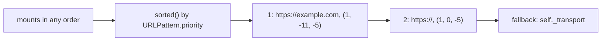

# httpx-architecture-002: Which mounted transport wins

**Answer:** option `d`. The transport for `"https://example.com"`, because patterns with a longer host sort ahead of those with a shorter one.

## The short version

`_transport_for_url` returns the **first** matching pattern in `self._mounts`. `Client.__init__` **sorts** `self._mounts` once, using `URLPattern.priority`. The priority puts patterns with a longer host first, so `https://example.com` is tested before `https://`.

## How to navigate there

1. **Read the lookup.** `Client._transport_for_url` (`httpx/_client.py:760`):

   ```python
   # httpx/_client.py:765-769
           for pattern, transport in self._mounts.items():
               if pattern.matches(url):
                   return self._transport if transport is None else transport

           return self._transport
   ```

   First match wins, so the order of `self._mounts` is the whole rule.

2. **Find where the order is set.** The last line of `Client.__init__`:

   ```python
   # httpx/_client.py:716
           self._mounts = dict(sorted(self._mounts.items()))
   ```

   `sorted` on `(URLPattern, transport)` pairs compares the `URLPattern` keys (the keys are distinct, so the transport values are never compared). That uses `URLPattern.__lt__`.

3. **Follow the comparison into `httpx/_utils.py`:**

   ```python
   # httpx/_utils.py:205-223 (docstring removed)
       @property
       def priority(self) -> tuple[int, int, int]:
           # URLs with a port should take priority over URLs without a port.
           port_priority = 0 if self.port is not None else 1
           # Longer hostnames should match first.
           host_priority = -len(self.host)
           # Longer schemes should match first.
           scheme_priority = -len(self.scheme)
           return (port_priority, host_priority, scheme_priority)
       ...
       def __lt__(self, other: URLPattern) -> bool:
           return self.priority < other.priority
   ```

## Compute it

| Pattern | `port` | `host` | `scheme` | `priority` |
|---|---|---|---|---|
| `"https://example.com"` | `None` | `"example.com"` (11) | `"https"` (5) | `(1, -11, -5)` |
| `"https://"` | `None` | `""` (0) | `"https"` (5) | `(1, 0, -5)` |

Tuples compare element by element. The ports tie at `1`. Then `-11 < 0`, so `https://example.com` sorts first. For `https://example.com/path`, it is tested first, `matches` succeeds (same scheme, host regex `^example\.com$` matches), and its transport is returned. A request to `https://other.com` fails that test and falls through to `https://`.



## Why the other options are wrong

- **a (first passed in `mounts`).** The `mounts` dict is copied into `self._mounts` with `update` (lines 711-714), but then line 716 rebuilds it in sorted order. The original order only matters for patterns with *equal* priority (`sorted` is stable), which isn't the case here.
- **b (`"https://"` because it is shorter and matched first).** It is the reverse. The sort key negates lengths, so shorter hosts get *larger* numbers and sort *later*. An empty host gives `0`, the largest possible host value.
- **c (last passed in `mounts`).** Same as a. Nothing in the lookup depends on insertion order after the sort.

## Details worth knowing

- **Port beats host beats scheme.** The tuple order means any pattern with a port sorts ahead of every pattern without one, regardless of host length. And `"all://example.com"` (scheme `""` because `all` is treated as a wildcard, line 174) still sorts ahead of `"https://"`, because the host length is compared before the scheme length.
- **Matching is structured, not a string prefix.** `matches` (line 192) compares scheme, host (by regex, with `*.` wildcard support, lines 177-190) and port separately. `"https://example.com"` does *not* match `https://www.example.com`, because the host regex is anchored (`^example\.com$`).
- **Proxies use the same table.** `self._mounts` starts with one entry per proxy key from `_get_proxy_map` (lines 697-710), and user mounts are merged in afterward. A mount whose key equals a proxy key replaces it, because `URLPattern.__eq__` and `__hash__` both use the pattern string.

## Compare with requests

`requests` solves the same problem differently (see `Session.mount` / `Session.get_adapter`): it keeps adapters ordered by raw prefix string length and tests `url.startswith(prefix)`. httpx parses each key into scheme, host and port and ranks them, so `https://example.com` can't accidentally match `https://example.community`.

## Takeaways

- When a lookup takes "the first match", look for where the collection is sorted or ordered. That is where the precedence rule is defined.
- Sorting by a tuple of negated lengths is a compact way to say "most specific first". Work through the tuples for each candidate instead of guessing.
- `sorted()` on dict items compares keys through their `__lt__`. Check the key class for a custom comparison before assuming insertion order.
