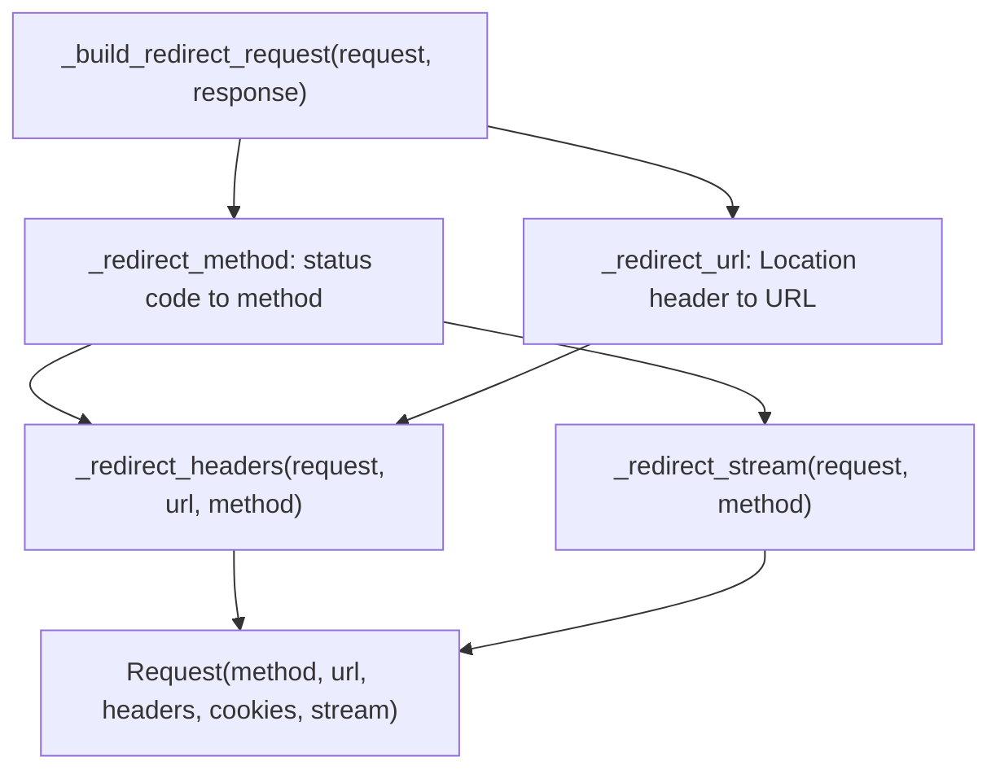

# httpx-find-001: Changing the method on redirect

**Answer:** `httpx/_client.py#BaseClient._redirect_method`

## How a strong engineer would get there

1. **Find the redirect code.** Redirects are handled by both `Client` and `AsyncClient`, so the shared logic is likely on their common base, `BaseClient` (line 188). Search `_client.py` for `redirect` and you find a group of helpers next to each other, from line 475.
2. **Read the method that combines them.** The hint names it. `_build_redirect_request` gives each helper one job:

   ```python
   # httpx/_client.py:480-483
           method = self._redirect_method(request, response)
           url = self._redirect_url(request, response)
           headers = self._redirect_headers(request, url, method)
           stream = self._redirect_stream(request, method)
   ```

   Only `_redirect_method` receives the `response` and returns a method. Its name says the rest.
3. **Confirm by reading the body.**

   ```python
   # httpx/_client.py:499-515
           method = request.method

           # https://tools.ietf.org/html/rfc7231#section-6.4.4
           if response.status_code == codes.SEE_OTHER and method != "HEAD":
               method = "GET"

           # Do what the browsers do, despite standards...
           # Turn 302s into GETs.
           if response.status_code == codes.FOUND and method != "HEAD":
               method = "GET"

           # If a POST is responded to with a 301, turn it into a GET.
           # This bizarre behaviour is explained in 'requests' issue 1704.
           if response.status_code == codes.MOVED_PERMANENTLY and method == "POST":
               method = "GET"

           return method
   ```

## The rules it implements

| Status | Original method | New method |
|---|---|---|
| 303 See Other | anything but HEAD | GET |
| 302 Found | anything but HEAD | GET |
| 301 Moved Permanently | POST | GET |
| 301 Moved Permanently | anything else | unchanged |
| 307 / 308 | anything | unchanged (no branch matches) |

## How the helpers depend on each other



The method decision comes first because two other helpers depend on it. `_redirect_headers` removes `Content-Length` and `Transfer-Encoding` when the method changed to GET (lines 561-565), and `_redirect_stream` drops the body in the same case (lines 579-580). So in httpx, the body is dropped *because* the method changed, not because of the status code directly.

That is a real difference from requests, whose `resolve_redirects` drops the body for every status except 307 and 308, even when a `PUT` keeps its method on a 301. In httpx a `PUT` that gets a 301 keeps both its method and its body.

## Why the other candidates are wrong

- **`BaseClient._build_redirect_request`** (line 475). It calls `_redirect_method` and assembles the new `Request`. It contains no status-code logic itself.
- **`BaseClient._redirect_url`** (line 517). It turns the `Location` header into a URL: handling a missing host, relative URLs and fragments. It doesn't look at the method.
- **`BaseClient._redirect_headers`** (line 546). It *receives* the already-chosen method as a parameter and adjusts headers to match. It never decides the method.
- **`BaseClient._redirect_stream`** (line 573). Also receives the chosen method, and decides whether to keep the body.
- **The redirect-following loops on `Client` and `AsyncClient`.** They decide whether to follow a redirect and send the next request. They aren't `BaseClient` methods, and they don't choose methods.
- **`Response.has_redirect_location`** (in `httpx/_models.py`). It decides *whether* to follow a redirect, not which method to use.

## Takeaways

- When an operation is split into small helpers, find the method that calls them all. It shows which helper owns which decision and the order they depend on each other.
- Look at the parameters: a helper that receives `method` is downstream of the one that computes it.
- The same HTTP rule can be implemented differently in two libraries (here, httpx versus requests). Comparing them is a good way to understand what the code actually guarantees.
