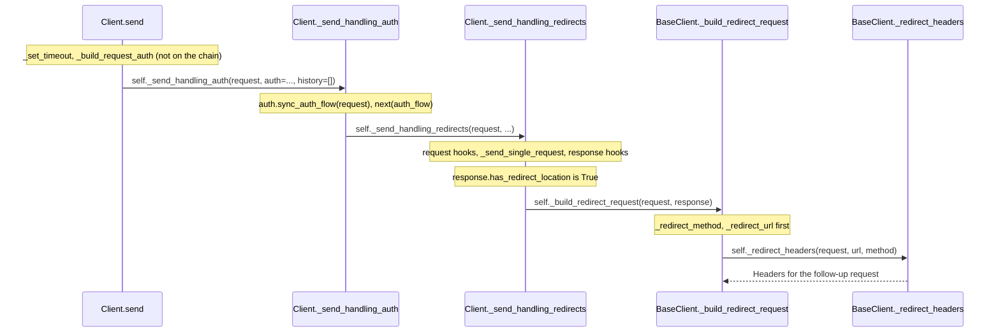

# httpx-trace-001: From Client.send to the redirect request headers

**Answer:** `httpx/_client.py#Client.send` -> `httpx/_client.py#Client._send_handling_auth` -> `httpx/_client.py#Client._send_handling_redirects` -> `httpx/_client.py#BaseClient._build_redirect_request` -> `httpx/_client.py#BaseClient._redirect_headers`

## The layers

`Client.send` is built as nested loops. Each layer handles one concern and calls the layer below:

```text
Client.send                          line 879   resolve settings, read the body unless streaming
└── Client._send_handling_auth       line 930   loop: drive the auth flow generator
    └── Client._send_handling_redirects  line 964   loop: send, follow redirects
        ├── Client._send_single_request  line 1001  one request through a transport
        └── BaseClient._build_redirect_request  line 475  build the next request
            ├── _redirect_method   line 494
            ├── _redirect_url      line 517
            ├── _redirect_headers  line 546  <-- end of the chain
            └── _redirect_stream   line 573
```



## Step by step

1. **`Client.send`** (line 879). It checks the client isn't closed, resolves `follow_redirects`, calls `self._set_timeout(request)` and `self._build_request_auth(request, auth)`, then hands off:

   ```python
   # httpx/_client.py:914-919
           response = self._send_handling_auth(
               request,
               auth=auth,
               follow_redirects=follow_redirects,
               history=[],
           )
   ```

   `_set_timeout` and `_build_request_auth` return values but don't lead onward, so they aren't steps.

2. **`Client._send_handling_auth`** (line 930). It starts the auth generator (`auth.sync_auth_flow(request)`, then `next(auth_flow)`), and in its loop:

   ```python
   # httpx/_client.py:942-946
                   response = self._send_handling_redirects(
                       request,
                       follow_redirects=follow_redirects,
                       history=history,
                   )
   ```

   The auth flow calls are the ones the prompt tells you to skip. Even with no `auth`, `_build_request_auth` returns a plain `Auth()` (line 473), so this layer always runs.

3. **`Client._send_handling_redirects`** (line 964). Inside `while True:` it runs request hooks, sends the request, runs response hooks, then:

   ```python
   # httpx/_client.py:985-988
                   if not response.has_redirect_location:
                       return response

                   request = self._build_redirect_request(request, response)
   ```

   The prompt says the first response is a redirect with a `Location` header, so `has_redirect_location` is true and `_build_redirect_request` is called.

4. **`BaseClient._build_redirect_request`** (line 475). It calls the four helpers in order, and the third computes the headers:

   ```python
   # httpx/_client.py:480-483
           method = self._redirect_method(request, response)
           url = self._redirect_url(request, response)
           headers = self._redirect_headers(request, url, method)
           stream = self._redirect_stream(request, method)
   ```

5. **`BaseClient._redirect_headers`** (line 546). It copies the original headers, strips `Authorization` on a cross-origin redirect (unless it's an http-to-https upgrade), updates `Host`, removes body headers if the method became GET, and removes `Cookie`. That's the end condition.

## How to navigate it quickly

- The hint, "the redirect loop lives one level below the auth loop", tells you to expect `_send_handling_auth` before `_send_handling_redirects`. The names match the layers.
- Note where each method is defined. The first three are on `Client` (sync only). The last two are on `BaseClient`, shared with `AsyncClient`, because building a redirect request involves no I/O. Use the `BaseClient` IDs for those.

## Why the other candidates are wrong

- **`Client._send_single_request`** (line 1001). Called by `_send_handling_redirects` *before* the redirect check. It sends one request through the transport and returns. A sibling, not a step.
- **`BaseClient._redirect_method`, `_redirect_url`, `_redirect_stream`.** Siblings of `_redirect_headers`, called by the same method. `_redirect_method` and `_redirect_url` produce the arguments `_redirect_headers` needs, but they don't call it.
- **`BaseClient._set_timeout` and `BaseClient._build_request_auth`.** Called by `send` before `_send_handling_auth`. They prepare state and return.
- **`Auth.sync_auth_flow` and the generator calls.** Part of the auth layer's protocol, excluded by the prompt. The redirect loop is called directly from `_send_handling_auth`, not from inside the generator.
- **`Response.has_redirect_location`.** A property read that decides whether to follow the redirect. It doesn't call onward.
- **`Client.request` or `Client.get`.** These call `send`, but they come before the start of the trace.
- **`AsyncClient.send`, `AsyncClient._send_handling_auth`, `AsyncClient._send_handling_redirects`.** The async mirror of the chain. The prompt fixes the sync `Client`.
- **`Client._send_handling_redirects` -> `_redirect_headers` directly.** `_send_handling_redirects` never calls `_redirect_headers`. It goes through `_build_redirect_request`.

## Takeaways

- Clients that handle auth, redirects and retries often stack them as nested loops, one method per concern. Learn the stack once and many traces become easy.
- Logic that does no I/O is often shared on a base class (`BaseClient`) while the I/O loops are duplicated for sync and async. Check which class actually defines each method.
- Note that `_build_redirect_request` runs even when `follow_redirects` is false: the built request is stored as `response.next_request` (line 994). Reading the branches after the call tells you how its result is used.
