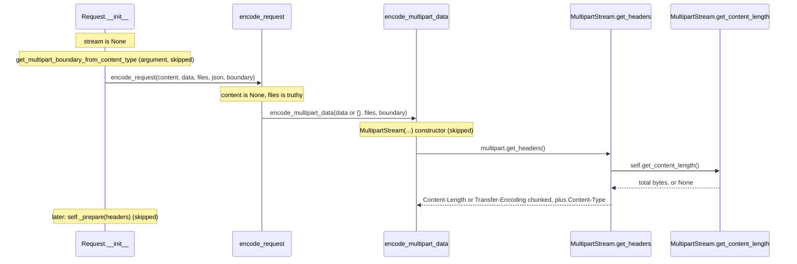

# httpx-trace-002: Sizing a multipart upload

**Answer:** `httpx/_models.py#Request.__init__` -> `httpx/_content.py#encode_request` -> `httpx/_content.py#encode_multipart_data` -> `httpx/_multipart.py#MultipartStream.get_headers` -> `httpx/_multipart.py#MultipartStream.get_content_length`

## The call sequence

The chain crosses three files: the model, the body-encoding dispatcher, and the multipart implementation.



## Step by step

1. **`Request.__init__`** (`httpx/_models.py:383`). With no `stream=` argument it takes the `if stream is None:` branch and encodes the body:

   ```python
   # httpx/_models.py:406-419
           if stream is None:
               content_type: str | None = self.headers.get("content-type")
               headers, stream = encode_request(
                   content=content,
                   data=data,
                   files=files,
                   json=json,
                   boundary=get_multipart_boundary_from_content_type(
                       content_type=content_type.encode(self.headers.encoding)
                       if content_type
                       else None
                   ),
               )
               self._prepare(headers)
   ```

   `get_multipart_boundary_from_content_type` runs first because it is an argument, but it just returns a boundary (or `None`) and doesn't lead onward. `_prepare` runs after `encode_request` returns. The prompt excludes both.

2. **`encode_request`** (`httpx/_content.py:186`). A dispatcher on which body argument was given:

   ```python
   # httpx/_content.py:209-216
       if content is not None:
           return encode_content(content)
       elif files:
           return encode_multipart_data(data or {}, files, boundary)
       elif data:
           return encode_urlencoded_data(data)
       elif json is not None:
           return encode_json(json)
   ```

   The earlier `data is not None and not isinstance(data, Mapping)` check (line 197) doesn't apply because `data` is `None`. `content` is `None`, so `elif files:` is taken.

3. **`encode_multipart_data`** (`httpx/_content.py:152`). Three lines:

   ```python
   # httpx/_content.py:155-157
       multipart = MultipartStream(data=data, files=files, boundary=boundary)
       headers = multipart.get_headers()
       return headers, multipart
   ```

   `MultipartStream(...)` is a constructor (skipped). It builds `self.fields`, a list of `DataField` and `FileField` objects. Then `get_headers` is called.

4. **`MultipartStream.get_headers`** (`httpx/_multipart.py:287`). This is why the length is needed, as the hint says: it decides which header describes the body.

   ```python
   # httpx/_multipart.py:288-292
           content_length = self.get_content_length()
           content_type = self.content_type
           if content_length is None:
               return {"Transfer-Encoding": "chunked", "Content-Type": content_type}
           return {"Content-Length": str(content_length), "Content-Type": content_type}
   ```

5. **`MultipartStream.get_content_length`** (line 265). The end point. It adds up each part's length plus the framing, and gives up if any part is unknown:

   ```python
   # httpx/_multipart.py:270-283
           boundary_length = len(self.boundary)
           length = 0

           for field in self.fields:
               field_length = field.get_length()
               if field_length is None:
                   return None

               length += 2 + boundary_length + 2  # b"--{boundary}\r\n"
               length += field_length
               length += 2  # b"\r\n"

           length += 2 + boundary_length + 4  # b"--{boundary}--\r\n"
           return length
   ```

   The arithmetic mirrors `iter_chunks` (lines 258-263), which yields `--boundary\r\n`, the field, `\r\n` for each field and a closing `--boundary--\r\n`. The length can be computed without rendering the body.

## When is the length unknown?

`FileField.get_length` (line 171) returns `None` when `peek_filelike_length` (`httpx/_utils.py:95`) can't find the file's size without reading it: no usable `fileno()` and no `tell`/`seek`. A real file on disk or an `io.BytesIO` has a known size. A generator or a socket-like stream doesn't. One unknown part makes the whole body length unknown, so the request is sent with `Transfer-Encoding: chunked` instead of `Content-Length`.

## Why the other candidates are wrong

- **`encode_content`, `encode_urlencoded_data`, `encode_json`.** The other branches of `encode_request`. With `files=` and no `content`, none is taken.
- **`MultipartStream.__init__` and `MultipartStream._iter_fields`.** Reached through the constructor call, which the prompt says to skip. They build the field list but compute no length.
- **`FileField.get_length` / `DataField.get_length`.** Called by `get_content_length`, so they come after the end point. Each measures one part, not the whole body.
- **`MultipartStream.iter_chunks` / `__iter__`.** These render the body when it is sent. They aren't called during construction.
- **`get_multipart_boundary_from_content_type`** and **`Request._prepare`.** Called from `Request.__init__`, but neither is on the path. The prompt names both as exclusions.
- **`Request.read`.** Called at line 423 only when the stream is a `ByteStream`. A `MultipartStream` isn't one, and the call comes after `encode_request` returns anyway.

## Takeaways

- A body-encoding dispatcher (`encode_request`) that branches on which argument is set is a common pattern. Use the prompt's "no other body argument" to pick the branch.
- Computing a length by mirroring the rendering code (count the framing bytes, add each part) lets a client send `Content-Length` without buffering the body. When one part can't be measured, falling back to chunked encoding is the usual answer.
- Arguments are evaluated before the call. A helper inside an argument list (`get_multipart_boundary_from_content_type(...)`) runs first, but it is still a sibling, not a step in the chain.
