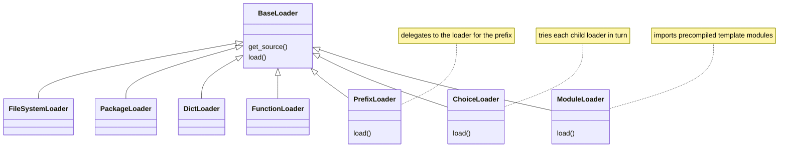

# jinja-architecture-001: Loaders that replace the loading step

**Answer:** `PrefixLoader`, `ChoiceLoader` and `ModuleLoader`, all in `src/jinja2/loaders.py`.

## How to find them

Open `src/jinja2/loaders.py` and look at the outline. There are seven loader classes, all subclasses of `BaseLoader`. Scan each one for a `load` method:

| Class | Defines `get_source`? | Defines `load`? |
|---|---|---|
| `BaseLoader` | yes, a stub that raises unless overridden | yes, the standard implementation |
| `FileSystemLoader` | yes | no |
| `PackageLoader` | yes | no |
| `DictLoader` | yes | no |
| `FunctionLoader` | yes | no |
| `PrefixLoader` | yes | **yes** (line 538) |
| `ChoiceLoader` | yes | **yes** (line 588) |
| `ModuleLoader` | no | **yes** (line 660) |

A search for `def load` in the file gives the same four hits: the base class and the three answers.



## Why each one overrides `load`

**`PrefixLoader` and `ChoiceLoader` are composites.** They hold other loaders and pass the whole `load` call through to them, rather than fetching source and compiling it themselves. `ChoiceLoader.load` (lines 594–599):

```python
        for loader in self.loaders:
            try:
                return loader.load(environment, name, globals)
            except TemplateNotFound:
                pass
        raise TemplateNotFound(name)
```

Delegating `load`, not just `get_source`, matters when a child is itself special. For example, a `ChoiceLoader` wrapping a `ModuleLoader` must call the `ModuleLoader`'s own `load`, because that loader has no source to give. Both composites also define `get_source`, which delegates to the children's `get_source` in the same way.

Note that `BaseLoader.load`'s docstring still says that collection loaders such as `PrefixLoader` and `ChoiceLoader` call `get_source` directly instead of `load`. The code shows that is only true of their `get_source` methods. Their `load` methods call the children's `load`. This is why the prompt asks you to read the code, not the comments.

**`ModuleLoader` never has source text.** It loads templates that `Environment.compile_templates` has already compiled to Python modules. It sets `has_source_access = False` and does not define `get_source`, so the inherited `BaseLoader.get_source` raises a `RuntimeError` for it. Its `load` imports the module and builds the template from it, skipping compilation entirely (lines 683–685):

```python
        return environment.template_class.from_module_dict(
            environment, mod.__dict__, globals
        )
```

## Why the plausible wrong answers are wrong

- **`FileSystemLoader`, `PackageLoader`, `DictLoader`, `FunctionLoader`** only provide `get_source` (plus `list_templates` for some). They rely on `BaseLoader.load` for bytecode caching and compiling, which is the point of the base class.
- **`BaseLoader`** defines `load`, but it is the default implementation the others inherit, not a class that replaces it.
- **Methods instead of classes.** The prompt asks for the classes.

## Takeaways

The base class here is a template method: `BaseLoader.load` fixes the algorithm and `get_source` is the hook subclasses fill in. Classes that override the template method itself are the interesting ones, because they are the ones that don't fit the normal "find source, then compile" shape. Comparing each subclass's outline against the base class is the quickest way to find them.
