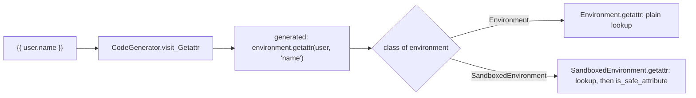

# jinja-architecture-002: How the sandbox sees attribute access

**Answer:** option `d`. The code generator writes every attribute access as a call to `environment.getattr(...)`, and `SandboxedEnvironment` overrides `getattr` with a version that runs the check.

## How to find it

1. Start in the code generator. In `src/jinja2/compiler.py`, `CodeGenerator.visit_Getattr` (line 1746) is what turns `user.name` into Python source:

   ```python
       @optimizeconst
       def visit_Getattr(self, node: nodes.Getattr, frame: Frame) -> None:
           if self.environment.is_async:
               self.write("(await auto_await(")

           self.write("environment.getattr(")
           self.visit(node.node, frame)
           self.write(f", {node.attr!r})")
   ```

   Nothing here depends on whether the environment is sandboxed. The generated code for `{{ user.name }}` always calls `environment.getattr(<user>, 'name')`.

2. Look at what `environment` is at render time. It is the `Environment` instance itself, so the call goes through normal method lookup on that object's class.

3. Compare the two classes. The base `Environment.getattr` (`src/jinja2/environment.py`, line 484) just tries `getattr(obj, attribute)` and then `obj[attribute]`. `SandboxedEnvironment.getattr` (`src/jinja2/sandbox.py`, line 312) does the same lookup, then checks the value before returning it (lines 327–330):

   ```python
               if self.is_safe_attribute(obj, attribute, value):
                   return value
               return self.unsafe_undefined(obj, attribute)
           return self.undefined(obj=obj, name=attribute)
   ```



Even constant folding goes through the same method: `nodes.Getattr.as_const` (`src/jinja2/nodes.py`, line 868) calls `eval_ctx.environment.getattr(...)`.

## Why the other options are wrong

- **a.** The parser does not consult the environment's safety rules. `is_safe_attribute` needs the actual object and value, which only exist at render time. A safe name on one object can be unsafe on another (see `is_internal_attribute`, which branches on the object's type).
- **b.** This is a real pattern in the compiler, but for different operations. The `sandboxed` flag does change what is written for **calls** (`visit_Call` writes `environment.call(context, ...)` when `self.environment.sandboxed` is true) and for **intercepted operators** (`environment.call_binop` / `call_unop`). Attribute access needs no flag because it is always routed through `environment.getattr`, and the check runs inside the overridden method, not as an inline call.
- **c.** There is no proxy layer. Context values are stored and passed as they are.

## Why it is designed this way

Routing every attribute and item access through two methods on the environment, `getattr` and `getitem`, gives Jinja one extension point for attribute semantics. The sandbox is then just a subclass. The same compiled template code runs under both environments, and only the method that runs differs. `getitem` follows the same pattern (`visit_Getitem` writes `environment.getitem(`, and `SandboxedEnvironment.getitem` checks attributes it falls back to), apart from slices, which bypass it.

Calls are the exception. For a call, the compiler checks `sandboxed` and writes `environment.call(context, ...)` only for sandboxed environments, and `context.call(...)` otherwise. That flag-dependent code is why option b sounds plausible.

## Takeaways

To find out how a policy is enforced in a compiler-based system, read what the code generator emits. If the emitted code calls back into a runtime object, the policy can live in a subclass of that object and the compiler never needs to know about it.
