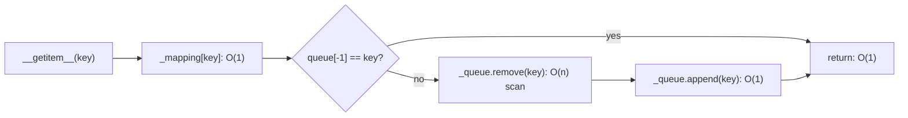

# jinja-design-001: Reading a key in an LRU cache

**Answer:** b. O(n): the key is found and removed from the deque by a linear scan, then appended at the right end.

## The design

`LRUCache` splits the job between two structures (src/jinja2/utils.py:439-443):

```python
# src/jinja2/utils.py:439-443
    def __init__(self, capacity: int) -> None:
        self.capacity = capacity
        self._mapping: dict[t.Any, t.Any] = {}
        self._queue: deque[t.Any] = deque()
        self._postinit()
```

- `_mapping` is a dict from key to value, so finding the *value* is O(1).
- `_queue` is a deque of keys in recency order: the least recently used key on the left, the most recently used on the right.

`_postinit` (line 445) gives the deque's bound methods short names, so `self._remove` is `self._queue.remove` and `self._append` is `self._queue.append` (lines 447-451).

## Following a read

```python
# src/jinja2/utils.py:514-528
        with self._wlock:
            rv = self._mapping[key]

            if self._queue[-1] != key:
                try:
                    self._remove(key)
                except ValueError:
                    # if something removed the key from the container
                    # when we read, ignore the ValueError that we would
                    # get otherwise.
                    pass

                self._append(key)

            return rv
```

The value comes out of the dict in O(1). The key isn't the most recent one, so the check on line 517 passes and line 519 calls `deque.remove(key)`. A deque has no index from a value to its position, so `remove` walks from the left until it finds the key: O(n) in the worst case. `append` on line 526 is O(1). The whole call is O(n).



## Why the other options are wrong

- **a, O(1):** a deque has O(1) appends and pops at either end, but no way to move a key out of the middle without finding it first.
- **c, O(log n):** nothing sorts the deque or searches it. Its order comes only from appending on use, and `remove` is a plain scan.
- **d, O(1) amortized:** that's a real technique (lazy deletion), but this code removes the old entry right away, on line 519. If it didn't, `__setitem__` couldn't evict with a simple `popleft` (line 538), because the leftmost key could be a stale copy of a key that was used since.

## Why it's built this way

The comment above `__init__` (lines 435-437) says this is fast for small capacities and doesn't scale. The default template cache holds 400 entries (`create_cache` in src/jinja2/environment.py:83-93 builds the `LRUCache`), and at that size a scan over a compact deque is cheap.

## Takeaways

The usual interview answer for an O(1) LRU cache is a hash map from key to a node in a doubly linked list: the map finds the node, and unlinking and relinking it is O(1). In Python, `collections.OrderedDict` with `move_to_end` and `popitem(last=False)` does the same job. Jinja trades that for simpler code, because its n is small.
