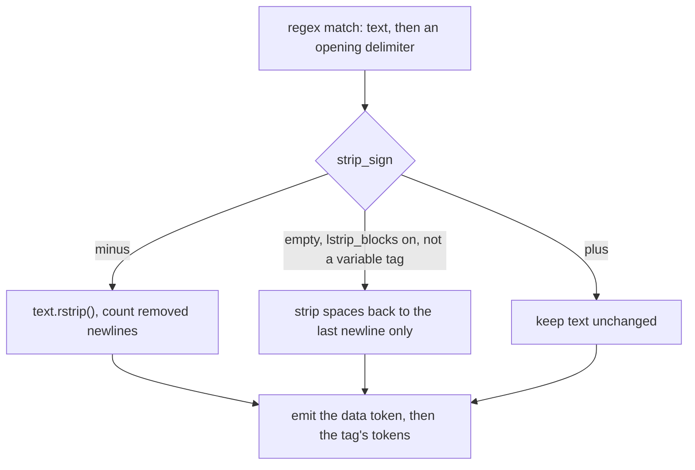

# jinja-find-002: Stripping whitespace before a tag

**Answer:** `src/jinja2/lexer.py:L736-L740`. Any selection that covers lines 736–740 and stays within lines 733–741 is accepted.

## How to navigate there

1. Open `src/jinja2/lexer.py` and jump to `Lexer.tokeniter` (line 669). It is a long method, about 200 lines, that runs the lexer's state machine of regex rules over the source.
2. Search inside it for `strip`. The first hits are in a block guarded by `if isinstance(tokens, OptionalLStrip):` (line 727). `OptionalLStrip` is the token tuple type used for rules whose opening delimiter can carry a whitespace-control sign.
3. Line 734 extracts that sign: `strip_sign = next(g for g in groups[2::2] if g is not None)`. It is `"-"`, `"+"`, or `""`.
4. The very next statement is the answer: the `if strip_sign == "-":` branch, which right-strips the text that came before the tag.

## The key code

`src/jinja2/lexer.py`, lines 734–745:

```python
                        strip_sign = next(g for g in groups[2::2] if g is not None)

                        if strip_sign == "-":
                            # Strip all whitespace between the text and the tag.
                            stripped = text.rstrip()
                            newlines_stripped = text[len(stripped) :].count("\n")
                            groups = [stripped, *groups[1:]]
                        elif (
                            # Not marked for preserving whitespace.
                            strip_sign != "+"
                            # lstrip is enabled.
                            and self.lstrip_blocks
```

`text` is the plain template data matched before the tag (`groups[0]`). The branch:

1. removes all trailing whitespace from it with `str.rstrip()`, newlines included,
2. counts how many newlines it removed, so that line numbers reported later stay correct, and
3. replaces the first group with the stripped text, so the data token emitted afterward has no trailing whitespace.



## Why the plausible wrong answers are wrong

- **The `elif` branch (lines 741–756)** also removes whitespace, but it implements the `lstrip_blocks` setting, not the `-` sign. It only strips spaces and tabs between the last newline and a block tag, it never removes newlines, and it is skipped for `{{` variable tags. The prompt explicitly excludes it.
- **Line 734 alone** reads the sign but changes nothing.
- **`Lexer.__init__` and `compile_rules`** build the regexes that capture the `-`, but they do not modify any text.
- **A `-` on a closing delimiter (`-%}`)** removes whitespace *after* a tag. That is handled by the closing-tag regexes built in `Lexer.__init__`, not by this branch, and the prompt is about the opening delimiter.

## Takeaways

In a hand-written lexer, something a user thinks of as syntax (`{%-`) often comes down to "which regex group matched". Search for the operation that must happen (`strip`) rather than for the feature's name, then read the surrounding condition to see which variant of the feature you are looking at.
