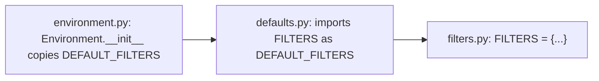

# jinja-find-003: Where the built-in filters are listed

**Answer:** `src/jinja2/filters.py`

## How to navigate there

1. Open `src/jinja2/environment.py` and go to `Environment.__init__`. Line 352 reads `self.filters = DEFAULT_FILTERS.copy()`.
2. Go to the definition of `DEFAULT_FILTERS`. Line 25 imports it, `from .defaults import DEFAULT_FILTERS`, which takes you to `src/jinja2/defaults.py`.
3. `defaults.py` looks like the right place, since it holds the other defaults: the delimiters, `DEFAULT_NAMESPACE` and `DEFAULT_POLICIES`. But line 3 shows that `DEFAULT_FILTERS` is not written there. It is a re-export under a new name:

   ```python
   from .filters import FILTERS as DEFAULT_FILTERS  # noqa: F401
   ```

4. Follow that import to `src/jinja2/filters.py`. The dictionary literal starts at line 1812 and lists every filter:

   ```python
   FILTERS = {
       "abs": abs,
       "attr": do_attr,
       "batch": do_batch,
   ```



## Why the plausible wrong answers are wrong

- **`src/jinja2/defaults.py`** is where `Environment` imports the name from, and it does contain several real dictionary literals. But the filter mapping is only aliased there. The prompt asks for the file where the literal is written out entry by entry.
- **`src/jinja2/environment.py`** only copies the mapping.
- **`src/jinja2/tests.py`** has the same structure for template *tests* (`TESTS = {` at line 216, re-exported as `DEFAULT_TESTS`). That is a different mapping.

## Why the code is shaped this way

Each `do_*` filter function and the `FILTERS` table that names them live together in `filters.py`, so adding a filter is a one-file change. `defaults.py` then gathers every default into one module, so `environment.py` has a single place to import them from. The `as DEFAULT_FILTERS` rename, and the `noqa: F401` comment that silences the "unused import" lint, are the signs of a re-export.

## Takeaways

"Go to definition" on an imported name often lands on an import, not the definition. Keep going until you reach an assignment. A `noqa: F401` comment or an `import X as Y` in a "defaults" or `__init__` module is a strong hint that the module is only passing a name through.
