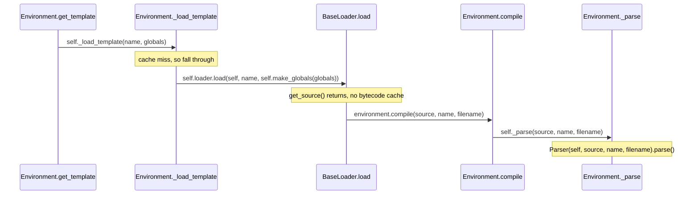

# jinja-trace-001: From get_template to the parser

**Answer:**

1. `src/jinja2/environment.py#Environment.get_template`
2. `src/jinja2/environment.py#Environment._load_template`
3. `src/jinja2/loaders.py#BaseLoader.load`
4. `src/jinja2/environment.py#Environment.compile`
5. `src/jinja2/environment.py#Environment._parse`

## The flow



## Step by step

**1. `Environment.get_template`** (`src/jinja2/environment.py`, line 981). The name is a string, so the `isinstance(name, Template)` early return is skipped. `parent` is `None`, so `join_path` is not called. The last line hands off:

```python
        return self._load_template(name, globals)
```

**2. `Environment._load_template`** (line 956). The template is not in `self.cache`, so the cache branch does nothing, and the method reaches:

```python
        template = self.loader.load(self, name, self.make_globals(globals))
```

`make_globals` runs first, but it returns a value and calls nothing further on this path, so it is a sibling, not part of the chain.

**3. `BaseLoader.load`** (`src/jinja2/loaders.py`, line 108). `self.loader` is a `FileSystemLoader`, and `FileSystemLoader` defines `__init__`, `get_source` and `list_templates` but not `load`. So the inherited `BaseLoader.load` runs. That is also where the index points, because the call is typed as a `BaseLoader`. Inside, `self.get_source(environment, name)` reads the file and returns. With no bytecode cache, `code` is still `None`, so:

```python
        if code is None:
            code = environment.compile(source, name, filename)
```

**4. `Environment.compile`** (line 731, the implementation after two `@typing.overload` stubs). The source is a `str`, so:

```python
            if isinstance(source, str):
                source_hint = source
                source = self._parse(source, name, filename)
```

**5. `Environment._parse`** (line 617) is the end of the chain. Its whole body is `return Parser(self, source, name, filename).parse()`. Constructing `Parser` is a class constructor, which the prompt says to skip, and it is the end condition.

## Why the plausible wrong answers are wrong

- **Including `FileSystemLoader.get_source`.** It is called by `BaseLoader.load`, but it returns before `compile` is called, so it does not call the next step. The same goes for `make_globals` and `join_path`.
- **`FileSystemLoader.load` instead of `BaseLoader.load`.** No such method exists. Checking the class outline shows `FileSystemLoader` only overrides how the source is found.
- **Going through `Environment.parse`.** The public `parse` (line 597) also calls `_parse`, but nothing on this path calls `parse`. `compile` calls the private `_parse` directly.
- **Ending at `Parser.parse`.** The prompt ends at the *Environment* method that constructs the parser, which is `_parse`.
- **Inserting `Template.from_code`.** `BaseLoader.load` calls it, but only after `compile` returns. It wraps the compiled code in a `Template` object and is not on the way to the parser.
- **Inserting `Environment._generate` or `Environment._compile`.** Both run inside `compile`, but after `_parse`, to turn the AST into Python source and then bytecode.

## Background: why loading is split this way

The split gives each layer one job:

| Layer | Responsibility |
|---|---|
| `get_template` | name handling: pass-through of `Template` objects, relative names via `join_path` |
| `_load_template` | the environment's in-memory template cache, and `auto_reload` checks |
| `BaseLoader.load` | finding source, the on-disk bytecode cache, building the `Template` |
| `compile` | source to AST to Python source to code object |
| `_parse` | the single place a `Parser` is created for template source |

Because the caching and compiling logic lives in `BaseLoader.load`, a custom loader normally only needs to implement `get_source`. `_parse`, `_generate` and `_compile` are small internal hooks, so a subclass of `Environment` can replace one stage of compilation without copying `compile`.

## Takeaways

- When a call goes through an attribute such as `self.loader`, work out which class's method actually runs, and check whether the subclass overrides it.
- Read each step under the stated configuration (no cache hit, no bytecode cache, a string name). Each condition in the prompt removes one branch, and the chain is what remains.
