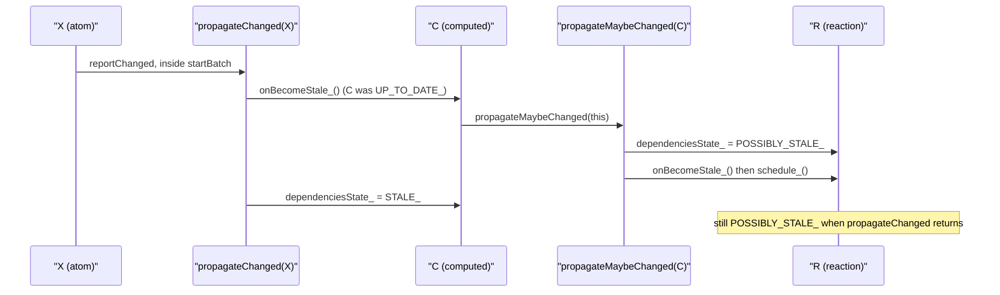

# mobx-architecture-001: Staleness through a computed value

**Answer:** option c, `POSSIBLY_STALE_`.

## The setup

The dependency graph in the prompt is a chain of three nodes:

```text
X (observable)  --observed by-->  C (computed)  --observed by-->  R (reaction)
```

All three start `UP_TO_DATE_`. The question is what happens to R, which sits two hops away from the write, during the synchronous propagation step, before any reaction actually runs.

## The four states

The enum lives at the top of `packages/mobx/src/core/derivation.ts`:

| State | Value | Meaning (from the code and its comments) |
|---|---|---|
| `NOT_TRACKING_` | -1 | Not run yet, or not observed outside a batch. Holds no dependency data. |
| `UP_TO_DATE_` | 0 | No shallow dependency changed since the last run. |
| `POSSIBLY_STALE_` | 1 | A deep dependency changed, but it is not yet known whether a shallow one did. |
| `STALE_` | 2 | A shallow (direct) dependency changed. Must recompute when next needed. |

The comment on `POSSIBLY_STALE_` already gives a strong hint: "currently only ComputedValue will propagate POSSIBLY_STALE".

## Walking the propagation

`Atom.reportChanged` (`packages/mobx/src/core/atom.ts:94`) is `startBatch(); propagateChanged(this); endBatch()`. The batch counter is now 1, so nothing scheduled during propagation can run yet.

`propagateChanged(X)` only touches X's **direct** observers:

```ts
// packages/mobx/src/core/observable.ts:238-243
observable.observers_?.forEach(d => {
    if (d.dependenciesState_ === IDerivationState_.UP_TO_DATE_) {
        d.onBecomeStale_()
    }
    d.dependenciesState_ = IDerivationState_.STALE_
})
```

X has one observer, C. C is `UP_TO_DATE_`, so `C.onBecomeStale_()` runs first, and only afterwards is C marked `STALE_`.

`ComputedValue.onBecomeStale_` (`packages/mobx/src/core/computedvalue.ts:138`) is a one-liner: `propagateMaybeChanged(this)`. That function walks C's observers:

```ts
// packages/mobx/src/core/observable.ts:275-280
observable.observers_?.forEach(d => {
    if (d.dependenciesState_ === IDerivationState_.UP_TO_DATE_) {
        d.dependenciesState_ = IDerivationState_.POSSIBLY_STALE_
        d.onBecomeStale_()
    }
})
```

R is `UP_TO_DATE_`, so it becomes `POSSIBLY_STALE_`, and `Reaction.onBecomeStale_` calls `schedule_()`. That pushes R onto `globalState.pendingReactions` and calls `runReactions()`, which returns immediately because `globalState.inBatch > 0` (`core/reaction.ts:277`).

Control returns to `propagateChanged`, which sets C to `STALE_`. Nothing in that loop revisits R, because R is not an observer of X.



## What happens next (after the moment the prompt asks about)

When `endBatch` brings the counter back to zero, `runReactions` drains the queue and `Reaction.runReaction_` calls `shouldCompute(R)`. For `POSSIBLY_STALE_`, `shouldCompute` (`core/derivation.ts:84`) calls `get()` on every computed R observes. C recomputes; if its value actually changed, `ComputedValue.get` calls `propagateChangeConfirmed(C)` (`computedvalue.ts:229`), which promotes R from `POSSIBLY_STALE_` to `STALE_`. If C's value came out the same, R is reset to `UP_TO_DATE_` by `changeDependenciesStateTo0` and its body does not re-run.

## Why the other options are wrong

- **a, `STALE_`.** In `propagateChanged`, only direct observers of the changed atom get `STALE_`, and that is C. R can become `STALE_` later through `propagateChangeConfirmed`, but only after C recomputes to a different value. That happens during `runReactions`, after the moment the prompt asks about.
- **b, `NOT_TRACKING_`.** That state means a derivation holding no dependency data: never run, or cleared by `clearObserving`. R has run and is subscribed to C. Nothing on this path calls `clearObserving`.
- **d, `UP_TO_DATE_`.** This would be true if propagation stopped at C. But `ComputedValue.onBecomeStale_` forwards to `propagateMaybeChanged`, which changes R. A tempting mistake is to assume `propagateChanged` sets C's state before calling `onBecomeStale_`, see C already non-`UP_TO_DATE_`, and conclude nothing forwards. The code checks C's state first, calls `onBecomeStale_`, and only then assigns `STALE_`.

## Why MobX is built this way

The two-level staleness is what lets MobX skip work. If R were marked `STALE_` right away, it would have to re-run every time X changed, even when C's output stayed the same (for example, `C = X > 10` while X goes from 11 to 12). With `POSSIBLY_STALE_`, R only asks C to recompute and compares. The comment on the enum calls this the "second big optimization".

## Takeaways

- In push-pull reactive systems, look for two kinds of invalidation: a definite "changed" for direct dependents and a weaker "maybe changed" for everything further downstream.
- When a loop both calls a callback and assigns a field, check the order. Here `onBecomeStale_()` runs before the `STALE_` assignment, and that order decides the answer.
