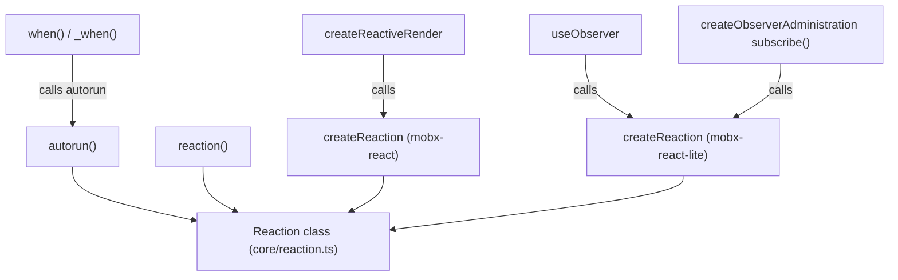

# mobx-architecture-002: Who constructs a Reaction

**Answer:**

- `packages/mobx/src/api/autorun.ts#autorun`
- `packages/mobx/src/api/autorun.ts#reaction`
- `packages/mobx-react/src/observerClass.ts#createReaction`
- `packages/mobx-react-lite/src/useObserver.ts#createReaction`

## How a strong engineer would find them

This is a "find every construction site" question, so a plain text search beats clicking through the class. Search for `new Reaction` and restrict to `packages/*/src`, ignoring `__tests__`. You get five hits:

| File | Line | Enclosing function |
|---|---|---|
| `packages/mobx/src/api/autorun.ts` | 54 | `autorun` (synchronous branch) |
| `packages/mobx/src/api/autorun.ts` | 67 | `autorun` (scheduled or delayed branch) |
| `packages/mobx/src/api/autorun.ts` | 141 | `reaction` |
| `packages/mobx-react/src/observerClass.ts` | 218 | `createReaction` |
| `packages/mobx-react-lite/src/useObserver.ts` | 24 | `createReaction` |

The prompt asks for functions, not expressions, so group the hits by their enclosing function. The two `autorun` sites are two branches of one `if (runSync) { ... } else { ... }`, which leaves four functions.

`packages/mobx-undecorate` and `packages/eslint-plugin-mobx` have no hits. They are tooling, not runtime code.

## How the four fit together



Only the four nodes with an arrow straight into the `Reaction` class contain the `new` expression. Everything else reaches `Reaction` through one of them.

## A look at each site

`autorun` picks a reaction body based on whether a scheduler or delay is set (`autorun.ts:49`, `const runSync = !opts.scheduler && !opts.delay`). Either branch assigns the same local `reaction` variable:

```ts
// packages/mobx/src/api/autorun.ts:52-54
if (runSync) {
    // normal autorun
    reaction = new Reaction(
```

`reaction` builds one `Reaction` whose body either runs `reactionRunner` directly or hands it to the scheduler (`autorun.ts:141`).

In the bindings, both packages wrap construction in a small helper named `createReaction`. In `mobx-react` (class components) it returns the reaction, and `createReactiveRender` stores it lazily on first render (`observerClass.ts:189`). In `mobx-react-lite` (function components) it assigns `adm.reaction` on the administration object. `useObserver` calls it on first render (`useObserver.ts:92`), and the `subscribe` method created in `createObserverAdministration` calls it again if the reaction was lost (`useObserver.ts:57`).

## Why other candidates are wrong

- **`when` and `_when`** in `api/when.ts` are built on `autorun` (`when.ts:60`, `var disposer = autorun(r => {`). They never write `new Reaction` themselves.
- **`useObserver`** and **`createReactiveRender`** call the `createReaction` helpers, but the `new Reaction` expression is inside the helper. Selecting the caller is one level too high.
- **`createObserverAdministration`** (and its `subscribe` method) in `mobx-react-lite` also calls `createReaction`. Same reasoning: it is a caller.
- **The `Reaction` class and its constructor** in `core/reaction.ts` are what gets constructed, not code that constructs it. Methods like `Reaction.getDisposer_` and `Reaction.schedule_` do not call `new Reaction`.
- **`observer`** in either package is a higher-level wrapper. It reaches a reaction only through `useObserver` or `makeClassComponentObserver`, and neither contains the expression.
- **Test files** construct reactions directly, but the prompt excludes them.

## Background

`Reaction` is the low-level primitive. MobX keeps it internal-ish (you can import it, but the docs steer you to `autorun`, `reaction` and `when`). Each public API is a different policy around the same primitive: `autorun` tracks and runs the same function; `reaction` separates the tracked expression from the untracked effect; `when` is a one-shot `autorun` that disposes itself. The React bindings need a reaction whose "effect" is "re-render this component", so each binding has its own factory.

## Takeaways

- For "who constructs X" questions, search for the `new X` expression, then group by enclosing function. Don't stop at the first hit per file.
- Same-named helpers in different packages (`createReaction` here) are common in monorepos. Always check the full path before assuming two symbols are one.
