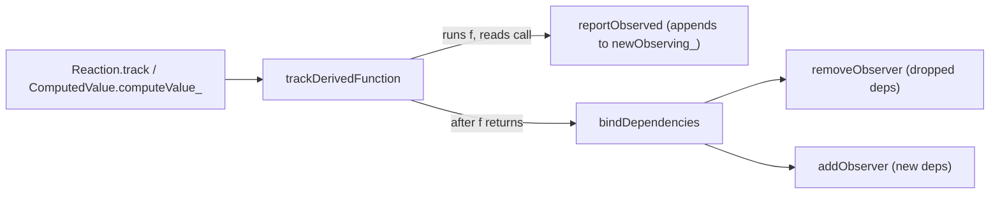

# mobx-find-001: Diffing a derivation's dependencies

**Answer:** `packages/mobx/src/core/derivation.ts#bindDependencies`

## How a strong engineer would navigate there

1. The prompt says "a reaction or a computed value", so the code must be shared between `Reaction` and `ComputedValue`. That points at `packages/mobx/src/core/derivation.ts`, the module that defines the `IDerivation` interface both classes implement.
2. Find where a derivation's function runs. `Reaction.track` (`core/reaction.ts:173`) and `ComputedValue.computeValue_` (`core/computedvalue.ts:299`) both call `trackDerivedFunction`. That is the "runs the derivation's function" step the prompt excludes.
3. Read `trackDerivedFunction` (`derivation.ts:166`). It allocates a fresh `newObserving_` array, sets `globalState.trackingDerivation`, calls `f`, restores the tracking state, and then calls `bindDependencies(derivation)` on line 192. That call is the jump target.
4. Inside `bindDependencies` you see both `removeObserver` and `addObserver`. That confirms you are in the right place: the prompt describes both registering and unregistering.



## How the diff works

`bindDependencies` avoids building a `Set`. Each observable carries a one-bit scratch field, `diffValue`, and the function makes three passes:

```text
pass 1  over newObserving_   0 -> 1 on first sight, drop duplicates (already 1)
pass 2  over old observing_  still 0  => not read this run  => removeObserver
                             then reset every old dep to 0
pass 3  over new observing   still 1  => not in the old list => addObserver, reset to 0
```

The key lines:

```ts
// packages/mobx/src/core/derivation.ts:261-266
while (l--) {
    const dep = prevObserving[l]
    if (dep.diffValue === 0) {
        removeObserver(dep, derivation)
    }
    dep.diffValue = 0
}
```

```ts
// packages/mobx/src/core/derivation.ts:272-277
while (i0--) {
    const dep = observing[i0]
    if (dep.diffValue === 1) {
        dep.diffValue = 0
        addObserver(dep, derivation)
    }
}
```

An observable that appears in both lists gets set to 1 in pass 1 and back to 0 in pass 2, so pass 3 skips it. That is exactly "already observed, don't touch". The whole diff is linear in the size of the two lists.

At the end, if any newly read dependency is itself a derivation that is not `UP_TO_DATE_`, it sets the derivation's state to match and calls `onBecomeStale_()` (lines 282-285). That covers a computed that went stale during this run (the comment references issue #916).

## Why other candidates are wrong

- **`trackDerivedFunction`** runs the derivation's function and collects reads, then delegates the comparison. The prompt excludes it by name ("not the one that runs the derivation's function").
- **`reportObserved`** (`core/observable.ts:177`) appends each read observable to `newObserving_` while the function runs (`derivation.newObserving_![derivation.unboundDepsCount_++] = observable`). It is the recording step. It never looks at the old list.
- **`addObserver` and `removeObserver`** (`core/observable.ts:63` and `:77`) each add or remove one observer on one observable. `bindDependencies` calls them, but they do no comparison.
- **`clearObserving`** (`derivation.ts:288`) removes the derivation from every observable and sets `NOT_TRACKING_`. It throws everything away when a reaction is disposed or a computed is suspended (`Reaction.dispose`, `ComputedValue.suspend_`). It does not diff.
- **`Reaction.track`** and **`ComputedValue.trackAndCompute` / `computeValue_`** are callers further up. They never touch `observing_` directly.
- **`changeDependenciesStateTo0`** resets state flags at the start of a run. It changes no subscriptions.

## Takeaways

- When a prompt describes work shared by several classes, look for the module that defines their common interface. Shared algorithms usually live next to it as free functions.
- "Record, then reconcile" is a common pattern in reactive libraries. The recorder appends cheaply during the run, and a separate function does the diff once the run ends. Expect them to be two functions.
- Spotting a tiny per-node scratch flag like `diffValue` is a good sign you have found a hand-tuned diff loop.
