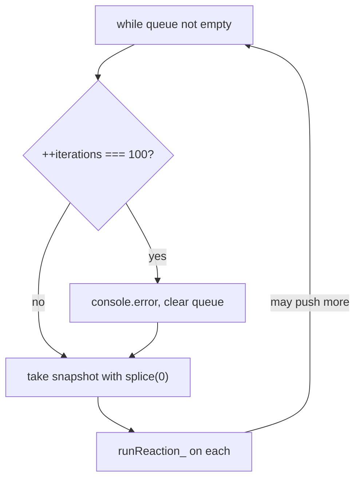

# mobx-find-002: Runaway reaction cycle guard

**Answer:** lines 292-300 of `packages/mobx/src/core/reaction.ts`, the `if (++iterations === MAX_REACTION_ITERATIONS) { ... }` block inside `runReactionsHelper`.

## How a strong engineer would navigate there

1. The prompt already names the file. Open `packages/mobx/src/core/reaction.ts` and look for a queue being drained. The global queue is `globalState.pendingReactions`. `Reaction.schedule_` pushes onto it (line 120), so search for other uses of `pendingReactions`.
2. That leads to `runReactions` (line 275) and the private helper below it, `runReactionsHelper` (line 283). `runReactions` only decides whether to drain now. The helper does the draining.
3. The hint says a module-level constant defines the limit. Just above `runReactions` is `const MAX_REACTION_ITERATIONS = 100` (line 271), with a comment that starts "Magic number alert!". Search for its other use and you land in the `while` loop.

## The code

```ts
// packages/mobx/src/core/reaction.ts:291-305
while (allReactions.length > 0) {
    if (++iterations === MAX_REACTION_ITERATIONS) {
        console.error(
            __DEV__
                ? `Reaction doesn't converge to a stable state after ${MAX_REACTION_ITERATIONS} iterations.` +
                      ` Probably there is a cycle in the reactive function: ${allReactions[0]}`
                : `[mobx] cycle in reaction: ${allReactions[0]}`
        )
        allReactions.splice(0) // clear reactions
    }
    let remainingReactions = allReactions.splice(0)
    for (let i = 0, l = remainingReactions.length; i < l; i++) {
        remainingReactions[i].runReaction_()
    }
}
```

The answer is the `if` from line 292 through its closing brace on line 300. The grader requires every line from 292 to 300 to be selected, and the selection must stay inside lines 288-306.

## How the loop works

Each pass of the `while` takes a snapshot of the queue with `splice(0)` and runs every reaction in it. Running a reaction can write observables, which can push more reactions onto `globalState.pendingReactions` (the same array, `allReactions`). The loop re-checks the length and goes again.



If two reactions keep re-triggering each other, the queue never empties. On the 100th pass, the guard logs an error and empties the queue. The snapshot on line 301 is then empty, so the loop body does nothing and the `while` exits.

Note the guard counts passes over the queue, not individual reactions. A batch of 500 independent reactions is a single pass.

## Why other selections are wrong

- **The re-entrancy guard in `runReactions`** (lines 277-279, `if (globalState.inBatch > 0 || globalState.isRunningReactions)`) stops a nested drain from starting while a batch is open or a drain is already running. It is in a different function, and it protects against re-entrancy, not infinite cycles.
- **Lines 301-304** take the snapshot and run each reaction. That is the normal path through the loop, not the protection.
- **Line 271, `MAX_REACTION_ITERATIONS`**, is the limit the guard uses, not the guard.
- **Only the `console.error(...)` call or only `allReactions.splice(0)`** leaves out the `if` line, so the anchor is not covered.
- **The whole `while` loop or the whole helper** runs past the allowed window (it starts at 288 and ends at 306), and includes code that is not the guard.
- **Error handling inside `Reaction.runReaction_`** or `reportExceptionInDerivation_` deals with exceptions thrown by a reaction, not reactions that keep re-triggering.

## Design notes

MobX picks a "log and drop" policy instead of throwing. Throwing here would leave `globalState.isRunningReactions` set to `true` (line 306 resets it only after the loop) and wedge every future reaction. Clearing the queue lets the app keep running while still making the bug loud.

The reaction scheduler is pluggable (`setReactionScheduler`, line 311), which is why `runReactions` passes the helper as a callback instead of calling it directly.

## Takeaways

- A named limit constant near a loop is often the fastest way to find a safety guard. Search for its uses.
- Distinguish re-entrancy guards (stop a function from running while it is already running) from convergence guards (stop a loop that never settles). They often sit in neighbouring functions.
