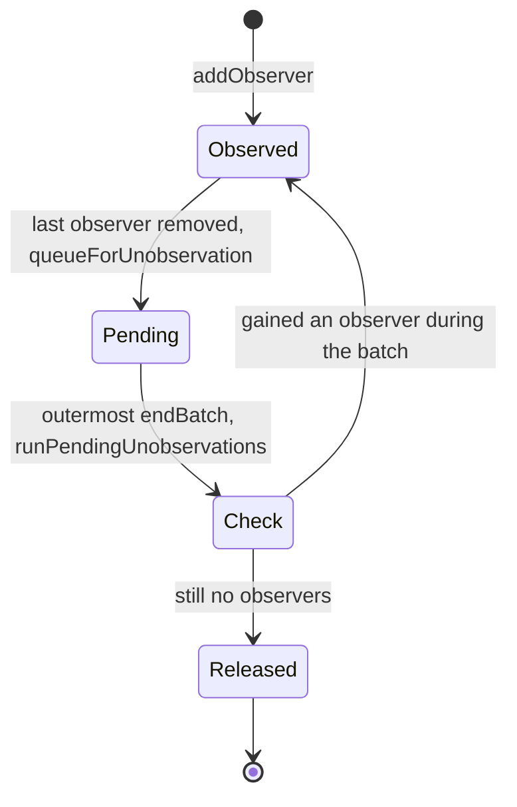

# mobx-find-003: Deferring an observable's release

**Answer:** `packages/mobx/src/core/observable.ts#queueForUnobservation`

## How a strong engineer would navigate there

1. The prompt names the file and the starting function. Open `removeObserver` in `packages/mobx/src/core/observable.ts` (line 77).
2. Read what happens when the observer set empties:

```ts
// packages/mobx/src/core/observable.ts:85-89
observers.delete(node)
if (observers.size === 0) {
    // deleting last observer
    queueForUnobservation(observable)
}
```

3. Jump to `queueForUnobservation`, which sits directly below:

```ts
// packages/mobx/src/core/observable.ts:94-100
export function queueForUnobservation(observable: IObservable) {
    if (observable.isPendingUnobservation === false) {
        // invariant(observable._observers.length === 0, "INTERNAL ERROR, should only queue for unobservation unobserved observables");
        observable.isPendingUnobservation = true
        globalState.pendingUnobservations.push(observable)
    }
}
```

It sets the flag and pushes onto the global list, exactly the "flags ... and appends" from the prompt. The flag check also makes it idempotent: queueing the same observable twice in one batch adds it only once.

## The life cycle of a pending unobservation



Note that `addObserver` does not clear the pending flag or remove the observable from the list. An observable that gains a new observer mid-batch stays queued, and the check happens when the list is drained. That re-check is the reason for the delay. `runPendingUnobservations` (line 128) checks the observer set again before releasing anything:

```ts
// packages/mobx/src/core/observable.ts:134-135
observable.isPendingUnobservation = false
if (!observable.observers_ || observable.observers_.size === 0) {
```

If a reaction stops reading an observable and another derivation starts reading it within the same batch, the observable is not torn down and rebuilt. Only those still unobserved at the end are released: the empty `Set` is dropped, `onBUO` (on-become-unobserved) hooks fire, and computed values are suspended with `suspend_()`.

The comment above `startBatch` (lines 102-106) states the goal: "During a batch `onBecomeUnobserved` will be called at most once per observable."
## Why other candidates are wrong

- **`runPendingUnobservations`** (line 128) is the function that later processes the list. It clears the flag, releases the empty observer set, calls `onBUO` and suspends computed values. The prompt excludes it.
- **`endBatch`** (line 111) decides *when* the list is processed (when `inBatch` drops to 0 and no drain is already running) but never appends to it.
- **`removeObserver`** is the caller from the prompt. It removes the observer and then delegates the queueing.
- **`reportObserved`** (line 177) also calls `queueForUnobservation`, for an observable read outside any derivation while a batch is open and with no observers. It is another caller, not the function that flags and appends.
- **`markObserved`** (line 166) handles the opposite transition. Its own comment notes "No queueForUnobservation here".
- **`ComputedValue.suspend_`** is the tear-down step for computed values, called from `runPendingUnobservations` at the end of the batch.
- **The `isPendingUnobservation` getter and setter** on `Atom` and `ComputedValue` store the flag in a bit field. They don't append anything to a list.

## Takeaways

- Deferring cleanup until the end of a transaction is a common way to avoid thrashing: something released and re-acquired in the same unit of work never pays the release cost.
- A boolean "pending" flag next to a push onto a shared list is the usual way to de-duplicate a work queue without searching it.
