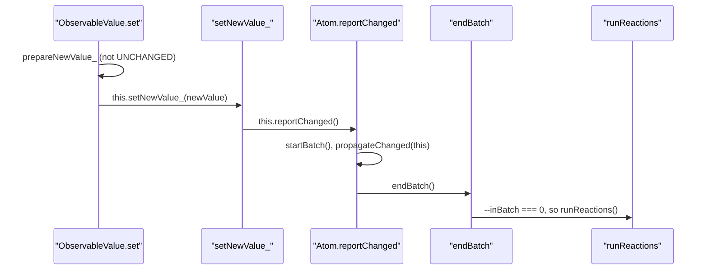

# mobx-trace-001: From a value write to running reactions

**Answer (in order):**

1. `packages/mobx/src/types/observablevalue.ts#ObservableValue.set`
2. `packages/mobx/src/types/observablevalue.ts#ObservableValue.setNewValue_`
3. `packages/mobx/src/core/atom.ts#Atom.reportChanged`
4. `packages/mobx/src/core/observable.ts#endBatch`
5. `packages/mobx/src/core/reaction.ts#runReactions`

## The call sequence



## Step by step

**1 to 2.** `ObservableValue.set` first asks `prepareNewValue_` whether anything changed. With no interceptors and a different value, it returns the new value rather than `globalState.UNCHANGED`, so `set` calls `setNewValue_`:

```ts
// packages/mobx/src/types/observablevalue.ts:96-97, 109
newValue = this.prepareNewValue_(newValue) as any
if (newValue !== globalState.UNCHANGED) {
    ...
    this.setNewValue_(newValue)
```

**2 to 3.** `setNewValue_` stores the value and announces it (lines 135-137):

```ts
const oldValue = this.value_
this.value_ = newValue
this.reportChanged()
```

`ObservableValue` does not define `reportChanged`. Its declaration is `export class ObservableValue<T> extends Atom` (line 56-57), so the call resolves to the base class method `Atom.reportChanged` in `core/atom.ts`. That is the step the hint points at, and the one people most often get wrong by looking for a method in `observablevalue.ts`.

**3 to 4.** `Atom.reportChanged` is three lines (`core/atom.ts:95-97`):

```ts
startBatch()
propagateChanged(this)
endBatch()
```

Only `endBatch` continues the chain toward `runReactions`.

**4 to 5.** `endBatch` decrements the counter and checks it (`core/observable.ts:112-113`):

```ts
if (--globalState.inBatch === 0) {
    runReactions()
```

Because the write happened outside any action, transaction or batch, `startBatch` took the counter from 0 to 1 and `endBatch` brings it back to 0. The `if` is true and `runReactions` is called. That is the end condition.

## Why other sequences are wrong

- **Including `prepareNewValue_`.** `set` does call it, but it returns before `setNewValue_` is called. It runs `checkIfStateModificationsAreAllowed`, interceptors, the enhancer and the equality check, then returns. Nothing it calls leads to `runReactions`, so it is a side branch, not a link in the chain.
- **Including `propagateChanged`.** It is called by `reportChanged`, but it only marks observers stale and calls `onBecomeStale_`. The next link, `endBatch`, is called by `reportChanged`, not by `propagateChanged`.
- **Going through `Reaction.schedule_`.** `propagateChanged` leads to `Reaction.onBecomeStale_` and `schedule_`, and `schedule_` does literally call `runReactions()` (`core/reaction.ts:121`). But at that moment `inBatch` is 1, so that call is not "the call to `runReactions` made when the global batch counter reaches zero". It returns immediately at line 277. The prompt pins the end at the `endBatch` call.
- **Including `startBatch`.** It only increments `globalState.inBatch` and calls nothing.
- **Using an `ObservableValue.reportChanged` ID.** No such method exists. The method is inherited, and its symbol is `core/atom.ts#Atom.reportChanged`.
- **Including `notifyListeners` or `hasListeners`.** These run after `reportChanged` returns, and the prompt says no change listeners are registered. They never lead to `runReactions`.
- **Continuing to `runReactionsHelper` or `Reaction.runReaction_`.** Those run after `runReactions` is called, which is past the end condition.
- **Leaving out `ObservableValue.set`.** The prompt says to include the start function.

## Why the batch matters

`reportChanged` wraps propagation in its own batch even when no action is open. While the counter is above zero, `runReactions` returns early, so all the stale-marking finishes before any reaction runs. Without that, a reaction could run halfway through propagation and see a mix of old and new derived values. If the write had happened inside an action, `endBatch` here would take the counter from 2 to 1, the `if` would be false, and reactions would run when the outermost action ends.

## Takeaways

- When a method call on `this` has no definition in the current class, check the `extends` clause before searching elsewhere.
- In batched systems, the same function (`runReactions`) is often called from several places, and only one of those calls does work. The prompt's end condition ("when the counter reaches zero") tells you which.
