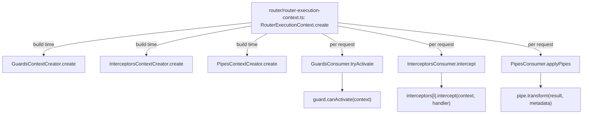

# nest-architecture-001: Who actually invokes guards, interceptors and pipes

**Answer:**
- `packages/core/guards/guards-consumer.ts`
- `packages/core/interceptors/interceptors-consumer.ts`
- `packages/core/pipes/pipes-consumer.ts`

## The pattern: creator, consumer, orchestrator

Each enhancer type in `packages/core/` is split into two classes, in a folder named after the type:

```text
packages/core/
  guards/        guards-context-creator.ts        guards-consumer.ts
  interceptors/  interceptors-context-creator.ts  interceptors-consumer.ts
  pipes/         pipes-context-creator.ts         pipes-consumer.ts
```

- The **context creator** answers "which enhancer instances apply to this handler?" It reads metadata, resolves instances from the container and filters out anything without the right method.
- The **consumer** answers "run them." It loops over the instances and calls `canActivate`, `intercept` or `transform`.
- An **orchestrator** such as `RouterExecutionContext` (HTTP) or `ExternalContextCreator` wires both together. It calls the creator once when it builds the handler, then calls the consumer on each request.



## How to navigate there

1. **Search for the method names as calls.** Search `packages/core/` for `.canActivate(`, `.intercept(` and `.transform(`, excluding `*.spec.ts` and `test/`. That returns just six hits:

   | Hit | What it calls |
   |---|---|
   | `guards/guards-consumer.ts:22` | `guard.canActivate(context)`, a user guard |
   | `interceptors/interceptors-consumer.ts:33` | `interceptors[i].intercept(context, handler)`, a user interceptor |
   | `pipes/pipes-consumer.ts:43` | `pipe.transform(result, { metatype, type, data, schema })`, a user pipe |
   | `router/router-execution-context.ts:231` | `this.interceptorsConsumer.intercept(...)`, a Nest class |
   | `helpers/external-context-creator.ts:182` | `this.interceptorsConsumer.intercept(...)`, a Nest class |
   | `services/reflector.service.ts:65` | `options.transform(metadataValue)`, a decorator option |

2. **Check the receiver of each call.** The prompt says "the user-supplied enhancer instance itself". The two `this.interceptorsConsumer.intercept(...)` calls have a Nest class as the receiver, so they are exactly the "files that only call another Nest class" the prompt excludes. The Reflector hit is a metadata option, not a pipe.

3. **Confirm each consumer's loop.** For example:

   ```ts
   // packages/core/guards/guards-consumer.ts:21-22
   for (const guard of guards) {
     const result = guard.canActivate(context);
   ```

   ```ts
   // packages/core/pipes/pipes-consumer.ts:42-43
   for (const pipe of transforms) {
     result = await pipe.transform(result, { metatype, type, data, schema });
   ```

   ```ts
   // packages/core/interceptors/interceptors-consumer.ts:29-33
   const handler: CallHandler = {
     handle: () =>
       defer(bindAsyncScope(() => nextFn(i + 1))).pipe(mergeAll()),
   };
   return interceptors[i].intercept(context, handler);
   ```

## How each consumer treats its enhancers

| Consumer | Call | Order and short-circuit |
|---|---|---|
| `GuardsConsumer.tryActivate` | `guard.canActivate(context)` | In order. Returns `false` on the first guard that says no. Results can be `boolean`, `Promise` or `Observable`; non-booleans go through `pickResult`. |
| `InterceptorsConsumer.intercept` | `interceptors[i].intercept(context, handler)` | Nested. Each interceptor gets a `handler.handle()` that calls the next one. The last one calls the route handler through `transformDeferred`. |
| `PipesConsumer.applyPipes` | `pipe.transform(value, metadata)` | In order, each pipe receives the previous pipe's output. |

## Why the other candidates are wrong

- **`guards/guards-context-creator.ts`, `interceptors/interceptors-context-creator.ts`, `pipes/pipes-context-creator.ts`** mention `canActivate`, `intercept` and `transform`, but only inside `isFunction(guard.canActivate)`-style checks and `!!(metatype as CanActivate).canActivate` property reads. They test that the method exists. They never call it.
- **`router/router-execution-context.ts`** is the HTTP orchestrator. `createGuardsFn` calls `this.guardsConsumer.tryActivate(...)`, `getParamValue` calls `this.pipesConsumer.apply(...)`, and `create` calls `this.interceptorsConsumer.intercept(...)`. All are calls to Nest classes.
- **`helpers/external-context-creator.ts`** does the same for non-HTTP contexts. Its `canActivateFn` calls `this.guardsConsumer.tryActivate`, and line 182 calls `this.interceptorsConsumer.intercept`.
- **`services/reflector.service.ts`** calls `options.transform(metadataValue)`. That `transform` is an option of `Reflector.createDecorator`, not a `PipeTransform`.
- **`pipes/params-token-factory.ts`** is used by `PipesConsumer.apply` to turn the param type enum into a string. It does not call pipes.
- **`PipesConsumer.apply` vs `applyPipes`** are both in the correct file, so the file-level answer is the same. `apply` normalizes metadata and calls `applyPipes`, which does the loop.
- **Files in `packages/common/`** define the interfaces `CanActivate`, `NestInterceptor` and `PipeTransform`, and built-in pipes such as `ValidationPipe`. They are outside `packages/core/`, and they define the methods rather than call them.

## Why Nest splits it this way

Resolving enhancers is expensive. It reads class and method metadata, merges global, controller and method scopes, and looks up instances in the DI container. Running them is cheap. Splitting the two lets `RouterExecutionContext.create` resolve the static enhancers once, when the route is set up, while the consumers stay small loops that run on every request. The consumers also have no HTTP knowledge, so other transports reuse them: `ExternalContextCreator` in `packages/core/helpers/`, and outside core, for example, `packages/websockets/context/ws-context-creator.ts` and `packages/microservices/context/rpc-context-creator.ts`, which both take a `GuardsConsumer`.

## Takeaways

- When asked "who calls X", search for the call syntax (`.x(`) and then check the receiver of each hit. A method name alone matches checks, property reads and unrelated APIs.
- Pairs of classes named `*ContextCreator` and `*Consumer` (or `*Factory` and `*Executor`) usually split "decide what to run" from "run it."
- An orchestrator calling a consumer is still one level away from the user's code. Count the hops.
