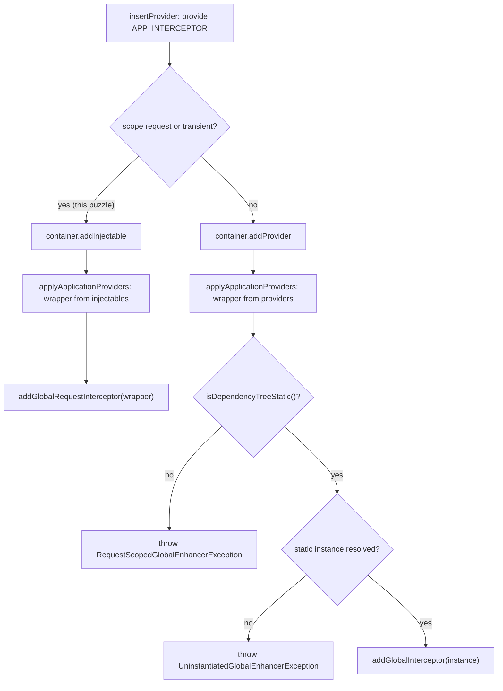

# nest-architecture-002: A request-scoped global interceptor

**Answer:** b, its `InstanceWrapper` is passed to `ApplicationConfig.addGlobalRequestInterceptor`.

## The short version

The scope is decided once, when the provider is inserted during scanning. `insertProvider` reads `Scope.REQUEST` from the class, records it in `applicationProvidersApplyMap`, and registers the provider as an *injectable* instead of a normal provider. Later, `applyApplicationProviders` sees the recorded scope, looks the wrapper up in `injectables`, and hands the wrapper (not an instance) to the request-scoped registration method. It returns before any of the static-path checks that throw.

## Phase 1: `insertProvider` during the scan

`DependenciesScanner.insertProvider` is in `packages/core/scanner.ts` (line 480).

1. **Is it a custom provider?** `isCustomProvider` returns true when the object has a non-nil `provide` key. `{ provide: APP_INTERCEPTOR, useClass: AuditInterceptor }` does.

2. **Is the token one of the four global-enhancer tokens?** `getApplyProvidersMap()` has keys `APP_INTERCEPTOR`, `APP_PIPE`, `APP_GUARD` and `APP_FILTER`. `APP_INTERCEPTOR` is one of them, so the method does not return early with a plain `addProvider`.

3. **Work out the scope.**

   ```ts
   // packages/core/scanner.ts:495-498
   let scope = (provider as ClassProvider | FactoryProvider).scope;
   if (isNil(scope) && (provider as ClassProvider).useClass) {
     scope = getClassScope((provider as ClassProvider).useClass);
   }
   ```

   The provider object has no `scope` key, so `getClassScope(AuditInterceptor)` reads the `@Injectable` options metadata (`packages/core/helpers/get-class-scope.ts`) and returns `Scope.REQUEST`.

4. **Record it for later, and register it as an injectable.**

   ```ts
   // packages/core/scanner.ts:506-511
   this.applicationProvidersApplyMap.push({
     type,
     moduleKey: token,
     providerKey: providerToken,
     scope,
   });
   ```

   ```ts
   // packages/core/scanner.ts:529-532
   if (this.isRequestOrTransient(factoryOrClassProvider.scope!)) {
     return this.container.addInjectable(newProvider, token, enhancerSubtype);
   }
   this.container.addProvider(newProvider, token, enhancerSubtype);
   ```

   `providerToken` is a unique string, `` `${type} (UUID: ${uuid})` ``, so several modules can each register an `APP_INTERCEPTOR` without colliding.

## Phase 2: `applyApplicationProviders` after bootstrap

It is called from `packages/core/nest-factory.ts:251`, right after `dependenciesScanner.scan(module)` and `instanceLoader.createInstancesOfDependencies()`. For each recorded entry:

```ts
// packages/core/scanner.ts:717-725
if (this.isRequestOrTransient(scope!)) {
  instanceWrapper = getInstanceWrapper(
    moduleKey,
    providerKey,
    'injectables',
  )!;

  this.graphInspector.insertAttachedEnhancer(instanceWrapper);
  return applyRequestProvidersMap[type as string](instanceWrapper);
}
```

`applyRequestProvidersMap[APP_INTERCEPTOR]` is:

```ts
// packages/core/scanner.ts:791-792
[APP_INTERCEPTOR]: (interceptor: InstanceWrapper<NestInterceptor>) =>
  this.applicationConfig.addGlobalRequestInterceptor(interceptor),
```

## The two paths side by side



## What happens at request time

`ApplicationConfig` keeps the two kinds in separate arrays: `addGlobalInterceptor` pushes onto `globalInterceptors`, `addGlobalRequestInterceptor` pushes the wrapper onto `globalRequestInterceptors` (`packages/core/application-config.ts:92-94` and `112-116`). `InterceptorsContextCreator.getGlobalMetadata` returns only the static ones for the static context, and for a request context it resolves each wrapper for that request:

```ts
// packages/core/interceptors/interceptors-context-creator.ts:114-120
const scopedInterceptors = iterate(scopedInterceptorWrappers)
  .map(wrapper =>
    wrapper.getInstanceByContextId(
      this.getContextId(contextId, wrapper),
      inquirerId,
    ),
  )
```

That is why a wrapper is stored instead of an instance. A request-scoped class has no single shared instance. A new one is created for each request context.

## Why the other choices are wrong

| Choice | Why it is wrong |
|---|---|
| a, shared instance to `addGlobalInterceptor` | That is the static path. It is reached only when `isRequestOrTransient(scope)` is false. Here the scope is `REQUEST`, so the method returns earlier, and a request-scoped class has no shared instance to pass. |
| c, `RequestScopedGlobalEnhancerException` | This is thrown only on the static path, when an enhancer *registered as static* has a dependency tree that is not static, for example a static interceptor that injects a request-scoped service. Here the enhancer itself is request-scoped, so the scope is recorded correctly and the static checks are never reached. |
| d, ignored | The request-scoped path exists precisely to support this case. There are four `addGlobalRequest*` methods, one for each enhancer token. |

The exception name makes choice c tempting. Read its guard: `if (!instanceWrapper.isDependencyTreeStatic())` sits after the `return` of the request-scoped branch.

## Takeaways

- When a decision is made in one phase and acted on in another, look for the record that links them. Here it is `applicationProvidersApplyMap`, with the `scope` field written at scan time and read after bootstrap.
- In a DI container, "request-scoped" usually means "store a recipe (wrapper), not a value (instance)." Check what type a registration method takes.
- An exception's name tells you the topic, not the condition. Read the code that throws it before picking it as an answer.
