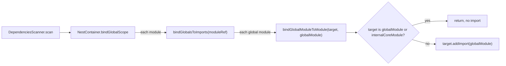

# nest-find-002: Skipping the global module binding

**Answer:** `packages/core/injector/container.ts`, lines 336 to 338: the `if (target === globalModule || target === this.internalCoreModule) { return; }` block in `NestContainer.bindGlobalModuleToModule`. A selection is accepted if it covers 336–338 and stays inside 335–340.

## The code

```ts
// packages/core/injector/container.ts:335-340
public bindGlobalModuleToModule(target: Module, globalModule: Module) {
  if (target === globalModule || target === this.internalCoreModule) {
    return;
  }
  target.addImport(globalModule);
}
```

Line 336 is the condition, 337 the `return`, 338 the closing brace. The two kinds of target are named by the two sides of `||`.

## How to navigate there

1. **Open the method.** Search `packages/core/injector/container.ts` for `bindGlobalModuleToModule`. It is five lines long, so the "early return" is easy to spot: it is the first statement in the body, as the hint says.

2. **Understand who calls it, to see why the guard is needed.**

   ```ts
   // packages/core/injector/container.ts:325-333
   public bindGlobalScope() {
     this.modules.forEach(moduleRef => this.bindGlobalsToImports(moduleRef));
   }

   public bindGlobalsToImports(moduleRef: Module) {
     this.globalModules.forEach(globalModule =>
       this.bindGlobalModuleToModule(moduleRef, globalModule),
     );
   }
   ```

   This is a full cross product: every module times every global module. Global modules are themselves in `this.modules`, so the loop will at some point pass a global module as both `target` and `globalModule`. `bindGlobalScope` is the last call in `DependenciesScanner.scan`.

3. **Work out what each side of the condition excludes.**
   - `target === globalModule`: a global module would otherwise import itself.
   - `target === this.internalCoreModule`: the internal core module (registered by `DependenciesScanner.registerCoreModule` through `registerCoreModuleRef`, line 354) is skipped as a target. It is decorated with `@Global()` in `packages/core/injector/internal-core-module/internal-core-module.ts:16`, so it is also one of the global modules that gets bound *into* every other module. The guard only stops other global modules from being imported *into* it.

## What the binding does



`Module.addImport` (`packages/core/injector/module.ts:540`) just adds the module to the target's `_imports` set. After this, the injector can resolve a global module's exported providers from any module, as if every module had listed it in `imports`.

## Why other selections are wrong

| Lines | Code | Why it is not the answer |
|---|---|---|
| 335 | method signature | Inside the window, so including it is fine, but on its own it is not the early return. |
| 336 only | the `if` condition | The prompt asks for the lines that make up the return, including the condition. The `return` and its closing brace are part of it. |
| 337 only | `return;` | Missing the condition. |
| 339 | `target.addImport(globalModule);` | This is the binding itself, the statement the guard protects. It runs when the guard does not return. |
| 325–333 | `bindGlobalScope`, `bindGlobalsToImports` | They loop and delegate. Neither has an early return. They are also outside the window. |
| `scanner.ts`, `scanForModules` | `this.container.bindGlobalsToImports(moduleInstance)` | Another caller, used for lazily loaded modules. It is not the method the prompt names. |

## Background

Global modules are an opt-in shortcut: mark a module `@Global()` (or return `global: true` from a dynamic module) and its exports become visible everywhere. `NestContainer.addModule` records such modules in `globalModules` (lines 176-182) and also sets their `distance` to `Number.MAX_VALUE`, so their lifecycle hooks run first. Instead of special-casing globals during resolution, Nest rewrites the module graph: it adds the global module as an import of every other module. That keeps the injector's lookup simple. It only has to follow `imports`.

## Takeaways

- A guard at the top of a method often only makes sense once you read the loop that calls it. A cross product of "all X times all Y" usually needs a "skip self" check.
- Read both sides of an `||` guard separately and ask which case each one handles.
- Some framework features (like "global") are implemented by rewriting a data structure once at startup, instead of adding checks on every lookup.
