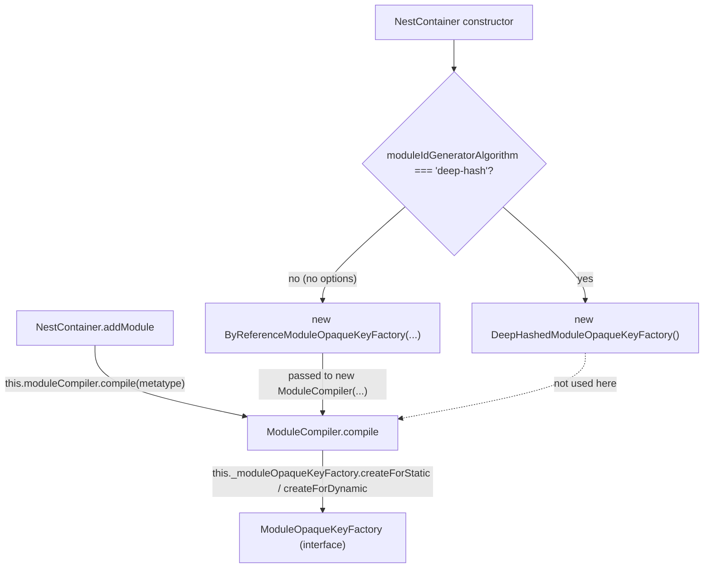

# nest-find-003: Who makes the module token

**Answer:** `packages/core/injector/opaque-key-factory/by-reference-module-opaque-key-factory.ts`

## Why this puzzle is tricky

The call site in `addModule` goes through two layers of indirection, and the second one is an interface. Reading forward from `addModule` you reach `this._moduleOpaqueKeyFactory.createForStatic(...)` and stop, because the field's type is `ModuleOpaqueKeyFactory`, an interface with two implementations. To know which class runs, you have to find where the object was created and which branch the configuration takes.



## How to navigate there

1. **Start at the token in `addModule`.** In `packages/core/injector/container.ts`:

   ```ts
   // packages/core/injector/container.ts:108-110
   const { type, dynamicMetadata, token } =
     await this.moduleCompiler.compile(metatype);
   if (this.modules.has(token)) {
   ```

   The token comes from `ModuleCompiler.compile`, so `ModuleCompiler` only *asks* for it.

2. **Read `ModuleCompiler.compile`** in `packages/core/injector/compiler.ts`. It calls `this._moduleOpaqueKeyFactory.createForDynamic(...)` for a dynamic module and `createForStatic(...)` otherwise (lines 30-38). The field comes from the constructor:

   ```ts
   // packages/core/injector/compiler.ts:11-13
   constructor(
     private readonly _moduleOpaqueKeyFactory: ModuleOpaqueKeyFactory,
   ) {}
   ```

   Go to definition on `ModuleOpaqueKeyFactory` lands on an interface, so this is a dead end. Switch to "who constructs `ModuleCompiler`?"

3. **Find the construction.** The hint says it happens when the container is constructed:

   ```ts
   // packages/core/injector/container.ts:52-60
   const moduleOpaqueKeyFactory =
     this._contextOptions?.moduleIdGeneratorAlgorithm === 'deep-hash'
       ? new DeepHashedModuleOpaqueKeyFactory()
       : new ByReferenceModuleOpaqueKeyFactory({
           keyGenerationStrategy: this._contextOptions?.snapshot
             ? 'shallow'
             : 'random',
         });
   this.moduleCompiler = new ModuleCompiler(moduleOpaqueKeyFactory);
   ```

4. **Fix the configuration.** `NestFactory.create(AppModule)` with no options:

   ```ts
   // packages/core/nest-factory.ts:93-98
   const [httpServer, appOptions] = this.isHttpServer(serverOrOptions!)
     ? [serverOrOptions, options]
     : [await this.createHttpAdapter(), serverOrOptions];

   const applicationConfig = new ApplicationConfig();
   const container = new NestContainer(applicationConfig, appOptions);
   ```

   `serverOrOptions` is `undefined`, so `isHttpServer` is false and `appOptions` is `undefined`. In the container constructor, `this._contextOptions?.moduleIdGeneratorAlgorithm` is `undefined`, not `'deep-hash'`, so the `ByReferenceModuleOpaqueKeyFactory` branch is taken, with `keyGenerationStrategy: 'random'`.

5. **Follow the import to the file.** `container.ts:18` imports it from `./opaque-key-factory/by-reference-module-opaque-key-factory.js`. The class there builds the string in `getOrCreateModuleId`:

   ```ts
   // packages/core/injector/opaque-key-factory/by-reference-module-opaque-key-factory.ts:40-42
   let moduleId: string;
   if (this.keyGenerationStrategy === 'random') {
     moduleId = this.generateRandomString();
   ```

## What the by-reference strategy does

The token is tied to the module *reference*, not to its contents:

```ts
// by-reference-module-opaque-key-factory.ts:35-38 and 50-51
// Own property only: a subclass would inherit the id of the module it extends.
if (Object.prototype.hasOwnProperty.call(originalRef, K_MODULE_ID)) {
  return originalRef[K_MODULE_ID];
}
...
originalRef[K_MODULE_ID] = moduleId;
return moduleId;
```

The first time a module class (or dynamic-module object) is seen, it gets a random id stored on it under a private `Symbol`. Every later `compile` of the same reference returns the same id, which is how `addModule` recognizes a module it has already registered (`this.modules.has(token)`). Because the id is stored on `originalRef`, which for a dynamic module is the object returned by something like `forRoot({...})`, two separate calls produce two distinct objects and so two distinct tokens.

| Strategy | Chosen when | Token based on |
|---|---|---|
| `ByReferenceModuleOpaqueKeyFactory`, `'random'` | default | identity of the reference, random string |
| `ByReferenceModuleOpaqueKeyFactory`, `'shallow'` | `snapshot: true` | random string plus a SHA-256 of the class source or dynamic metadata |
| `DeepHashedModuleOpaqueKeyFactory` | `moduleIdGeneratorAlgorithm: 'deep-hash'` | a hash of the module class's id and name, plus the serialized dynamic metadata for a dynamic module |

## Why the other files are wrong

| File | Why it is wrong |
|---|---|
| `packages/core/injector/opaque-key-factory/deep-hashed-module-opaque-key-factory.ts` | Defines `DeepHashedModuleOpaqueKeyFactory`. It also builds token strings, but it is used only when `moduleIdGeneratorAlgorithm` is `'deep-hash'`. With no options, it is never constructed. |
| `packages/core/injector/opaque-key-factory/interfaces/module-opaque-key-factory.interface.ts` | Declares the `ModuleOpaqueKeyFactory` interface. It has no implementation, and the prompt excludes it by name. |
| `packages/core/injector/compiler.ts` | Defines `ModuleCompiler`, which calls `createForStatic` or `createForDynamic` and passes the token on. It asks for the token. It does not build it. |
| `packages/core/injector/container.ts` | Chooses and constructs the factory, and stores modules by token. The string is built in the factory's file. |
| `packages/core/nest-factory.ts` | Creates the container and passes the options. It decides the configuration, not the token. |
| `packages/core/injector/module.ts` | `Module` holds the token as a property (`moduleRef.token = token` in `setModule`). It does not create it. |

## Takeaways

- When "go to definition" lands on an interface, switch questions: find where the object stored in that field is constructed. Constructor injection moves the answer out of the file you are reading.
- A configuration-dependent answer needs the default path traced explicitly. Here `undefined?.moduleIdGeneratorAlgorithm === 'deep-hash'` is false, so the `else` branch wins.
- Strategy classes behind a shared interface are a common extension point. The constructor that picks one is usually the place where a new strategy would be wired in.
