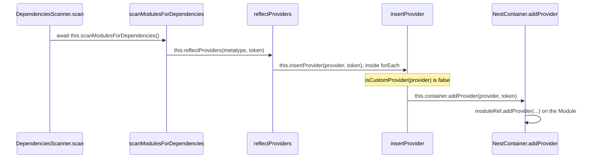

# nest-trace-001: From scan to a registered provider

**Answer:** `DependenciesScanner.scan` -> `scanModulesForDependencies` -> `reflectProviders` -> `insertProvider` -> `NestContainer.addProvider`

- `packages/core/scanner.ts#DependenciesScanner.scan`
- `packages/core/scanner.ts#DependenciesScanner.scanModulesForDependencies`
- `packages/core/scanner.ts#DependenciesScanner.reflectProviders`
- `packages/core/scanner.ts#DependenciesScanner.insertProvider`
- `packages/core/injector/container.ts#NestContainer.addProvider`

## Two passes over the module graph

The hint is the key to this trace. `scan` does not read providers while it discovers modules. It works in passes:

```text
DependenciesScanner.scan(AppModule)                        scanner.ts:88
├─ registerCoreModule()          pass 0: the internal core module
├─ scanForModules({...})         pass 1: walk imports, create every Module (addModule)
├─ scanModulesForDependencies()  pass 2: for each Module, read its metadata   ◀── providers live here
│   ├─ reflectImports
│   ├─ reflectProviders  → insertProvider → NestContainer.addProvider
│   ├─ reflectControllers
│   └─ reflectExports
├─ addScopedEnhancersMetadata()
├─ calculateModulesDistance()
└─ container.bindGlobalScope()
```

Pass 1 has to finish first, because a provider is added *to a module*, and `NestContainer.addProvider` throws `UnknownModuleException` if the module token is not registered yet.



## How to navigate there

1. **`scan`** (`packages/core/scanner.ts:88`). Read the body top to bottom. After `registerCoreModule` and `scanForModules`, line 97 is `await this.scanModulesForDependencies();`. The name says "dependencies", and the hint says metadata is read in a separate pass, so follow it.

2. **`scanModulesForDependencies`** (line 223) loops over every registered module:

   ```ts
   // packages/core/scanner.ts:226-231
   for (const [token, { metatype }] of modules) {
     await this.reflectImports(metatype, token, metatype.name);
     this.reflectProviders(metatype, token);
     this.reflectControllers(metatype, token);
     this.reflectExports(metatype, token);
   }
   ```

3. **`reflectProviders`** (line 251) reads the `providers` metadata and calls `insertProvider` inside a `forEach` callback. The prompt says a call inside an inline callback counts as part of its enclosing function, so this is a direct call from `reflectProviders`:

   ```ts
   // packages/core/scanner.ts:260-264
   if (provider === undefined) {
     throw new UndefinedModuleEntryException(module, 'providers', index);
   }
   this.insertProvider(provider, token);
   if (!this.isCustomProvider(provider)) {
   ```

4. **`insertProvider`** (line 480). The prompt fixes the provider as a plain class, so the first check decides everything:

   ```ts
   // packages/core/scanner.ts:480-484
   public insertProvider(provider: Provider, token: string) {
     const isCustomProvider = this.isCustomProvider(provider);
     if (!isCustomProvider) {
       return this.container.addProvider(provider, token);
     }
   ```

   `isCustomProvider` checks for a non-nil `provide` key. A class has none, so it returns `false` and the method calls `addProvider` right away.

5. **`NestContainer.addProvider`** (`packages/core/injector/container.ts:253`) looks up the module by token and calls `moduleRef.addProvider(...)`. This is the `NestContainer` method the prompt ends at.

## Why other candidates are wrong

| Candidate | Why it is wrong |
|---|---|
| `scanForModules`, `insertOrOverrideModule`, `insertModule` | Pass 1. They lead to `NestContainer.addModule`, which creates the module. They never read `providers`. |
| `registerCoreModule` | Registers the internal core module. It also goes through `scanForModules`, not `reflectProviders` for the app's module. |
| `reflectImports`, `reflectControllers`, `reflectExports` | Siblings of `reflectProviders` in the same loop. They handle other metadata keys. |
| `reflectMetadata` | Called from `reflectProviders` to read the metadata array. It returns the list and never reaches `addProvider`. |
| `isCustomProvider` | Called from `insertProvider` as a check. It returns a boolean. |
| `reflectDynamicMetadata` -> `reflectInjectables` -> `insertInjectable` -> `NestContainer.addInjectable` | Also reached from `reflectProviders` for a plain class, *after* `insertProvider`. It registers the class's enhancers (guards, interceptors, filters, pipes) as injectables, not the provider itself. |
| `NestContainer.addInjectable` from `insertProvider` | Used only for custom providers whose token is `APP_GUARD`, `APP_PIPE`, `APP_INTERCEPTOR` or `APP_FILTER` and whose scope is request or transient. A plain class takes the first `return`. |
| `Module.addProvider` (`injector/module.ts`) | Called by `NestContainer.addProvider`. It is one step past the end condition, which asks for the `NestContainer` method. |
| `addScopedEnhancersMetadata`, `calculateModulesDistance`, `bindGlobalScope` | Called by `scan` after pass 2. They do not add providers. |

## Design notes

- **Scanning vs. instantiating.** Scanning only records *what* exists: modules, providers, imports. Nothing is instantiated here. Instances are created later by `InstanceLoader.createInstancesOfDependencies`, called from `NestFactory` after `scan` returns (`packages/core/nest-factory.ts:250`).
- **The container wraps the module call.** `insertProvider` goes through `NestContainer.addProvider` rather than calling the `Module` directly. The container method looks the module up by token, throws `UnknownModuleException` if it is missing, and after `moduleRef.addProvider(...)` also passes the new wrapper to `DiscoverableMetaHostCollection.inspectProvider` (line 268, defined in `packages/core/discovery/`).

## Takeaways

- Framework bootstrap code is usually several passes over the same graph. When a step seems to be missing, look for a later pass.
- A trace that "starts at X with a fixed input" usually has one branch that depends on that input. Here it is `isCustomProvider`, and it decides the whole tail of the chain.
- Calls inside `forEach` callbacks are easy to miss when you scan for `this.` calls at the top level of a method body. Read the callbacks too.
