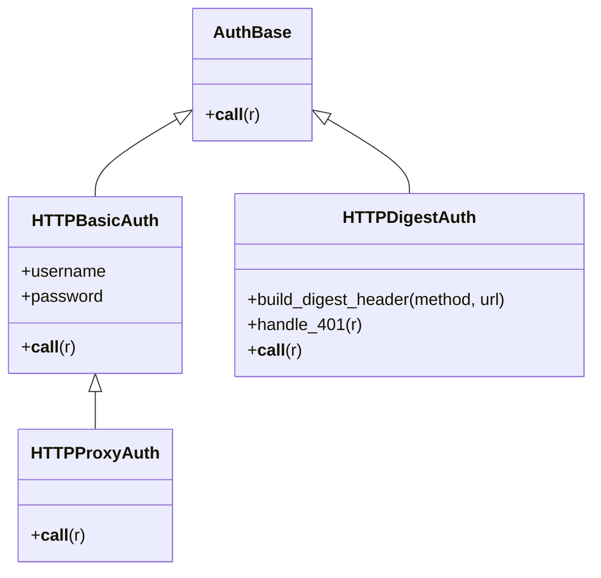

# requests-architecture-001: Concrete authentication classes

**Answer:** `src/requests/auth.py#HTTPBasicAuth`, `src/requests/auth.py#HTTPProxyAuth`, `src/requests/auth.py#HTTPDigestAuth`

## The shape of the hierarchy

`src/requests/auth.py` defines four classes. One is the base, two inherit from it directly, and one inherits through a sibling:



## How to navigate there

1. Open `src/requests/auth.py` and scan for `class` statements. There are only four, and they sit close together: `AuthBase` (line 78), `HTTPBasicAuth` (85), `HTTPProxyAuth` (116) and `HTTPDigestAuth` (124).
2. Identify the base. Its docstring says so, but the code says it too: `AuthBase.__call__` does nothing except raise.

   ```python
   # src/requests/auth.py:78-82
   class AuthBase:
       """Base class that all auth implementations derive from"""

       def __call__(self, r: PreparedRequest) -> PreparedRequest:
           raise NotImplementedError("Auth hooks must be callable.")
   ```

3. Read each class header for its base list:
   - `class HTTPBasicAuth(AuthBase):` (line 85), direct.
   - `class HTTPProxyAuth(HTTPBasicAuth):` (line 116), indirect through `HTTPBasicAuth`.
   - `class HTTPDigestAuth(AuthBase):` (line 124), direct.

That gives three derived classes, matching the "Select all 3" count.

## What each one actually does

| Class | Base | Header it sets in `__call__` | How |
|---|---|---|---|
| `HTTPBasicAuth` | `AuthBase` | `Authorization` | `_basic_auth_str(self.username, self.password)` (line 112) |
| `HTTPProxyAuth` | `HTTPBasicAuth` | `Proxy-Authorization` | same helper, different header (line 120) |
| `HTTPDigestAuth` | `AuthBase` | `Authorization`, only once it has a nonce | registers `handle_401` and `handle_redirect` response hooks (lines 339-340) |

`HTTPProxyAuth` is a good example of why it inherits from `HTTPBasicAuth` and not from `AuthBase`: it reuses the `__init__`, `__eq__` and `__ne__` that store and compare `username`/`password`, and overrides only `__call__`:

```python
# src/requests/auth.py:116-121
class HTTPProxyAuth(HTTPBasicAuth):
    """Attaches HTTP Proxy Authentication to a given Request object."""

    def __call__(self, r: PreparedRequest) -> PreparedRequest:
        r.headers["Proxy-Authorization"] = _basic_auth_str(self.username, self.password)
        return r
```

## Why the extension point is "a callable", not "a subclass"

The prompt describes auth as pluggable through any callable. You can see this in `PreparedRequest.prepare_auth` in `src/requests/models.py`:

```python
# src/requests/models.py:683-691
            if isinstance(auth, tuple) and len(auth) == 2:  # type: ignore[arg-type]  # pyright widens tuple from Callable in AuthType
                # special-case basic HTTP auth
                auth_handler = HTTPBasicAuth(*auth)  # type: ignore[arg-type]  # pyright widens tuple from Callable in AuthType
            else:
                # TODO: can be fixed by flipping the conditionals
                auth_handler = cast("Callable[..., PreparedRequest]", auth)

            # Allow auth to make its changes.
            r = auth_handler(self)
```

There is no `isinstance(auth, AuthBase)` check anywhere. A 2-tuple is turned into `HTTPBasicAuth`, and anything else is simply called with the request. `AuthBase` exists to document the contract and give a clear error if a subclass forgets `__call__`. Subclassing it is a convention, not a requirement. The `AuthType` alias in `src/requests/_types.py` (line 137) spells this out: `tuple[str, str] | AuthBase | Callable[[PreparedRequest], PreparedRequest] | None`.

## Why the other candidates are wrong

- **`AuthBase`.** It is the base class the prompt tells you to exclude. Selecting it gives four items instead of three.
- **Only `HTTPBasicAuth` and `HTTPDigestAuth`.** These are the two that name `AuthBase` in their header. Stopping there misses `HTTPProxyAuth`, which derives from it through `HTTPBasicAuth`. The prompt's "directly or through another class in the file" is there to include it.
- **`_basic_auth_str`.** It is the helper both Basic classes call to build the `Basic <base64>` string, but it is a module-level function, not a class.
- **Classes outside `auth.py`.** Test helpers in `tests/` (and anything a user writes) can also derive from `AuthBase`, but the prompt limits the search to `src/requests/auth.py`. `models.py` and `_types.py` only import the auth classes; they don't define new ones.
- **`HTTPDigestAuth`'s helper methods** (`build_digest_header`, `handle_401`, `init_per_thread_state`). These are methods on one of the answers, not classes.

## Takeaways

- To map a class hierarchy in Python, read the base list in every `class X(...)` header in the scope, then follow chains. Don't stop at classes that name the root directly.
- A base class whose only method raises `NotImplementedError` is usually documenting an interface. Check how callers actually use it (here, `prepare_auth` just calls the object) before assuming subclassing is enforced.
- Small subclasses that override one method, like `HTTPProxyAuth`, are often there to reuse state handling from a sibling. They are easy to miss when you skim.
