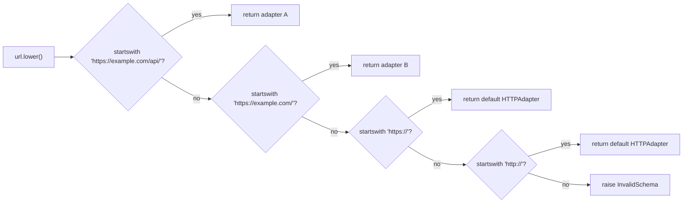

# requests-architecture-002: Choosing among mounted adapters

**Answer:** option `c`, the adapter registered under the longest matching prefix.

## The short version

`get_adapter` returns the **first** match in dictionary order. `mount` keeps the dictionary **sorted by descending prefix length**. Put together, the first match is always the longest matching prefix. Neither method alone tells you the rule; you need to read both.

## How to navigate there

1. Open `src/requests/sessions.py` and jump to `Session.get_adapter` (line 870). It is short:

   ```python
   # src/requests/sessions.py:876-881
           for prefix, adapter in self.adapters.items():
               if url.lower().startswith(prefix.lower()):
                   return adapter

           # Nothing matches :-/
           raise InvalidSchema(f"No connection adapters were found for {url!r}")
   ```

   There is no comparison of lengths here. It returns on the first hit. So the answer depends on the iteration order of `self.adapters`, and you have to find out what controls that order.

2. Find where `self.adapters` is written. Searching for `self.adapters` leads to `Session.__init__` (line 501, `self.adapters = OrderedDict()`) and to `Session.mount` (line 888):

   ```python
   # src/requests/sessions.py:893-897
           self.adapters[prefix] = adapter
           keys_to_move = [k for k in self.adapters if len(k) < len(prefix)]

           for key in keys_to_move:
               self.adapters[key] = self.adapters.pop(key)
   ```

   After inserting the new prefix, every key **shorter** than it is popped and re-inserted. Re-inserting a key into a dict puts it at the end. So all shorter keys end up behind the new one, in their previous relative order.

3. Confirm the starting state. `Session.__init__` mounts `"https://"` and then `"http://"` (lines 502-503). That list is already in descending length order (8 characters, then 7).

## Worked example

Start from a fresh `Session()` and mount two more prefixes. The table shows `self.adapters` key order after each step.

| Step | Call | Keys in order | Why |
|---|---|---|---|
| 1 | `__init__` | `https://`, `http://` | default mounts |
| 2 | `mount("https://example.com/api/", A)` | `https://example.com/api/`, `https://`, `http://` | both old keys are shorter (24 chars vs 8 and 7), so they move to the end |
| 3 | `mount("https://example.com/", B)` | `https://example.com/api/`, `https://example.com/`, `https://`, `http://` | the 24-char key is not shorter than 20, so it stays in front; the two short keys move |

Now `get_adapter("https://example.com/api/users")` walks the keys in that order. The first one it tests, `https://example.com/api/`, matches, so it returns adapter `A`. `get_adapter("https://example.com/other")` skips the first key, matches `https://example.com/`, and returns `B`. Mount order (A before B) played no part. If you swap steps 2 and 3, `mount` still ends with the 24-char key first.



## Why the other options are wrong

- **a (first mounted wins).** The default `https://` adapter is always mounted first, in `__init__`. If first-mounted won, no user-mounted `https://...` prefix could ever take effect. `mount` actively moves older, shorter keys behind newer, longer ones.
- **b (most recently mounted wins).** A newly mounted key goes to the end of the dict only until the shorter keys are moved behind it. It does not move ahead of keys that are longer. Mount `"https://"` again after step 3 and it stays behind both `example.com` prefixes, because assigning an existing key keeps its position and only shorter keys (here `http://`) are moved.
- **d (scheme only).** `get_adapter` compares the whole prefix string with `startswith`. In the example, `https://example.com/api/` and `https://example.com/` share the scheme but select different adapters. The host and path parts of a prefix clearly matter.

## Details worth noticing

- **Matching is case-insensitive** because both sides are lowercased (line 877), but it is a plain string prefix test, not URL-aware. A prefix of `https://example.com` (no trailing slash) also matches `https://example.community/`. That is why mounted prefixes usually end in `/`.
- **No match raises.** If nothing matches, for example a `ftp://` URL with only the defaults mounted, `get_adapter` raises `InvalidSchema`.
- **The ordering is an invariant kept on write.** `get_adapter` runs on every `Session.send` (line 778), while `mount` is rare. Paying the sorting cost in `mount` keeps the hot path a simple first-match loop.

## Takeaways

- When a lookup returns "the first match", the real rule lives wherever the collection is built. Search for writes to the collection, not just reads.
- `dict` (and `OrderedDict`) iteration order is insertion order, and `d[k] = d.pop(k)` is a common idiom for moving a key to the end. Recognising it makes code like `mount` readable at a glance.
- Docstrings can point you in the right direction ("Adapters are sorted in descending order by prefix length"), but confirm with the code, as done above.
