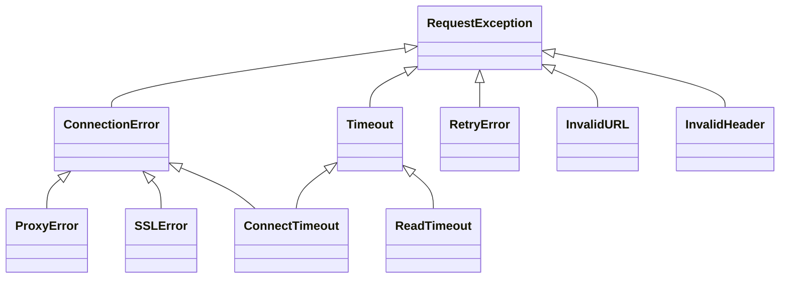

# requests-architecture-003: Connection errors raised by the adapter

**Answer:** `src/requests/exceptions.py#ConnectTimeout`, `src/requests/exceptions.py#ProxyError`, `src/requests/exceptions.py#SSLError`

## The approach

This is a two-step set question. First collect every requests exception class raised in the body of `HTTPAdapter.send`. Then keep the ones that are subclasses of `requests.exceptions.ConnectionError`. Neither file alone gives the answer.

## Step 1: what `send` raises

Open `HTTPAdapter.send` (`src/requests/adapters.py:634`) and read its `raise` statements. There are two `try` blocks:

```python
# src/requests/adapters.py:661-666
        try:
            conn = self.get_connection_with_tls_context(
                request, verify, proxies=proxies, cert=cert
            )
        except LocationValueError as e:
            raise InvalidURL(e, request=request)
```

and the big one around `conn.urlopen(...)`:

```python
# src/requests/adapters.py:710-746 (abridged)
        except (ProtocolError, OSError) as err:
            raise ConnectionError(err, request=request)

        except MaxRetryError as e:
            if isinstance(e.reason, ConnectTimeoutError):
                # TODO: Remove this in 3.0.0: see #2811
                if not isinstance(e.reason, NewConnectionError):
                    raise ConnectTimeout(e, request=request)

            if isinstance(e.reason, ResponseError):
                raise RetryError(e, request=request)

            if isinstance(e.reason, _ProxyError):
                raise ProxyError(e, request=request)

            if isinstance(e.reason, _SSLError):
                # This branch is for urllib3 v1.22 and later.
                raise SSLError(e, request=request)

            raise ConnectionError(e, request=request)
        ...
        except (_SSLError, _HTTPError) as e:
            if isinstance(e, _SSLError):
                raise SSLError(e, request=request)
            elif isinstance(e, ReadTimeoutError):
                raise ReadTimeout(e, request=request)
            elif isinstance(e, _InvalidHeader):
                raise InvalidHeader(e, request=request)
            else:
                raise
```

The names matter here. `ProxyError` and `SSLError` without an underscore are the requests classes, imported from `.exceptions` (lines 39-50). The urllib3 classes with the same names are imported under aliases: `_ProxyError`, `_SSLError`, `_HTTPError`, `_InvalidHeader` (lines 27-30). `ConnectionError` is also the requests class, which shadows Python's built-in `ConnectionError` in this module.

The requests classes raised in `send` are: `InvalidURL`, `ConnectionError`, `ConnectTimeout`, `RetryError`, `ProxyError`, `SSLError`, `ReadTimeout`, `InvalidHeader`. The plain `ValueError` for a bad timeout tuple (line 686) and the bare `raise` (line 746) are not requests classes.

## Step 2: which of those are `ConnectionError`s

Now check every base in each class header in `src/requests/exceptions.py`:



| Raised class | Header | Caught by `except ConnectionError`? |
|---|---|---|
| `ConnectionError` | line 70, `(RequestException)` | yes, but excluded by the prompt |
| `ProxyError` | line 74, `(ConnectionError)` | **yes** |
| `SSLError` | line 78, `(ConnectionError)` | **yes** |
| `ConnectTimeout` | line 91, `(ConnectionError, Timeout)` | **yes** |
| `ReadTimeout` | line 98, `(Timeout)` | no |
| `RetryError` | line 142, `(RequestException)` | no |
| `InvalidURL` | line 118, `(RequestException, ValueError)` | no |
| `InvalidHeader` | line 122, `(RequestException, ValueError)` | no |

That leaves three: `ConnectTimeout`, `ProxyError` and `SSLError`.

## Why `ConnectTimeout` has two bases

`ConnectTimeout(ConnectionError, Timeout)` is deliberately both. Its docstring notes that requests producing it are safe to retry, because the connection was never established. Code that catches `Timeout` gets both kinds of timeout (the `Timeout` docstring says so), and code that catches `ConnectionError` gets every failure to connect, including a timeout while connecting. `ReadTimeout` happens after the connection was made, so it is a `Timeout` but not a `ConnectionError`. The hint, "check every base class", points at this.

## Why the other candidates are wrong

- **`ReadTimeout`.** It is the closest trap: a timeout, raised in the same method, and next to `ConnectTimeout` in both files. But its only base is `Timeout`, so `except ConnectionError` doesn't catch it.
- **`RetryError`.** Raised in the same `MaxRetryError` branch as `ProxyError` and `SSLError`, but it derives straight from `RequestException`.
- **`InvalidURL`, `InvalidHeader`.** They derive from `RequestException` and `ValueError`, not `ConnectionError`.
- **`InvalidProxyURL`.** Imported into `adapters.py` and a subclass of `InvalidURL`, but it is raised in `get_connection_with_tls_context` and `get_connection`, not in `send` itself, and it isn't a `ConnectionError` anyway.
- **`InvalidSchema`.** Also imported in `adapters.py`, but the only `raise` of it in that file is the stand-in `SOCKSProxyManager` function used when SOCKS support isn't installed (line 67), not `send`.
- **`ConnectionError`.** Excluded by the prompt.
- **`Timeout` and `RequestException`.** Bases in the hierarchy, but `send` never raises them directly. `RequestException` is also the *parent* of `ConnectionError`, so `except ConnectionError` wouldn't catch it.
- **urllib3's `ProxyError` / `SSLError`.** Same names, but they are the third-party classes `send` catches (`_ProxyError`, `_SSLError`). They are not defined in `src/requests/exceptions.py`.

## Takeaways

- When a module imports two classes with the same name from different packages, check the aliases (`as _ProxyError`). Which name a `raise` uses decides which class it is.
- Multiple inheritance in exception hierarchies is a deliberate tool: `ConnectTimeout` belongs to two families so both kinds of `except` clause catch it. Always read every base.
- An adapter layer that translates third-party errors into your own hierarchy is a common design. It lets callers write `except requests.exceptions.ConnectionError` without knowing anything about urllib3.
