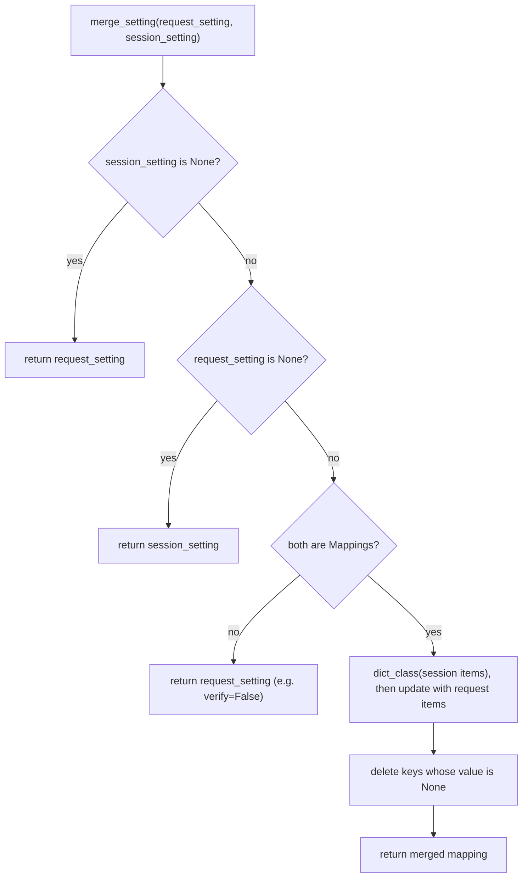

# requests-find-001: Merging request settings with session defaults

**Answer:** `src/requests/sessions.py#merge_setting`

## How a strong engineer would get there

The prompt gives you three strong filters: the file (`src/requests/sessions.py`), the kind (a module-level function, not a method), and a very specific behaviour (overlay request entries on session entries, then drop keys whose value is `None`).

1. **List the module-level functions.** In `sessions.py` they are `merge_setting` (line 76), `merge_hooks` (line 108) and, at the very bottom, the deprecated `session()` factory (line 908). Everything else is a method on `SessionRedirectMixin` or `Session`. Three candidates is a small enough list to read them all.
2. **Read for the `None` removal.** Only one of the three contains code that deletes keys:

   ```python
   # src/requests/sessions.py:96-105
       merged_setting = dict_class(to_key_val_list(session_setting))  # type: ignore[arg-type]  # isinstance narrows Any to Mapping[Unknown]
       merged_setting.update(to_key_val_list(request_setting))  # type: ignore[arg-type]

       # Remove keys that are set to None. Extract keys first to avoid altering
       # the dictionary during iteration.
       none_keys = [k for (k, v) in merged_setting.items() if v is None]
       for key in none_keys:
           del merged_setting[key]

       return merged_setting
   ```

   Session entries go in first, request entries are applied with `update` (so the request wins on conflicts), and then `None`-valued keys are removed.
3. **Confirm with callers.** The hint says `Session.prepare_request` calls the helper several times. It does, once each for headers, params and auth (lines 547-551). `Session.merge_environment_settings` also calls it four more times, for proxies, stream, verify and cert (lines 863-866).

## The full decision tree

The mapping merge is only the last branch. The earlier branches matter just as much for understanding how settings behave:



So for scalar settings like `verify` or `stream`, "the request wins if it said anything" (lines 84-94). For mappings like headers or params, the two are combined key by key.

## Why the `None` removal exists

It gives users a way to **remove** a session default for a single request. If a session sets `s.headers["Accept"] = "application/json"`, then `s.get(url, headers={"Accept": None})` overlays `None` onto that key, and the deletion step drops it, so the header is not sent at all. Without this step there would be no way to unset a session header per request short of copying and editing the session's headers.

The `dict_class` parameter is also worth noticing. `prepare_request` passes `dict_class=CaseInsensitiveDict` for headers (line 548), so `{"accept": None}` on the request also removes a session `"Accept"` header. Params and auth use the default `OrderedDict`.

## Why the other candidates are wrong

- **`merge_hooks`** (line 108). It has its own special cases: if either side's `"response"` list is empty it returns the other side unchanged (lines 118-122). In the general case it delegates to `merge_setting` (line 124). It contains no overlay or `None`-removal logic of its own, so it isn't "the function that combines" in the prompt's sense.
- **`session()`** (line 908). The only other module-level function. It just returns `Session()` and is kept for backward compatibility.
- **`Session.prepare_request`** and **`Session.merge_environment_settings`**. Both call `merge_setting`, but they are methods, and the prompt explicitly says "not a method". They orchestrate many settings; the per-setting merge happens in the helper.
- **`merge_cookies`**. It also merges request and session data, but it lives in `src/requests/cookies.py`, works on cookie jars rather than generic mappings, and doesn't drop `None` values. It is outside the file the prompt names.
- **`to_key_val_list`** (in `src/requests/utils.py`). `merge_setting` uses it to turn a mapping into a list of pairs before building the dict, but it doesn't combine anything.

## Takeaways

- When a prompt gives you a precise behaviour, search for the code that performs that behaviour (`del`, `is None`) rather than for a name. Names like `merge_*` can appear on several functions.
- Small "policy" helpers such as `merge_setting` are common in client libraries: one function encodes the precedence rule, and every setting goes through it. Once you find it, you understand the precedence of every option at once.
- Check the early-return branches of a merge helper. They often hold the rules people get wrong, like "a non-mapping request value replaces the session value entirely".
