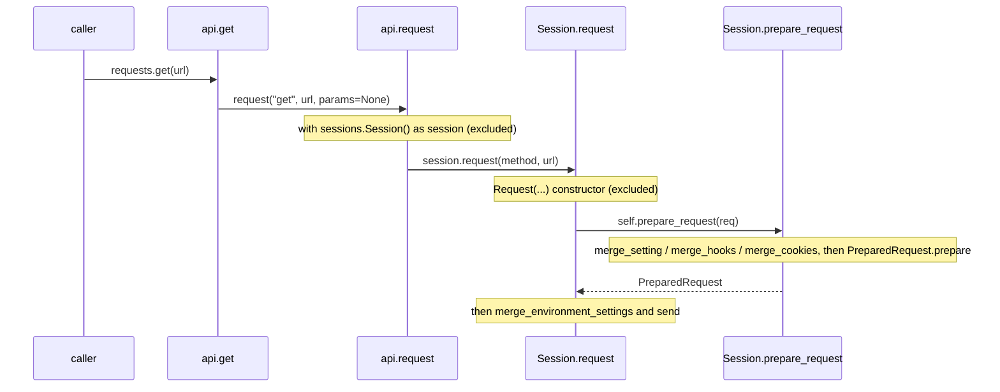

# requests-trace-001: From requests.get to a PreparedRequest

**Answer:** `src/requests/api.py#get` -> `src/requests/api.py#request` -> `src/requests/sessions.py#Session.request` -> `src/requests/sessions.py#Session.prepare_request`

## The call sequence



## Step by step

1. **`api.get`** (`src/requests/api.py:74`). The whole body is one line:

   ```python
   # src/requests/api.py:87
       return request("get", url, params=params, **kwargs)
   ```

   It calls the module-level `request` in the same file, not `Session.get`.

2. **`api.request`** (`src/requests/api.py:24`). It creates a short-lived session and delegates:

   ```python
   # src/requests/api.py:70-71
       with sessions.Session() as session:
           return session.request(method=method, url=url, **kwargs)
   ```

   `sessions.Session()` is a constructor and `__enter__`/`__exit__` are context-manager methods. The prompt excludes all three, so the next step is `Session.request`.

3. **`Session.request`** (`src/requests/sessions.py:557`). It builds a plain `Request` from the arguments (lines 623-634, a constructor, excluded) and then:

   ```python
   # src/requests/sessions.py:635
           prep = self.prepare_request(req)
   ```

4. **`Session.prepare_request`** (`src/requests/sessions.py:511`). This is the end condition. It merges the request's cookies with `self.cookies` (lines 531-533), falls back to netrc auth if nothing was given (lines 536-538), and passes merged values into `PreparedRequest.prepare`:

   ```python
   # src/requests/sessions.py:547-553
               headers=merge_setting(
                   request.headers, self.headers, dict_class=CaseInsensitiveDict
               ),
               params=merge_setting(request.params, self.params),
               auth=merge_setting(auth, self.auth),
               cookies=merged_cookies,
               hooks=merge_hooks(request.hooks, self.hooks),
   ```

   Headers, params, auth, cookies and hooks: exactly the five things the prompt lists.

## How to navigate it quickly

- Start from `get` in `api.py` and use "go to definition" on each call. Every hop in this chain is a single, obvious call, so the main work is deciding what to **skip**.
- The prompt's exclusions remove the noise: the `Session()` constructor and the `with` block in `api.request`, and the `Request(...)` constructor in `Session.request`.
- You know you've reached the end when the function's arguments to `PreparedRequest.prepare` are wrapped in `merge_*` calls. That is the "merge with the session's defaults" the prompt describes.

## Why the other candidates are wrong

- **`Session.get`** (`src/requests/sessions.py:655`). It is the obvious guess for "GET via a session", but `api.get` never calls it. `api.get` goes to `api.request`, which calls `Session.request` directly with `method="get"`. `Session.get` is only used when you call `session.get(...)` yourself.
- **`Session.send`** and **`Session.merge_environment_settings`**. Both are called from `Session.request`, but only *after* `prepare_request` returns (lines 641 and 651). `merge_environment_settings` merges proxies, stream, verify and cert, not headers, params, auth, cookies or hooks. `send` transmits an already-prepared request.
- **`PreparedRequest.prepare`** (`src/requests/models.py:424`). It is called by `prepare_request`, so it would be the next hop, not this one. It receives values that are already merged and has no access to the session, so it can't be the method that merges with session defaults. It is also not a Session method, which the prompt requires.
- **`Request.prepare`** (`src/requests/models.py:360`). It also produces a `PreparedRequest`, but from the `Request`'s own fields only, with no session involved. Nothing in this chain calls it.
- **`merge_setting` / `merge_hooks`**. They are helpers called from `prepare_request`; the prompt's end point is the Session method.
- **Including `Session.__enter__` or `Session.__init__`.** The prompt excludes context-manager methods and constructors. With them in, the sequence no longer matches.

## Background: why a throwaway Session?

`api.request` uses `with sessions.Session() as session:` even for a single call. The module-level helpers are just a convenience layer: all real work, including the defaults merge, lives on `Session`. The comment on lines 67-69 gives the reason for the `with`: closing the session promptly avoids leaving sockets open. The cost is that `requests.get` gets no connection reuse across calls, which is why long-running code should create one `Session` and reuse it.

## Takeaways

- Top-level convenience functions in libraries are usually thin shims. Expect them to delegate quickly to an object that holds state.
- A prompt's exclusions (constructors, context managers) tell you which calls to step over. Write the chain down and remove those before comparing.
- Separate "build the request" from "send the request". Here they're `prepare_request` and `send`, and `Session.request` is the method that calls both.
