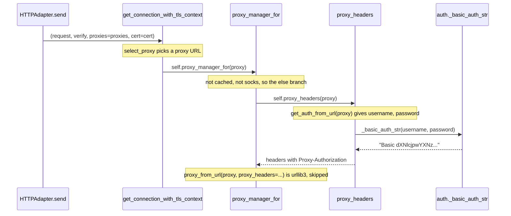
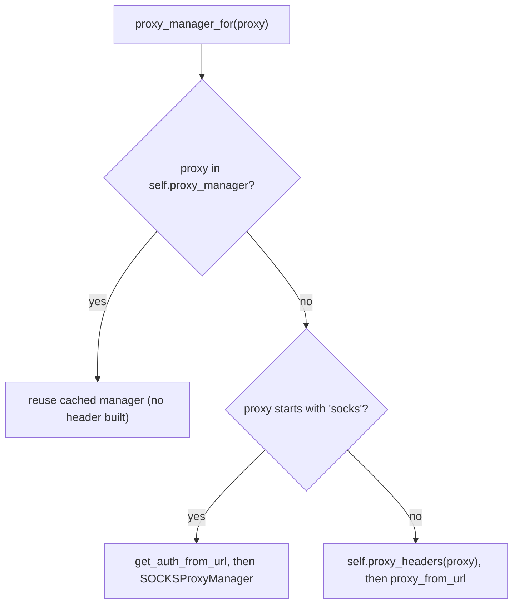

# requests-trace-002: Where proxy credentials become a header

**Answer:** `src/requests/adapters.py#HTTPAdapter.send` -> `src/requests/adapters.py#HTTPAdapter.get_connection_with_tls_context` -> `src/requests/adapters.py#HTTPAdapter.proxy_manager_for` -> `src/requests/adapters.py#HTTPAdapter.proxy_headers` -> `src/requests/auth.py#_basic_auth_str`

## The path



## Step by step

1. **`HTTPAdapter.send`** (`src/requests/adapters.py:634`). The first call that does real work is the connection lookup:

   ```python
   # src/requests/adapters.py:661-664
           try:
               conn = self.get_connection_with_tls_context(
                   request, verify, proxies=proxies, cert=cert
               )
   ```

   Everything after it (`cert_verify`, `request_url`, `add_headers`, the urllib3 `urlopen`) happens once the connection exists, so none of it can be on the path to building the proxy header.

2. **`get_connection_with_tls_context`** (line 455). It calls `select_proxy(request.url, proxies)` (line 483) and, because the prompt says the URL is routed through a proxy, enters the `if proxy:` branch:

   ```python
   # src/requests/adapters.py:492-500
           if proxy:
               proxy = prepend_scheme_if_needed(proxy, "http")
               proxy_url = parse_url(proxy)
               if not proxy_url.host:
                   raise InvalidProxyURL(
                       "Please check proxy URL. It is malformed "
                       "and could be missing the host."
                   )
               proxy_manager = self.proxy_manager_for(proxy)
   ```

   `select_proxy` and `prepend_scheme_if_needed` are requests functions in `utils.py`, but they only choose and normalize the proxy URL. They don't call onward toward the header, so they're not part of the chain. `parse_url` is urllib3.

3. **`proxy_manager_for`** (line 269). This is where the prompt's two assumptions decide the branch:



   "No proxy manager has been cached yet" rules out the first branch (line 281). "Not a SOCKS proxy" rules out the second (line 283). The `else` branch calls `self.proxy_headers(proxy)` on line 295.

4. **`proxy_headers`** (line 613):

   ```python
   # src/requests/adapters.py:626-632
           headers: dict[str, str] = {}
           username, password = get_auth_from_url(proxy)

           if username:
               headers["Proxy-Authorization"] = _basic_auth_str(username, password)

           return headers
   ```

   Because the proxy URL contains a username, the `if username:` branch runs.

5. **`_basic_auth_str`** (`src/requests/auth.py:34`). It encodes both parts as latin-1, joins them with `:`, base64-encodes the result and prefixes `"Basic "` (lines 65-73). This is the function that produces the `Basic ...` value, so the chain ends here.

## Why the other candidates are wrong

- **`HTTPAdapter.get_connection`** (line 512). Same structure, also calls `proxy_manager_for`, but it is deprecated and emits a `DeprecationWarning`. `send` calls `get_connection_with_tls_context`, not this.
- **`get_auth_from_url`** (`src/requests/utils.py`). Called from `proxy_headers`, and also from the SOCKS branch of `proxy_manager_for`. It only splits the username and password out of the URL. It doesn't build a header value, and it doesn't call `_basic_auth_str`, so it's a side branch, not a step.
- **The SOCKS path.** For a `socks5://` proxy, `proxy_manager_for` passes the credentials straight to `SOCKSProxyManager` (lines 284-293) and never calls `proxy_headers`. The prompt excludes it.
- **The cached path.** If `self.proxy_manager` already has the proxy, the stored manager is returned (lines 281-282) and no header is built on this call. That is why the prompt says nothing is cached.
- **`HTTPAdapter.request_url`** (line 565). It also checks for a proxy, but only to decide between a path and a full URL in the request line. It is called *after* the connection is obtained and never touches credentials.
- **`HTTPAdapter.add_headers`** (line 599). The name suggests headers, but the body is just `pass`. It is a hook for subclasses.
- **`SessionRedirectMixin.rebuild_proxies`** (`src/requests/sessions.py:334`). It also calls `_basic_auth_str` to set `Proxy-Authorization` (line 366), but it runs on redirects inside the session layer and isn't reachable from `HTTPAdapter.send`.
- **`HTTPProxyAuth.__call__`** (`src/requests/auth.py:119`). Another caller of `_basic_auth_str` for `Proxy-Authorization`, but it is user-supplied auth applied during request preparation, not called from the adapter.
- **`proxy_from_url`**. It receives the finished headers, but it is urllib3 code, which the prompt tells you to skip. It also comes after the header is built.

## Background: why build the header in the adapter?

The headers returned by `proxy_headers` are handed to urllib3's proxy manager (`proxy_from_url(proxy, proxy_headers=proxy_headers, ...)`, lines 296-303). The docstring on `proxy_headers` explains the reason: urllib3 then sends them to the proxy itself, including on the `CONNECT` request when tunnelling HTTPS, rather than inside the tunnel where the target server would see them. The result is cached per proxy URL in `self.proxy_manager`, which is why a header is built once per adapter and proxy, not once per request.

## Takeaways

- A trace prompt's assumptions ("not SOCKS", "not cached") usually map one-to-one to branches in the code. Find the function with those branches and the path becomes obvious.
- When several functions call the same helper (`_basic_auth_str` has four callers), start from the given entry point and follow only calls that are reachable from it.
- Methods documented as "only exposed for use when subclassing" (`proxy_manager_for`, `proxy_headers`, `request_url`, `add_headers`) are the adapter's extension points. They're often where the interesting work happens.
