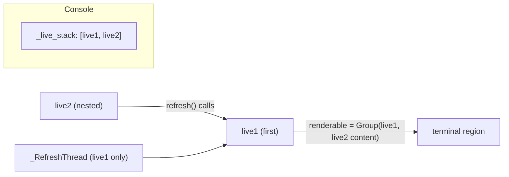

# rich-architecture-001: Two live displays on one console

**Answer:** d. The first Live draws a group made of the content of every Live on the console's stack, and refreshing the second Live only triggers a refresh of the first.

## How a strong engineer gets there

Start with how a Live registers itself, then see what each Live draws, then see what a refresh does.

### 1. Registration: `Console.set_live` keeps a stack

```python
# rich/console.py, lines 834-836
with self._lock:
    self._live_stack.append(live)
    return len(self._live_stack) == 1
```

Every Live is appended, and the return value only says whether it is the first one. Nothing raises. The docstring above this code mentions `errors.LiveError`, but the code never raises it, which is a good example of why the code, not the comment, is the evidence.

### 2. `Live.start`: the second Live stops early

```python
# rich/live.py, lines 122-124
if not self.console.set_live(self):
    self._nested = True
    return
```

A nested Live returns before it hides the cursor, redirects stdout, pushes a render hook, or starts a `_RefreshThread` (lines 128-143). Only the first Live does those things.

### 3. What the first Live draws: the `renderable` property

```python
# rich/live.py, lines 221-227
live_stack = self.console._live_stack
renderable: RenderableType
if live_stack and self is live_stack[0]:
    # The first Live instance will render everything in the Live stack
    renderable = Group(*[live.get_renderable() for live in live_stack])
else:
    renderable = self.get_renderable()
```

The first Live on the stack renders a `Group` of every Live's content, so the second one's content appears inside the first one's region.

### 4. What refreshing the second Live does: `Live.refresh`

```python
# rich/live.py, lines 247-251
self._live_render.set_renderable(self.renderable)
if self._nested:
    if self.console._live_stack:
        self.console._live_stack[0].refresh()
    return
```

A nested Live delegates to the first Live and returns. It never writes to the terminal itself.

## Structure



## Why the other options are wrong

- **a.** `set_live` appends and returns a boolean. It contains no `raise`. Only the docstring says `LiveError`.
- **b.** The nested Live returns from `start` before the `_RefreshThread` is created, and its `refresh` returns before any terminal output. It has no region of its own.
- **c.** The second Live's content is shown immediately, because the first Live includes it in its `Group` on every refresh. Nothing waits for the first Live to stop.
- **e.** The first Live keeps drawing, and it is the one that does all the drawing. The second never takes over.

## Background: why a stack and not a lock

Code that shows a `Progress` (which uses a `Live` internally) often runs inside other code that already has a `Live` or `Status` running. Refusing the second display would break that composition. Letting both draw would fight over cursor position, because each Live redraws by moving the cursor back up over its own last render. Rich solves this by keeping exactly one Live in charge of the terminal and letting nested ones become content inside it. When a nested Live stops, `Live.stop` prints its final content with `console.print` unless it is transient (lines 152-155).

## Takeaways

- For "what happens when two of X exist" questions, look for the shared registry (here `_live_stack`) and every place that reads its first element.
- Trust the code over docstrings. A `Raises:` section is a claim. A `raise` statement is evidence.
