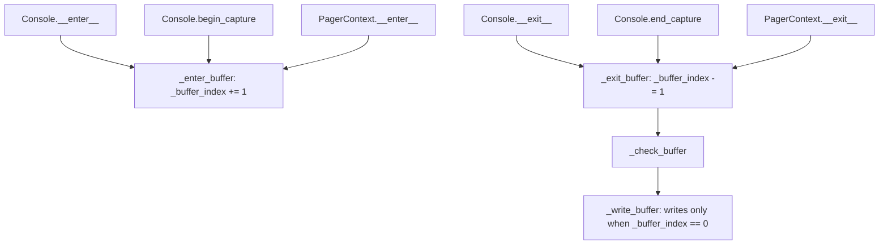

# rich-architecture-002: Leaving a buffer context

**Answer:** `Console.__exit__`, `Console.end_capture` and `PagerContext.__exit__`, all in `rich/console.py`.

## How a strong engineer gets there

1. Jump to `Console._exit_buffer` (line 817):

   ```python
   # rich/console.py, lines 817-820
   def _exit_buffer(self) -> None:
       """Leave buffer context, and render content if required."""
       self._buffer_index -= 1
       self._check_buffer()
   ```

2. Run *find references* on it. Outside the tests, three method bodies call it:

   ```python
   # rich/console.py, lines 862-864
   def __exit__(self, exc_type: Any, exc_value: Any, traceback: Any) -> None:
       """Exit buffer context."""
       self._exit_buffer()
   ```

   ```python
   # rich/console.py, lines 876-878 (Console.end_capture)
   render_result = self._render_buffer(self._buffer)
   del self._buffer[:]
   self._exit_buffer()
   ```

   ```python
   # rich/console.py, line 400 (last line of PagerContext.__exit__)
   self._console._exit_buffer()
   ```

3. Each of these has a matching "enter" that calls `_enter_buffer`: `Console.__enter__`, `Console.begin_capture` and `PagerContext.__enter__`.

## How the buffer works



`print`, `log`, `rule` and the other output methods append Segments to `self._buffer` inside `with self:`. Because the counter nests, a block like `with console: console.print(a); console.print(b)` writes both at once when the outer block exits. A capture or pager can take the buffered Segments out *before* calling `_exit_buffer`, so nothing reaches the terminal. That is why `end_capture` and `PagerContext.__exit__` both clear `self._buffer` first.

## Why plausible wrong answers are wrong

- **`Console.print`, `Console.log`, `Live.stop`, `Live.refresh`.** They use `with self:` or `with self.console:`. Python calls `Console.__exit__` for them, so their bodies never call `_exit_buffer` directly.
- **`Capture.__exit__`.** It calls `self._console.end_capture()`, which then calls `_exit_buffer`. That is one step removed.
- **`Console.update_screen_lines`.** It calls `_check_buffer` directly, skipping `_exit_buffer`, because it isn't leaving a buffer context.
- **`Console._enter_buffer`, `Console.__enter__`, `Console.begin_capture`.** They are the entering half of the pairs.

## Takeaways

- A counter plus "flush when it reaches zero" is a common way to batch output. To understand it, find every place the counter goes up and every place it goes down, and check that they pair up.
- `with obj:` is an implicit call to `obj.__exit__`. When a question says "calls directly", the `with` statement's owner is not the caller.
