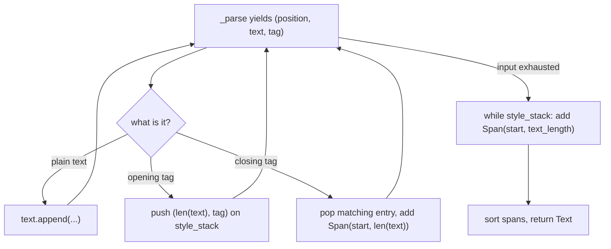

# rich-find-002: Tags that are never closed

**Answer:** `rich/markup.py`, lines 224-228, the `while style_stack:` loop near the end of `render`.

```python
# rich/markup.py, lines 223-228
text_length = len(text)
while style_stack:
    start, tag = style_stack.pop()
    style = str(tag)
    if style:
        append_span(_Span(start, text_length, style))
```

## How a strong engineer gets there

1. Open `render` in `rich/markup.py` (line 106). Skim its shape before reading details: some setup, one `for` loop over `_parse(markup)`, some code after the loop, then `return text`.
2. Inside the `for` loop, an **opening tag** is pushed onto `style_stack` together with the current length of the text, which is the offset where its style starts:

   ```python
   # rich/markup.py, lines 219-221
   else:  # Opening tag
       normalized_tag = _Tag(normalize(tag.name), tag.parameters)
       style_stack.append((len(text), normalized_tag))
   ```

3. A **closing tag** pops a matching entry (`pop_style` for `[/bold]`, plain `pop()` for `[/]`) and appends a `Span` from the saved start to the current length.
4. With `"[bold]Hello"`, no closing tag appears, so after the `for` loop `style_stack` still holds the bold tag with start offset 0. The only code that can still make "Hello" bold is the code after the loop: the `while style_stack:` loop, which closes every open tag at `text_length`, the end of the text.

## The flow in one picture



## Why nearby code is wrong

- **Lines 159-217 (closing-tag handling)** only run when a closing tag appears in the input. They raise `MarkupError` when a closing tag has nothing to match, and they never see a tag that stays open.
- **Lines 219-221 (opening tags)** record where the tag starts. They don't create a span.
- **Line 230 (`text.spans = sorted(...)`)** orders spans that already exist. It doesn't create the span for the unclosed tag.
- **Line 223 (`text_length = len(text)`)** is set-up for the loop, not part of it. The prompt asks for the loop's header through the last line of its body, though including it is still inside the allowed window.

## Takeaways

- Stack-based parsers almost always have a "drain the stack" step after the main loop. When you want to know what happens to unterminated input, look right after the loop.
- Rich's markup is lenient by design: an unclosed tag runs to the end of the string instead of being an error, while a closing tag that matches nothing *is* an error.
