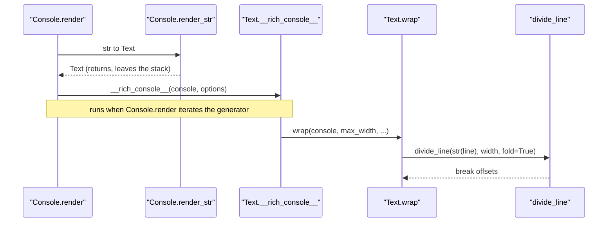

# rich-trace-001: From a plain string to word-wrap offsets

**Answer:** `Console.render` -> `Text.__rich_console__` -> `Text.wrap` -> `divide_line`

## How a strong engineer gets there

1. **Start at `Console.render`** (`rich/console.py`, line 1294). After a guard on `max_width` and a call to `rich_cast`, it has three branches. The first handles anything with a `__rich_console__` method. A plain `str` has none, so it falls to the second branch:

   ```python
   # rich/console.py, lines 1320-1324
   elif isinstance(renderable, str):
       text_renderable = self.render_str(
           renderable, highlight=_options.highlight, markup=_options.markup
       )
       render_iterable = text_renderable.__rich_console__(self, _options)
   ```

   `render_str` builds a `Text` and **returns**. It is not on the stack when wrapping happens, so it's not in the answer. The next call, `text_renderable.__rich_console__`, is made on a `Text` (that is `render_str`'s return type), so it resolves to `Text.__rich_console__`.

2. **`Text.__rich_console__`** (`rich/text.py`, line 689) is a generator. It does no work until `Console.render` iterates it, a few lines further down (`for render_output in iter_render:`). Its first real step is to wrap the text:

   ```python
   # rich/text.py, lines 692-703
   tab_size: int = console.tab_size if self.tab_size is None else self.tab_size
   justify = self.justify or options.justify or DEFAULT_JUSTIFY
   overflow = self.overflow or options.overflow or DEFAULT_OVERFLOW

   lines = self.wrap(
       console,
       options.max_width,
       justify=justify,
       overflow=overflow,
       tab_size=tab_size or 8,
       no_wrap=pick_bool(self.no_wrap, options.no_wrap, False),
   )
   ```

3. **`Text.wrap`** (line 1201) splits the text on newlines. For each line it either keeps the line whole (when `no_wrap` is set) or asks for break offsets. With default options `no_wrap` is False and the overflow is `"fold"`, not `"ignore"`, so it takes the wrapping branch:

   ```python
   # rich/text.py, line 1239
   offsets = divide_line(str(line), width, fold=wrap_overflow == "fold")
   ```

4. **`divide_line`** in `rich/_wrap.py` (line 26) is the end condition. It walks the words, measures each with `cell_len`, and returns the list of character offsets where new lines must start. `Text.divide(offsets)` then cuts the `Text` at those offsets.

## Sequence diagram



## Why plausible wrong answers are wrong

- **Including `Console.render_str`.** It is called by `Console.render`, but it returns before wrapping starts, and it never calls `Text.__rich_console__`. The prompt asks for the call stack at the moment the offsets are computed.
- **Including `rich/markup.py#render`.** With markup enabled, `render_str` calls it to parse the string, but that also finishes before any wrapping.
- **Going through `ConsoleRenderable.__rich_console__`.** That is the protocol method the first branch of `Console.render` calls for arbitrary renderables. A `str` doesn't take that branch, and a protocol method has no body to continue from.
- **Ending at `Text.divide`.** `divide` *uses* the offsets to cut the text. It doesn't compute them, and it lives in `rich/text.py`, not `rich/_wrap.py`.
- **Continuing to `cell_len`.** `divide_line` calls it to measure words, but the prompt ends at the function that computes the offsets.

## Background: why wrapping lives in its own module

`Text` is the class users touch, but the word-breaking algorithm is pure: it takes a `str`, a width and a fold flag, and returns integers. Keeping it in `_wrap.py` with no dependency on `Text`, `Style` or `Console` makes it easy to test and reuse. `Text.wrap` handles the Rich-specific parts around it: splitting on newlines, expanding tabs, justifying, and truncating with the overflow method.

## Takeaways

- When you trace from a method that has several `isinstance` branches, fix the input type first, then follow only the branch it takes.
- In generator-based rendering, a call such as `__rich_console__(...)` only creates the generator. Its body runs when the caller iterates it, but the caller is still the frame below it on the stack.
- A call stack contains only frames that are still active. Helpers that returned earlier, such as `render_str`, are not part of it.
