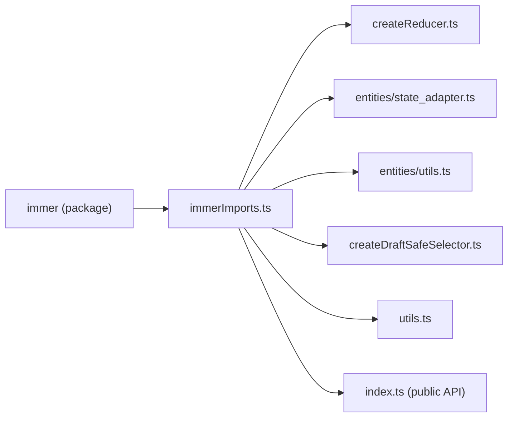

# rtk-architecture-001: Where immer's produce is renamed

**Answer:** `packages/toolkit/src/immerImports.ts`

## How a strong engineer would navigate there

Follow one import back to its source.

1. Open a file that uses `createNextState`. `packages/toolkit/src/createReducer.ts` is the obvious one, since reducers are where Redux Toolkit runs immer. Line 3 is `import { createNextState, isDraft, isDraftable } from './immerImports'`.
2. Jump to `./immerImports`. The whole file is one re-export statement:

```ts
// packages/toolkit/src/immerImports.ts:1-7
export {
  current,
  isDraft,
  produce as createNextState,
  isDraftable,
  setUseStrictIteration,
} from 'immer'
```

Line 4, `produce as createNextState`, is the rename. That is the answer.

## Who imports from it

A quick search for `immerImports` across `packages/toolkit/src` (outside `query/` and tests) shows the module acting as a single gateway to immer's runtime functions:



| File | What it imports from `immerImports` |
|---|---|
| `createReducer.ts` | `createNextState`, `isDraft`, `isDraftable` |
| `entities/state_adapter.ts` | `createNextState`, `isDraft` |
| `utils.ts` | `createNextState`, `isDraftable` (used by `freezeDraftable`) |
| `entities/utils.ts` | `current`, `isDraft` |
| `createDraftSafeSelector.ts` | `current`, `isDraft` |
| `index.ts` | re-exports `createNextState`, `current`, `isDraft` |

Other files still import immer directly, but only for types (`import type { Draft } from 'immer'`), which disappear at compile time.

## Why other files are wrong

- **`packages/toolkit/src/index.ts`** has `export { createNextState, current, isDraft } from './immerImports'` (line 7). It passes the already-renamed name through to the public API. The rename happened upstream. It also has `export { freeze, original } from 'immer'` on line 6, which imports straight from immer but does not touch `produce`.
- **`packages/toolkit/src/query/utils/immerImports.ts`** has the same file name and the same pattern, but it lives under `query/`, which the prompt excludes. It also does not export `produce` at all. It exports `applyPatches`, `produceWithPatches`, `enablePatches`, `original` and others.
- **`packages/toolkit/src/query/core/rtkImports.ts`** re-exports `createNextState` for RTK Query, but it takes it from `'@reduxjs/toolkit'`, already renamed. It is also under `query/`.
- **`createReducer.ts`, `entities/state_adapter.ts` and `utils.ts`** call `createNextState`, but they import it under that name. None of them mentions `produce`.

## Why it is built this way

Redux Toolkit's public API exposes immer's `produce` under the name `createNextState` (`index.ts:7`). Keeping one internal module that does the rename means every internal caller uses the same name as the public API. Funnelling all runtime imports through one file also makes it easy to see exactly which immer functions the core depends on. The sibling `query/core/rtkImports.ts` states a related motive in its header comment: ESBuild does not de-duplicate imports, so each package's imports are listed once in a single file.

## Takeaways

- When a name does not match the library it comes from, follow the import statement one hop and look for `as` in an `export { ... } from` line.
- Files with the same basename in different folders (`immerImports.ts` twice here) are a common trap. Always check the full path against the prompt's scope.
- Type-only imports (`import type`) do not count as runtime dependencies. Filter them out when mapping how a module depends on a library.
