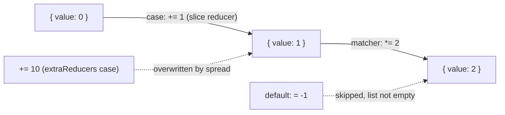

# rtk-architecture-004: A slice reducer and extraReducers on one type

**Answer:** d, `2`.

## The short version

Three facts decide it:

1. The slice's own `added` reducer and the `extraReducers` case for `'counter/added'` collide on one object key, and the slice's reducer wins.
2. A matching case does not stop matchers from running. Both the surviving case reducer and the matcher run, in that order.
3. The default case only runs when nothing else matched.

So the reducers that run are `+= 1`, then `*= 2`: `(0 + 1) * 2 = 2`.

## Following the code

`createSlice` is `buildCreateSlice()` (`packages/toolkit/src/createSlice.ts:859`), so the body to read is the inner `createSlice` function returned by `buildCreateSlice` (line 570).

**Step 1: the slice's own reducer is stored by type.** For each key in `reducers`, `createSlice` builds `type: getType(name, reducerName)` (line 658), which is `` `${slice}/${actionKey}` `` (line 561), so `'counter/added'`. `handleNormalReducerDefinition` (line 998) then calls `context.addCase(type, caseReducer)`, and `contextMethods.addCase` stores it:

```ts
// packages/toolkit/src/createSlice.ts:637
context.sliceCaseReducersByType[type] = reducer
```

**Step 2: the reducer is built lazily.** The slice's `reducer` function calls `buildReducer()` the first time it runs (lines 729-733).

**Step 3: `extraReducers` is collected, then merged.** `buildReducer` runs the builder callback through `executeReducerBuilderCallback` (`mapBuilders.ts:193`), which returns `[actionsMap, actionMatchers, defaultCaseReducer]`. Then:

```ts
// packages/toolkit/src/createSlice.ts:694-697
const finalCaseReducers = {
  ...extraReducers,
  ...context.sliceCaseReducersByType,
}
```

Both maps have the key `'counter/added'`. Object spread keeps the last value for a key, so the slice's `+= 1` replaces the `+= 10` from `extraReducers`. No error is raised, because the duplicate checks in `addCase` (`createSlice.ts:631` and `mapBuilders.ts:234`) each look only within their own map.

**Step 4: everything is handed to `createReducer`.** The builder adds one case per key, then slice matchers (none here), then the extra matchers, then the default case (lines 699-712).

**Step 5: the reducer runs every match.**

```ts
// packages/toolkit/src/createReducer.ts:161-169
let caseReducers = [
  actionsMap[action.type],
  ...finalActionMatchers
    .filter(({ matcher }) => matcher(action))
    .map(({ reducer }) => reducer),
]
if (caseReducers.filter((cr) => !!cr).length === 0) {
  caseReducers = [finalDefaultCaseReducer]
}
```

For `'counter/added'`, `caseReducers` is `[+= 1, *= 2]`. It is not empty, so the default case is skipped. The list is then reduced from left to right (line 171), each step wrapped in its own `createNextState` call because the state is a plain draftable object.



## Every reducer in the puzzle

| Reducer | Source | Runs? | Why |
|---|---|---|---|
| `value += 1` | `reducers.added` | yes | Its key wins the spread in `finalCaseReducers` |
| `value += 10` | `extraReducers` `addCase` | no | Overwritten by the slice reducer under the same key |
| `value *= 2` | `extraReducers` `addMatcher` | yes | `'counter/added'.endsWith('/added')` is true, and matchers always run |
| `value = -1` | `extraReducers` `addDefaultCase` | no | Only used when no case or matcher applies |

## Why the other options are wrong

- **a (20)** assumes the `extraReducers` case wins the merge: `0 + 10 = 10`, then `* 2`. The spread order puts the slice's reducers last, so they win.
- **b (1)** assumes a matched case stops processing, like a `switch`. `createReducer` runs the case reducer and then every matching matcher.
- **c (22)** assumes both case reducers for the same type run (`0 + 1 + 10 = 11`, then `* 2`). They are merged into one object key, so only one survives.
- **`-1`** (not offered) would need the default case to run, which only happens when the list of matching reducers is empty.

## Takeaways

- When two registries are merged with object spread, the later spread wins, silently. Look for the spread order whenever "which handler runs" depends on a merge.
- Redux Toolkit reducers are not a `switch`: one exact-type case plus every matching matcher, in registration order. Matchers are additive.
- Lazy construction (`if (!_reducer) _reducer = buildReducer()`) means the merge happens on the first call, not when `createSlice` returns. That matters if you are hunting for where it happens.
