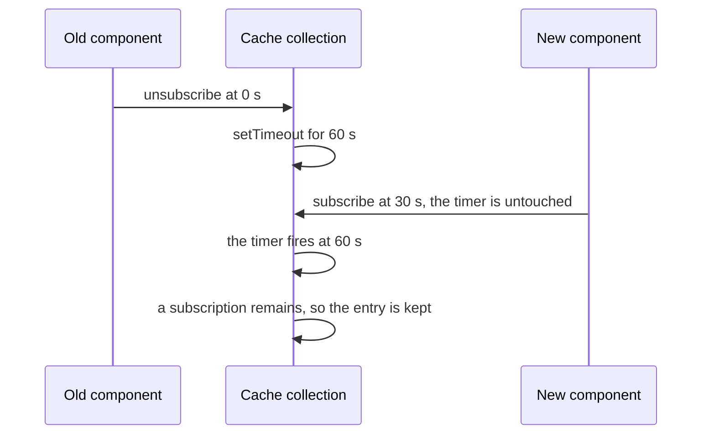

# rtk-design-001: Coming back before a cache entry expires

**Answer:** c. The removal timer still fires, finds a subscription for the cache key, and leaves the entry in place.

## The design

RTK Query frees unused data with one timer per cache key, kept in `currentRemovalTimeouts` (packages/toolkit/src/query/core/buildMiddleware/cacheCollection.ts:85). The handler starts that timer when the last subscriber leaves. It doesn't cancel it when someone subscribes again; instead, the timer checks again when it fires.

## Step 1: what starts the timer

The handler reacts to a short list of actions:

```ts
// cacheCollection.ts:68-73
  const canTriggerUnsubscribe = isAnyOf(
    unsubscribeQueryResult.match,
    queryThunk.fulfilled,
    queryThunk.rejected,
    cacheEntriesUpserted.match,
  )
```

The last subscriber leaving dispatches `unsubscribeQueryResult`, which reaches `handleUnsubscribe` through `handleUnsubscribeMany` (lines 99-114). There, with `keepUnusedDataFor` at 60 seconds and no subscriptions left, it schedules the removal:

```ts
// cacheCollection.ts:179-200
    if (!anySubscriptionsRemainingForKey(queryCacheKey)) {
      const currentTimeout = currentRemovalTimeouts[queryCacheKey]
      if (currentTimeout) {
        clearTimeout(currentTimeout)
      }

      currentRemovalTimeouts[queryCacheKey] = setTimeout(() => {
        if (!anySubscriptionsRemainingForKey(queryCacheKey)) {
          // Try to abort any running query for this cache key
          const entry = selectQueryEntry(api.getState(), queryCacheKey)

          if (entry?.endpointName) {
            const runningQuery = api.dispatch(
              getRunningQueryThunk(entry.endpointName, entry.originalArgs),
            )
            runningQuery?.abort()
          }
          api.dispatch(removeQueryResult({ queryCacheKey }))
        }
        delete currentRemovalTimeouts![queryCacheKey]
      }, finalKeepUnusedDataFor * 1000)
    }
```

## Step 2: the new subscriber at 30 seconds

Subscribing isn't one of the actions in `canTriggerUnsubscribe`. If the new subscription leads to a `queryThunk` result, which is in the list, `handleUnsubscribe` finds a subscription and skips the whole block above. The only `clearTimeout` calls are on line 182, which runs only when no subscriptions remain, and on line 118, for `resetApiState`. So the timer keeps running.

## Step 3: the timer fires at 60 seconds

The callback calls `anySubscriptionsRemainingForKey` again (line 186). That function reads `internalState.currentSubscriptions` (lines 75-83), which now holds the new component's subscription, so it returns true. The callback skips `removeQueryResult` and only deletes its own timer handle (line 198). The entry stays.



## Why the other options are wrong

- **a:** the timer isn't stopped, but it doesn't remove blindly. It checks for subscriptions when it fires.
- **b:** subscribing never touches `currentRemovalTimeouts`. Only another unsubscribe with nobody left (line 182) or a full API reset (line 118) clears a pending timer.
- **d:** removal only happens inside the timer's callback, after `keepUnusedDataFor` seconds. With 60 seconds set, nothing is removed when the subscriber leaves.

## Takeaways

- A cache with a grace period has two ways to handle a returning user: cancel the pending eviction when they arrive, or check again when the eviction fires. RTK Query does the second, so subscribing never has to know about timers.
- The cost of checking again is a timer that may wake up and do nothing, one per key that recently lost its last subscriber.
