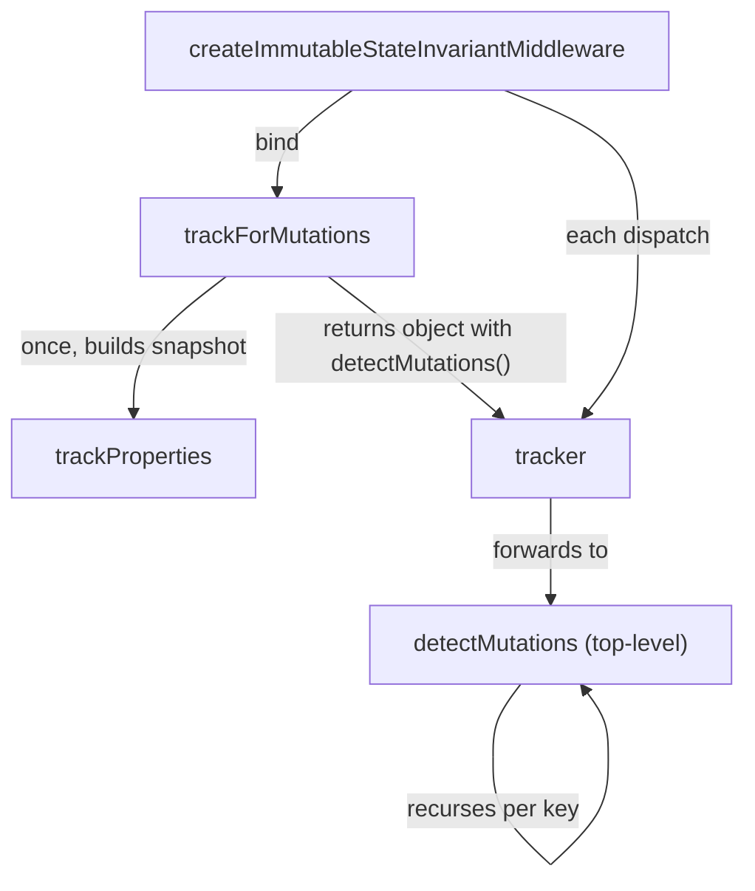

# rtk-find-001: Detecting a state mutation

**Answer:** `packages/toolkit/src/immutableStateInvariantMiddleware.ts#detectMutations`

## How a strong engineer would navigate there

1. Find the middleware. `getDefaultMiddleware.ts:81-83` unshifts `createImmutableStateInvariantMiddleware(immutableOptions)` in development, so jump to its definition in `packages/toolkit/src/immutableStateInvariantMiddleware.ts`.
2. Read the middleware body (line 250 onward). It builds `const track = trackForMutations.bind(null, isImmutable, ignoredPaths)` (line 248), creates `tracker = track(state)`, and on each action calls `result = tracker.detectMutations()` (line 264) and throws if `result.wasMutated`.
3. Jump to `trackForMutations` (line 16). It is a tiny factory:

```ts
// packages/toolkit/src/immutableStateInvariantMiddleware.ts:21-26
const trackedProperties = trackProperties(isImmutable, ignoredPaths, obj)
return {
  detectMutations() {
    return detectMutations(isImmutable, ignoredPaths, trackedProperties, obj)
  },
}
```

`trackProperties` builds the snapshot. The returned `detectMutations()` method is a thin closure that forwards to the top-level function of the same name. Jump to that top-level `detectMutations` on line 85. Its return type, `{ wasMutated: boolean; path?: string }`, matches the prompt word for word.

## How the two halves fit



The snapshot is a tree of `TrackedProperty` nodes (`{ value, children }`, line 29-32). `trackProperties` stores the *reference* of every mutable object it walks, not a deep copy.

## How the comparison detects a mutation

`detectMutations` walks the snapshot tree and the current value side by side. The core rule is on line 98:

```ts
// packages/toolkit/src/immutableStateInvariantMiddleware.ts:96-100
const sameRef = prevObj === obj

if (sameParentRef && !sameRef && !Number.isNaN(obj)) {
  return { wasMutated: true, path }
}
```

If the parent object is the same reference as before but one of its children now points somewhere else, someone changed the parent in place. That is a mutation. When a parent is a new reference (the reducer returned a new object), the children are allowed to differ, and the recursion passes `sameRef = false` down.

The rest of the function:

- Returns `{ wasMutated: false }` early if either side is immutable (primitives, `null`, frozen objects), via `isImmutable` (line 102).
- Keeps a `seen` map so circular references terminate (lines 106-116).
- Collects keys from both the old snapshot and the current object (lines 119-125), so added and deleted keys are both checked.
- Skips `ignoredPaths`, builds the dotted `nestedPath`, and recurses (lines 129-157). The first mutated result bubbles up with its path.

The `!Number.isNaN(obj)` check exists because `NaN !== NaN`, so a `NaN` value would otherwise always look changed.

## Why other candidates are wrong

- **`trackProperties`** (line 34) builds the snapshot. The prompt says "not the one that builds the snapshot".
- **`trackForMutations`** (line 16) wires the two together and returns the tracker. It contains no comparison logic.
- **The `detectMutations()` method inside the object `trackForMutations` returns** has the same name, but it is a one-line forwarder. It does not recurse and does not build the result. The index does not list it as a separate symbol, so the selectable `detectMutations` is the top-level function.
- **`isImmutableDefault`** (line 12) decides whether a single value can be skipped: `typeof value !== 'object' || value == null || Object.isFrozen(value)`. It compares nothing.
- **`createImmutableStateInvariantMiddleware`** (line 195) calls the tracker before and after `next(action)` and throws the error message. It is the middleware, not the comparer.
- **Anything in `serializableStateInvariantMiddleware.ts`** checks whether values are serializable, a different concern. This file only borrows its `IgnoredPaths` type.

## Design note

Taking a reference snapshot is cheap: `trackProperties` copies no values, it only records which object each key pointed at. That works because Redux reducers are supposed to replace objects rather than edit them. A legal update always creates a new parent reference, so "same parent, different child" can only come from a mutation. The check runs only outside production (line 198 returns a pass-through middleware in production), because walking the whole state tree on every dispatch is expensive.

## Takeaways

- When a method and a free function share a name, check which one has the body. Small closures that forward to a module-level function are common in JavaScript.
- A function's return type is often the quickest way to confirm you are in the right place. Here it matches the prompt's description exactly.
