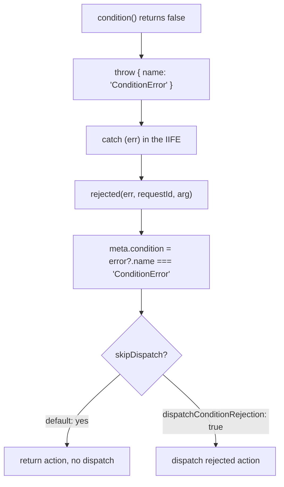

# rtk-find-002: Thunk condition returns false

**Answer:** lines 639-645 of `packages/toolkit/src/createAsyncThunk.ts`, the `if (conditionResult === false) { throw { name: 'ConditionError', ... } }` block.

## How a strong engineer would navigate there

1. The file is named, so search inside it for `condition`. The early hits are types and doc comments for the `condition` option (around line 331 there is also `dispatchConditionRejection`). Skip those and look for a call: `options?.condition?.(`.
2. That call is on line 634, inside the async IIFE the thunk builds: `actionCreator` (line 601) returns `(dispatch, getState, extra) => { ... }`, and inside it `const promise = (async function () { ... })()` (line 631).
3. The prompt's hint says the result is awaited if it is a promise. Lines 635-637 do exactly that with `isThenable`. The next statement is the target.

## The code

```ts
// packages/toolkit/src/createAsyncThunk.ts:634-645
let conditionResult = options?.condition?.(arg, { getState, extra })
if (isThenable(conditionResult)) {
  conditionResult = await conditionResult
}

if (conditionResult === false) {
  // eslint-disable-next-line no-throw-literal
  throw {
    name: 'ConditionError',
    message: 'Aborted due to condition callback returning false.',
  }
}
```

Select line 639 through line 645. The grader requires all of 639-645, and the selection must stay within 633-650.

The `// eslint-disable-next-line no-throw-literal` comment confirms that throwing a non-`Error` value is deliberate.

## What happens after the throw

The thrown object is caught a few dozen lines later and turned into a `rejected` action, which is then usually *not* dispatched:



- The `rejected` action creator sets `meta.condition` by checking the name (line 596).
- `skipDispatch` (lines 725-729) is true when `meta.condition` is set and `dispatchConditionRejection` is not enabled. So by default a cancelled-by-condition thunk dispatches neither `pending` nor `rejected`. The `pending` dispatch (line 670) comes after the throw, so it never runs either.

A plain object is enough because only its `name` is inspected. `miniSerializeError` (line 94) copies any string-valued `name`, `message`, `stack` and `code` properties from an object into the action's `error` field, so a plain object serializes the same way an `Error` would.

## Why other selections are wrong

- **Lines 634-637**, the call to `condition` and the `isThenable` await, compute the result. They don't test for `false` or throw.
- **Lines 646-657**, the next `if`, is the abort check. It throws an object named `AbortError` when `abortController.signal.aborted` is already true. It is a different guard with a different trigger, and it is not about `condition` returning `false`.
- **Line 596**, `condition: error?.name === 'ConditionError'`, reads the thrown value later, inside the `rejected` action creator. It does not stop the thunk.
- **Lines 725-733**, the `skipDispatch` logic, decide whether to dispatch the rejected action. That comes after the thunk has already stopped.
- **Only the `throw { ... }` (lines 641-644)** leaves the `if` line uncovered.
- **The whole `try` block** runs far past the window.

## Design note

The `=== false` comparison is strict on purpose. A `condition` callback that returns `undefined` (for example, one that forgets to return) lets the thunk run. Only an explicit `false` cancels it. That makes "no condition" and "condition with no opinion" behave the same.

## Takeaways

- For "select the `if` block" puzzles, find the call that produces the tested value first. The guard is usually right after it.
- A thrown plain object with a `name` field is a lightweight tagged signal. Search for that name elsewhere in the file to see how it is decoded.
