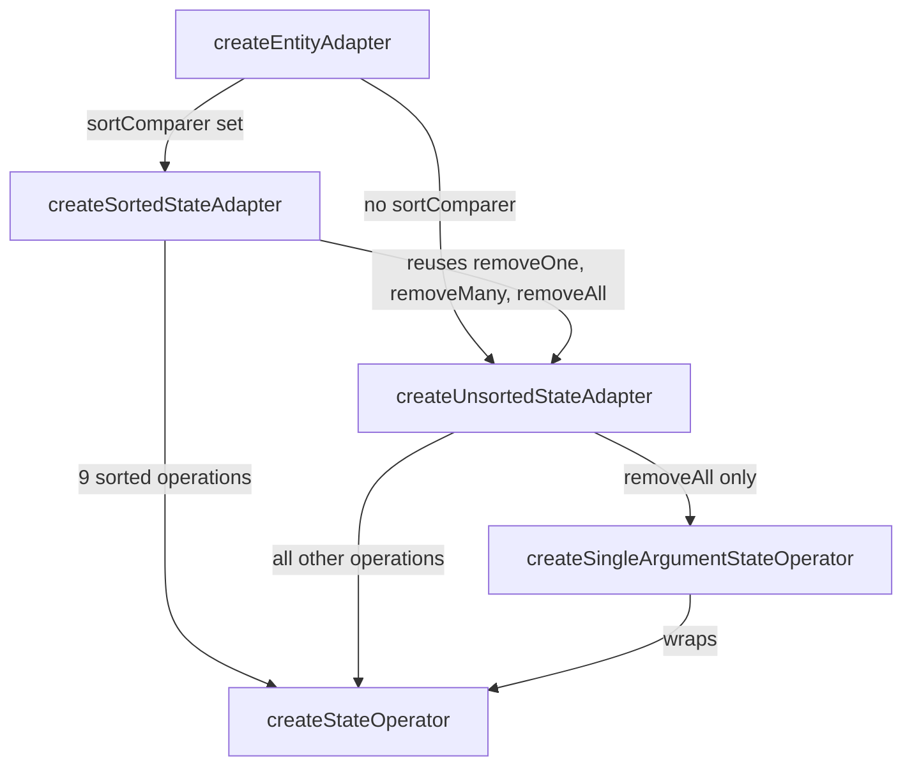

# rtk-trace-001: Sorted adapter and removeAll

**Answer (in order):**

1. `packages/toolkit/src/entities/sorted_state_adapter.ts#createSortedStateAdapter`
2. `packages/toolkit/src/entities/unsorted_state_adapter.ts#createUnsortedStateAdapter`
3. `packages/toolkit/src/entities/state_adapter.ts#createSingleArgumentStateOperator`

## How a strong engineer would approach it

Work backwards from the end point, because it is rare. `createSingleArgumentStateOperator` is defined in `entities/state_adapter.ts:11`. Find its references: outside its own file, the only caller is `unsorted_state_adapter.ts`, which imports it on line 11 and uses it once, on line 191. So whatever path you take from the sorted adapter has to pass through `createUnsortedStateAdapter`.

Then work forwards to confirm. `createSortedStateAdapter` calls `createUnsortedStateAdapter` near the top of its body:

```ts
// packages/toolkit/src/entities/sorted_state_adapter.ts:58-59
const { removeOne, removeMany, removeAll } =
  createUnsortedStateAdapter(selectId)
```

And `createUnsortedStateAdapter` calls the end function in its return object:

```ts
// packages/toolkit/src/entities/unsorted_state_adapter.ts:190-192
return {
  removeAll: createSingleArgumentStateOperator(removeAllMutably),
  addOne: createStateOperator(addOneMutably),
```

That gives a three-step chain.

## Structure of the adapters



`createEntityAdapter` (`entities/create_adapter.ts:35-36`) picks the sorted or unsorted adapter depending on whether a `sortComparer` was given. The sorted adapter only redefines the operations whose result depends on order (adding, setting, updating, upserting). Removal never changes the relative order of the entities that remain, so it borrows the three removal operations from the unsorted adapter and returns them as is (`sorted_state_adapter.ts:263-266`).

## Why `removeAll` needs its own factory

Every adapter operation has the shape `(state, arg)`. `removeAll` has no argument, so `createSingleArgumentStateOperator` adapts a one-argument mutator to that shape:

```ts
// packages/toolkit/src/entities/state_adapter.ts:14-16
const operator = createStateOperator(
  (_: undefined, state: DraftableEntityState<T, Id>) => mutator(state),
)
```

Then it returns an `operation(state)` that calls `operator(state as S, undefined)`. The underlying `createStateOperator` handles immer: if `state` is already a draft it runs the mutator directly, otherwise it wraps the call in `createNextState`.

## Why other sequences are wrong

- **`createSortedStateAdapter` → `createStateOperator` → ...** The sorted adapter does call `createStateOperator` directly (lines 267-275), but `createStateOperator` never calls `createSingleArgumentStateOperator`. The dependency goes the other way: `createSingleArgumentStateOperator` calls `createStateOperator`.
- **`createSortedStateAdapter` → `createSingleArgumentStateOperator`.** No such direct call exists. The sorted adapter doesn't even import it (its only import from `./state_adapter` is `createStateOperator`, line 9).
- **Going through `EntityStateAdapter.removeAll`.** The destructured `removeAll` name refers to a property of the `EntityStateAdapter` interface in `entities/models.ts`, which is a type declaration with no body. It calls nothing.
- **Including `removeAllMutably`.** It is passed as a value to `createSingleArgumentStateOperator` inside `createUnsortedStateAdapter`, not called on the way there. Once wrapped, it runs only when someone calls `removeAll`, after the end condition.
- **Starting at `createEntityAdapter`.** It calls `createSortedStateAdapter`, but the prompt fixes the start symbol.
- **Ending at `createStateOperator`.** It runs inside `createSingleArgumentStateOperator`, which is after the end condition.
- **Including sorted-adapter helpers** like `insert`, `findInsertIndex`, `addManyMutably` or `mergeFunction`. They deal with ordering and are not on the path to `removeAll`.

## Takeaways

- For a trace to a rarely-used function, start from the end: find its few callers, then connect them back to the start.
- Composition by destructuring (`const { a, b } = otherFactory()`) is a common way to reuse behaviour without inheritance. When a function seems to be missing from a module, check whether it is borrowed this way.
