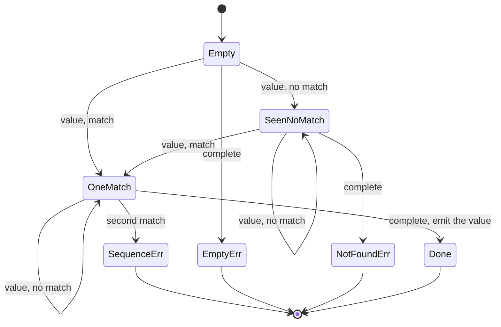

# rxjs-architecture-001: The errors the single operator raises itself

**Answer:**
- `packages/rxjs/src/empty-error.ts`
- `packages/rxjs/src/not-found-error.ts`
- `packages/rxjs/src/sequence-error.ts`

## How to navigate there

1. **Read the imports of `packages/rxjs/src/single.ts`.** The file is short, and its imports already list the candidates:

   ```ts
   // packages/rxjs/src/single.ts:1-5
   import { create } from './create.js';
   import { EmptyError } from './empty-error.js';
   import { NotFoundError } from './not-found-error.js';
   import { SequenceError } from './sequence-error.js';
   import { subscribeToSource } from './util/observable-helpers.js';
   ```

   Three imports have `Error` in their names. An import alone does not prove the class is used, so check each one.

2. **Find each `new ...Error(...)` in `singleOperator`.** There are three `subscriber.error(...)` calls, and two of them construct errors:

   ```ts
   // packages/rxjs/src/single.ts:48-52
   if (hasValue) {
     sourceController.abort();
     subscriber.error(new SequenceError('Too many matching values'));
     return;
   }
   ```

   ```ts
   // packages/rxjs/src/single.ts:61-68
   complete: () => {
     sourceController.abort();
     if (hasValue) {
       subscriber.next(singleValue as T);
       subscriber.complete();
     } else {
       subscriber.error(seenValue ? new NotFoundError('No matching values') : new EmptyError());
     }
   },
   ```

   The third call, in the `error` handler (line 59), passes the source's error through unchanged. That is the "forwarding" the prompt excludes.

3. **Open each class's file.** Each is a tiny `class X extends Error` that sets `this.name`. For example:

   ```ts
   // packages/rxjs/src/empty-error.ts
   export class EmptyError extends Error {
     constructor() {
       super('no elements in sequence');
       this.name = 'EmptyError';
     }
   }
   ```

## The state the operator keeps

`singleOperator` tracks three flags, and they map directly to the outcomes:

| Flag | Set when |
|---|---|
| `seenValue` | any value arrives, matching or not |
| `hasValue` | a matching value arrives (stored in `singleValue`) |
| `index` | counts values passed to the predicate |



| Source behaviour | Result | Error class |
|---|---|---|
| completes with no values | error | `EmptyError` |
| emits values, none match, then completes | error | `NotFoundError('No matching values')` |
| emits exactly one match, then completes | `next(value)`, then `complete()` | none |
| emits a second match | error, immediately (no need to wait for completion) | `SequenceError('Too many matching values')` |
| errors | error forwarded as-is | the source's own error |

## Why the other files are wrong

| File | Why it is wrong |
|---|---|
| `packages/rxjs/src/timeout-error.ts` | Defines `TimeoutError`. Not imported by `single.ts`. |
| `packages/rxjs/src/argument-out-of-range-error.ts` | Defines `ArgumentOutOfRangeError`. Not imported by `single.ts`. |
| `packages/rxjs/src/first.ts`, `last.ts`, `throw-if-empty.ts` | Other operators that also construct `EmptyError`. They use the class; they do not define it. |
| `packages/rxjs/src/util/observable-helpers.ts` | Imported for `subscribeToSource`. It defines no error class. |
| `packages/rxjs/src/create.ts` | Imported for the `create` symbol used to build the output observable. No error class. |
| `packages/rxjs/src/index.ts` | Re-exports the error classes for the public API. It does not define them. |
| `packages/rxjs/src/catch-error.ts`, `on-error-resume-next.ts` | Have "error" in the file name but are operators, not error classes. |
| `*.spec.ts` files such as `empty-error.spec.ts` | Tests for the classes. |

## Details worth noticing

- **The upstream is cancelled before the error is sent.** Every path calls `sourceController.abort()` first. Its signal is passed to `subscribeToSource` as the extra signal (line 71), so aborting it unsubscribes from the source. For `SequenceError` this matters: `single` stops listening as soon as it knows the answer is wrong.
- **A throwing predicate is not one of the three.** If `predicate` throws, `subscribeToSource`'s `guard` wrapper catches it and calls `subscriber.error(error)` with the thrown value. `single` does not construct that error.
- **One file per error class.** Each error has its own module. Operators import just the ones they raise, and `index.ts` re-exports all of them for the public API.

## Takeaways

- For "which classes does this function raise", read the imports first, then confirm each with a `new ClassName(` search inside the function.
- Separate errors the code *constructs* from errors it *forwards*. A handler like `error: (e) => subscriber.error(e)` is forwarding.
- Write out the small state machine of flags. It turns "when does each error happen" into a table you can check line by line.
