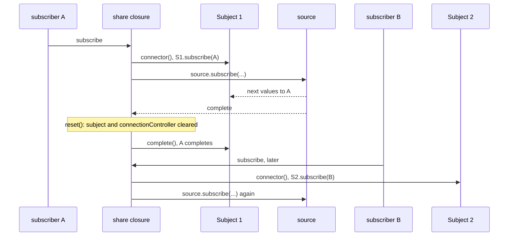

# rxjs-architecture-002: A late subscriber after a shared source completes

**Answer:** a, B causes the source to be subscribed again, through a new Subject from the connector.

## The state `share` keeps

Everything lives in closure variables inside the `share` implementation in `packages/rxjs/src/share.ts`:

```ts
// packages/rxjs/src/share.ts:26-33
const { connector = () => new Subject<T>(), resetOnError = true, resetOnComplete = true, resetOnRefCountZero = true } = config;

let connectionController: AbortController | undefined;
let resetController: AbortController | undefined;
let subject: SubjectLike<T> | undefined;
let refCount = 0;
let hasCompleted = false;
let hasErrored = false;
```

With no config, all three reset rules are `true` and the connector makes a plain `Subject`. Two variables decide what a new subscriber gets: `subject` (which Subject it attaches to) and `connectionController` (whether the source is already connected).

## Timeline

| Moment | What runs | `subject` | `connectionController` | `refCount` |
|---|---|---|---|---|
| A subscribes | `subject ??= connector()` makes Subject #1; no connection yet, so `source.subscribe(...)` | #1 | set | 1 |
| source emits | `destination.next(value)` reaches A | #1 | set | 1 |
| source completes | `complete` handler: `hasCompleted = true`, `cancelReset()`, `handleReset(reset, true)` runs `reset()` | `undefined` | `undefined` | 1 |
| | then `destination.complete()` completes Subject #1, which completes A | `undefined` | `undefined` | 1 |
| A's teardown | `refCount--`; flags were cleared by `reset()`, so `handleReset(resetAndDisconnect, true)` runs and resets again (nothing left to clear) | `undefined` | `undefined` | 0 |
| B subscribes later | `subject ??= connector()` makes Subject #2; `connectionController` is unset, so a new `AbortController` and a new `source.subscribe(...)` | #2 | set | 1 |

## The two pieces of code that decide it

The `complete` handler resets *before* it completes the Subject:

```ts
// packages/rxjs/src/share.ts:130-135
complete: () => {
  hasCompleted = true;
  cancelReset();
  handleReset(reset, resetOnComplete);
  destination.complete();
},
```

With `rule === true`, `handleReset` calls `resetState()` immediately (lines 60-63), and `reset` clears the state:

```ts
// packages/rxjs/src/share.ts:41-47
const reset = (): void => {
  cancelReset();
  connectionController = undefined;
  subject = undefined;
  hasCompleted = false;
  hasErrored = false;
};
```

`destination` is a local captured when A subscribed, so `destination.complete()` still completes Subject #1 even though `subject` has been cleared.

When B subscribes, the subscribe callback runs again:

```ts
// packages/rxjs/src/share.ts:101-112, 117-118
let destination: SubjectLike<T>;
try {
  destination = subject ??= connector();
  destination.subscribe(subscriber, { signal: subscriber.signal });
} catch (error) {
  subscriber.error(error);
  return;
}

if (!subscriber.active || connectionController || refCount === 0) {
  return;
}
...
const controller = new AbortController();
connectionController = controller;
```

`subject` is `undefined`, so `??=` calls the connector and creates Subject #2. `connectionController` is `undefined`, so the early return is skipped and `source.subscribe(...)` runs again. B sees a fresh run of the source from the beginning.



## Why the other choices are wrong

| Choice | When it would be right | Why not here |
|---|---|---|
| b, B completes immediately | With `resetOnComplete: false`. Then `handleReset` returns without resetting (line 65-67), `subject` still points at the completed Subject #1, and B attaches to it. A completed `Subject` completes new subscribers. | The default is `true`, so `subject` was cleared. |
| c, B waits forever on the old Subject | Would need B to attach to Subject #1 while nothing ever completes or reconnects it. | B never sees Subject #1: `reset()` dropped the reference before B subscribed. |
| d, B gets the last value, then completes | Would need a replay buffer, for example a `connector` that returns a `ReplaySubject`, and `resetOnComplete: false`. | The default connector is a plain `Subject`, which does not replay anything. |

## Background: why the default resets on completion

A `share`d observable behaves, by default, like a cold observable that is shared only while it is running. Once the source completes or errors, or every subscriber leaves (`resetOnRefCountZero`), the share forgets everything. The next subscriber starts a new shared run. Setting a rule to `false` keeps the old Subject. Passing a function instead of a boolean makes `handleReset` subscribe to the observable it returns and reset when that observable first emits (lines 72-85), which allows delayed resets.

## Takeaways

- For stateful operators, list the closure variables first, then track them through a timeline. Most "what happens next" questions come down to two or three variables.
- Order inside a handler matters. Here the reset happens before `destination.complete()`, so anything triggered by the completion already sees the reset state.
- A captured local (`destination`) and a shared variable (`subject`) can point at different objects at the same time. Note which one each line uses.
