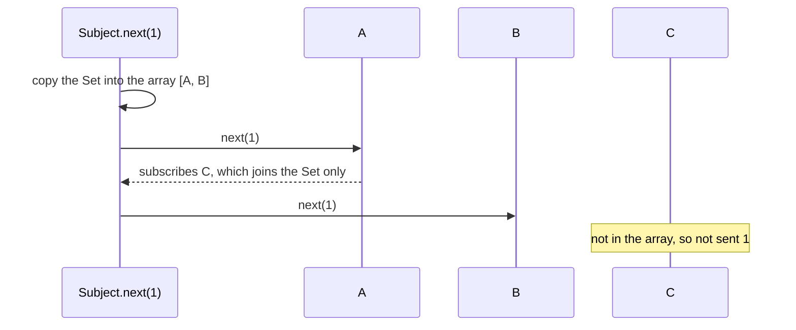

# rxjs-design-001: Subscribing during delivery

**Answer:** b. A and B. C is not sent 1, because next loops over a copy of the subscribers made before the loop starts.

## The code

```ts
// packages/rxjs/src/subject.ts:40-46
  next(value: T) {
    if (this.active) {
      for (const subscriber of Array.from(this.#internalSubscribers)) {
        subscriber.next(value);
      }
    }
  }
```

Subscribers live in a `Set` (line 19), and subscribing adds to it (line 33). But `next` doesn't loop over the Set. `Array.from` copies it into a new array first, and the loop walks that array.

## Following the scenario

```text
before next(1):   #internalSubscribers = {A, B}
Array.from        -> [A, B]                  the loop walks this array
A.next(1)         -> A's handler subscribes C
                     #internalSubscribers = {A, B, C}, the array is still [A, B]
B.next(1)
the loop ends     -> C was never sent 1; it gets values sent after this
```



## Why the other options are wrong

- **a:** nothing stops the loop. A's handler doesn't change the array, so B is next.
- **c:** the part about `Set` is true: a `Set`'s iterator does visit entries added during the loop. That's why the code copies the Set first. Without `Array.from`, C would be sent 1.
- **d:** `next` has no pending list. After the loop, it returns.

## Takeaways

- An event bus has to decide what a handler that subscribes or unsubscribes during delivery does to that delivery. Copying the list first means each value goes to exactly the subscribers who were there when it was sent, whatever the handlers do along the way.
- The copy costs O(n) per value. A bus that sends often to many subscribers can use copy-on-write instead, copying the list only when someone subscribes or unsubscribes.
