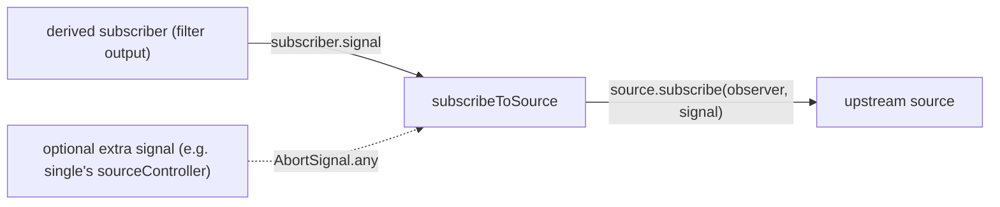

# rxjs-find-001: The shared upstream-subscription helper

**Answer:** `packages/rxjs/src/util/observable-helpers.ts#subscribeToSource`

## How to navigate there

1. **Start from a user of the helper, as the hint suggests.** Open `packages/rxjs/src/filter.ts`. The operator is small:

   ```ts
   // packages/rxjs/src/filter.ts:22-34
   function filterOperator<T>(this: Observable<T>, predicate: (value: T, index: number) => boolean): Observable<T> {
     return this[create]((subscriber) => {
       let index = 0;

       subscribeToSource(this, subscriber, {
         next: (value) => {
           if (predicate(value, index++)) {
             subscriber.next(value);
           }
         },
       });
     });
   }
   ```

   The only call that touches the upstream is `subscribeToSource(this, subscriber, { next })`. Its import on line 2 points at `./util/observable-helpers.js`.

2. **Confirm it is shared.** `scan.ts` (line 31) and `reduce.ts` (line 36) call the same function. A search shows that 72 non-test files in `packages/rxjs/src/` reference `subscribeToSource`, so it is the common way operators subscribe upstream.

3. **Open the helper and match each part of the prompt.**

   ```ts
   // packages/rxjs/src/util/observable-helpers.ts
   export function subscribeToSource<T>(
     source: Observable<T>,
     subscriber: Subscriber<unknown>,
     overrides?: Partial<Observer<T>>,
     signal?: AbortSignal
   ): void {
     const guard = <Args extends unknown[]>(override: ((...args: Args) => void) | undefined, forward: (...args: Args) => void) =>
       override
         ? (...args: Args) => {
             try {
               override(...args);
             } catch (error) {
               subscriber.error(error);
             }
           }
         : forward;
     const handleError = guard<[unknown]>(overrides?.error, (error) => subscriber.error(error));

     try {
       source.subscribe(
         {
           next: guard<[T]>(overrides?.next, (value) => subscriber.next(value)),
           error: handleError,
           complete: guard<[]>(overrides?.complete, () => subscriber.complete()),
         },
         { signal: signal ? AbortSignal.any([subscriber.signal, signal]) : subscriber.signal }
       );
     } catch (error) {
       // Subscription setup failures are source failures and therefore follow an
       // overridden source-error path when one is present.
       handleError(error);
     }
   }
   ```

   | Prompt says | Code |
   |---|---|
   | "subscribe to their upstream source" | the `source.subscribe(...)` call |
   | "override the `next`, `error` or `complete` handlers" | the `overrides?: Partial<Observer<T>>` parameter, used through `guard` |
   | "ties the upstream subscription's `AbortSignal` to the derived subscriber" | the `signal` option passed to `source.subscribe`, built from `subscriber.signal` |

## What `guard` adds

Without the helper, every operator would need its own `try/catch` around user callbacks such as `filter`'s `predicate`. `guard` does it once:

```text
override given?   yes → wrap it: call override, and on throw send the error to subscriber.error
                  no  → use the default forwarder (subscriber.next / .error / .complete)
```

So an operator only writes the handlers it changes. `filter` overrides `next` and gets the default `error` and `complete` for free. If the predicate throws, the derived subscriber receives the error instead of the exception escaping into the source.

## How cancellation flows



When the consumer of `filter`'s output unsubscribes, its `subscriber.signal` aborts, and because that signal (or a combination of it) was passed to `source.subscribe`, the upstream subscription is torn down too. Operators that need to stop the upstream early, like `single`, pass their own extra signal.

## Why the other candidates are wrong

| Candidate | Why it is wrong |
|---|---|
| `convertObservableValue` (same file, line 8) | Returns `Observable.from(options.value)`. It converts an input to an observable. It does not subscribe, take overrides or use a signal. |
| `guard`, `handleError` | Local arrow functions inside `subscribeToSource`, not module-level functions. They wrap handlers but do not subscribe. |
| `create` (`packages/rxjs/src/create.ts`) | Builds the *derived* observable that the operator returns. The prompt is about subscribing *upstream*. |
| `filterOperator`, `scanOperator`, `reduce`'s implementation | They call the helper. They are not in `util/observable-helpers.ts`. |
| `Observable.prototype.subscribe` | The native or polyfilled `subscribe` the helper calls. It is not defined in this file and knows nothing about overrides. |

## Background

This version of RxJS is built on the native-style `Observable` from `@rxjs/observable-polyfill` (imported on line 1 of the helper), where subscriptions are canceled through `AbortSignal` rather than by returning a `Subscription`. That makes "pass the right signal upstream" the one thing every operator must get right, which is why it lives in a single shared helper.

## Takeaways

- When many files do the same job, look for the helper they all import. Starting from the smallest user (`filter`) is the fastest route.
- `Partial<Observer<T>>` overrides plus default forwarders is a common way to let callers change only some callbacks.
- In signal-based APIs, follow the `signal` option. It tells you how teardown propagates.
