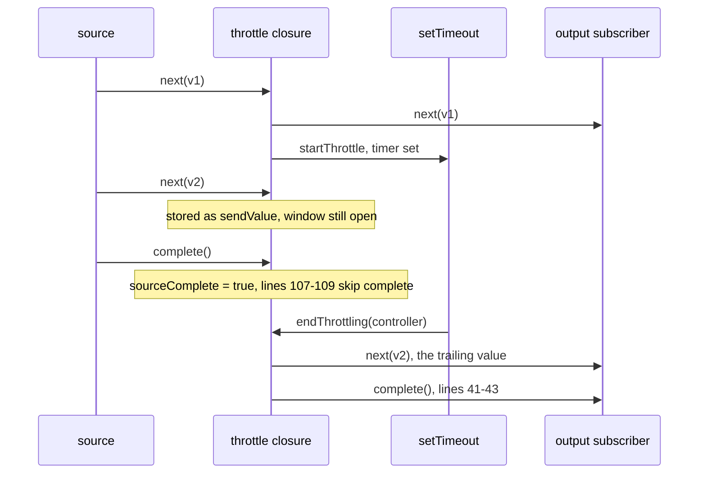

# rxjs-find-003: Completing a throttle after its trailing value

**Answer:** `packages/rxjs/src/throttle.ts`, lines 41 to 43: the `if (sourceComplete) { subscriber.complete(); }` inside `endThrottling`. A selection is accepted if it covers 41–43 and stays inside 38–44.

## Where `subscriber.complete()` can come from

`throttle.ts` completes the output in exactly three places. The puzzle is to work out which one fires in the given scenario.

| Lines | Inside | Runs when |
|---|---|---|
| 41-43 | `endThrottling` | the throttle window ends (timer fired, or a duration observable emitted) and the source has already completed |
| 51-53 | `cleanupThrottling` | a *duration observable* completes without emitting, and the source has completed |
| 107-109 | the source's `complete` handler | the source completes and there is no pending trailing value inside an open window |

## The scenario, step by step

Config `{ trailing: true }` with defaults gives:

```ts
// packages/rxjs/src/throttle.ts:24
const { leading = true, trailing = false, restartOnTrailing = true } = config ?? {};
```

so `leading = true`, `trailing = true`, `restartOnTrailing = true`.

| Event | Code path | State after |
|---|---|---|
| source emits `v1` | `next`: `hasValue = true`, `sendValue = v1`; no `innerController` and `leading`, so `send()`: emits `v1`, then `startThrottle(v1)` sets `innerController` and a `setTimeout(() => endThrottling(controller), delay)` | window open, `hasValue = false` |
| source emits `v2` | `next`: `hasValue = true`, `sendValue = v2`; `innerController` is set, so nothing else | window open, `v2` pending |
| source completes | `complete`: `sourceComplete = true`; `trailing && hasValue && innerController` is true, so `!(...)` is false and lines 107-109 do **not** complete | waiting for the timer |
| timer fires | `endThrottling(controller)`: aborts the controller, `innerController = null`; `trailing`, so `send(restartOnTrailing)` emits `v2` but does not restart because `sourceComplete` is true; then **lines 41-43 complete the subscriber** | done |



## The answer lines

```ts
// packages/rxjs/src/throttle.ts:31-44
const endThrottling = (controller: AbortController) => {
  if (innerController !== controller) {
    return;
  }
  controller.abort();
  innerController = null;

  if (trailing) {
    send(restartOnTrailing);
  }
  if (sourceComplete) {
    subscriber.complete();
  }
};
```

## How to navigate there

1. **Search `throttle.ts` for `subscriber.complete()`.** Three hits: lines 42, 52 and 108. List them in a table like the one above.
2. **Rule out the source's own `complete` handler** (line 107) by evaluating its condition with the scenario: trailing is on, a value is pending, the window is open. The negated condition is false.
3. **Decide which window-ending path runs.** `startThrottle` branches on `typeof delay === 'number'` (line 61). A number uses `setTimeout` calling `endThrottling`. Only the other branch, a duration function, wires up `cleanupThrottling` (line 74).
4. **Read `endThrottling` to the end.** After sending the trailing value it checks `sourceComplete`, which the source's handler set to `true`.

## Why other lines are wrong

| Lines | Why they are wrong |
|---|---|
| 107-109 (`complete` handler) | They complete only when there is no pending trailing value in an open window. Here all three of `trailing`, `hasValue` and `innerController` are truthy, so the `if` body is skipped. This is the most tempting wrong answer, because it is the handler named "complete". |
| 51-53 (`cleanupThrottling`) | Same shape, but only reachable through `subscribeToSource(result, ..., { complete: () => cleanupThrottling(controller) })` for a duration observable. A numeric `delay` never calls it. |
| 38-40 | `if (trailing) { send(restartOnTrailing); }` emits the trailing value. It does not complete anything. Inside the window, so 38-43 is accepted, but 38-40 alone misses the anchor. |
| 86-89 inside `send` | `send` emits and might restart the throttle (not here, since `sourceComplete` is true). It never completes. |
| 32-36 | The identity check and the cleanup of the old window. Also outside the window. |

## Why it is designed this way

With `trailing: true`, the last value seen during a window must still be emitted when the window ends, even if the source has completed in the meantime. So the source's `complete` handler cannot complete the output right away when a trailing value is pending. It records `sourceComplete = true` and leaves the actual completion to whoever ends the window. `endThrottling` emits the trailing value first and completes second, so the trailing value is never lost. The `restartThrottle && !sourceComplete` guard in `send` (line 87) stops a new window from being opened when no more source values can arrive.

## Takeaways

- When a function has several places that do the same thing (`subscriber.complete()`), list them all with their conditions, then evaluate each condition for the scenario.
- Deferred completion is a common pattern in time-based operators: the source's completion is recorded as a flag, and a later event (timer, inner observable) performs it.
- Branch on configuration types early. Here `typeof delay === 'number'` decides which of two cleanup functions can ever run.
