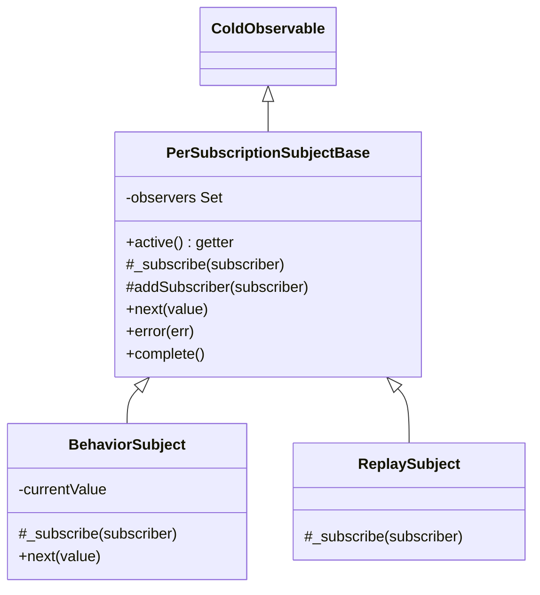

# rxjs-trace-001: Subscribing to a BehaviorSubject

**Answer:** `BehaviorSubject._subscribe` -> `PerSubscriptionSubjectBase._subscribe` -> `PerSubscriptionSubjectBase.addSubscriber`

- `packages/rxjs/src/behavior-subject.ts#BehaviorSubject._subscribe`
- `packages/rxjs/src/per-subscription-subject-base.ts#PerSubscriptionSubjectBase._subscribe`
- `packages/rxjs/src/per-subscription-subject-base.ts#PerSubscriptionSubjectBase.addSubscriber`

## The class hierarchy



The base class constructor wires every subscription into `_subscribe`:

```ts
// packages/rxjs/src/per-subscription-subject-base.ts:55-57
protected constructor() {
  super((subscriber) => this._subscribe(subscriber));
}
```

So subclasses customize subscription by overriding `_subscribe`, and the base keeps the set of observers private.

## How to navigate there

1. **`BehaviorSubject._subscribe`** (`packages/rxjs/src/behavior-subject.ts:11`):

   ```ts
   // packages/rxjs/src/behavior-subject.ts:11-16
   protected override _subscribe(subscriber: Subscriber<T>) {
     if (this.active) {
       subscriber.next(this.#currentValue);
     }
     super._subscribe(subscriber);
   }
   ```

   Three things are referenced: `this.active` (a getter, skipped), `subscriber.next(...)` (a call on the subscriber, skipped), and `super._subscribe(subscriber)`. Only the last one continues the chain.

2. **Resolve `super`.** `BehaviorSubject` extends `PerSubscriptionSubjectBase` (line 3), so `super._subscribe` is `PerSubscriptionSubjectBase._subscribe`:

   ```ts
   // packages/rxjs/src/per-subscription-subject-base.ts:83-95
   protected _subscribe(subscriber: Subscriber<Out>): void {
     if (!this.active) {
       if (this.#hasError) {
         subscriber.error(this.#error);
         return;
       }

       subscriber.complete();
       return;
     }

     this.addSubscriber(subscriber);
   }
   ```

   The prompt says the subject has not completed or errored, so `this.active` is `true`, the `if` block is skipped, and `this.addSubscriber(subscriber)` runs.

3. **`PerSubscriptionSubjectBase.addSubscriber`** is the end condition:

   ```ts
   // packages/rxjs/src/per-subscription-subject-base.ts:104-109
   protected addSubscriber(subscriber: Subscriber<Out>): void {
     this.#observers.add(subscriber);
     subscriber.addTeardown(() => {
       this.#observers.delete(subscriber);
     });
   }
   ```

   `#observers` is the set of live observers that `next`, `error` and `complete` iterate.

## Why the prompt's exclusions matter

| Reference | Where | Why it is not a step |
|---|---|---|
| `this.active` | both `_subscribe` methods | A getter (`get active()` at line 43). The prompt skips getters. |
| `subscriber.next(this.#currentValue)` | `BehaviorSubject._subscribe` | A call on the subscriber object. Skipped by the prompt. |
| `subscriber.error(...)`, `subscriber.complete()` | base `_subscribe` | Calls on the subscriber, and only on the inactive path. |
| `subscriber.addTeardown(...)` | `addSubscriber` | A call on the subscriber, past the end condition. |
| `this.#observers.add(...)` | `addSubscriber` | A built-in `Set` method. |

## Why other candidates are wrong

- **`ReplaySubject._subscribe`** (`replay-subject.ts:50`) also ends in `super.addSubscriber(subscriber)`, but it belongs to a different subclass. It is never on a `BehaviorSubject`'s path.
- **`AsyncSubject`'s `#addSubscriber`** has a similar name, but `AsyncSubject` extends `ObservableBase`, not `PerSubscriptionSubjectBase`, and is unrelated.
- **`Subject`** in `subject.ts` also extends `ObservableBase` directly. `BehaviorSubject` does not inherit from it in this codebase, so nothing on the path is in `subject.ts`.
- **`PerSubscriptionSubjectBase.next`** fans values out to `#observers`. It reads the set. It does not add to it.
- **`BehaviorSubject.next`** updates `#currentValue` and calls `super.next`. It is not called during subscription.
- **Skipping the base `_subscribe`** and going straight to `addSubscriber` is wrong. `BehaviorSubject._subscribe` never calls `addSubscriber` itself. It goes through `super._subscribe`.
- **The constructor arrow `(subscriber) => this._subscribe(subscriber)`** is how subscription reaches `BehaviorSubject._subscribe`. It is upstream of the start symbol.

## Design notes

- **Template method.** The base class owns the observer set and the active/terminal logic. Subclasses only add behavior before deferring with `super._subscribe`. `BehaviorSubject` adds "emit the current value first", `ReplaySubject` adds "replay the buffer first".
- **Current value first.** `BehaviorSubject` sends the current value to the new subscriber *before* `super._subscribe` adds it to `#observers`. After that, it receives later values through `PerSubscriptionSubjectBase.next` like any other observer.
- **Private state.** `#observers` is a true private field, so subclasses can only add subscribers through `addSubscriber`. That is why it is a `protected` method and why `ReplaySubject` calls it as `super.addSubscriber`.

## Takeaways

- For `super.method()` calls, resolve the base class from the `extends` clause before following the call.
- A prompt that says "has not completed or errored" is fixing a branch. Find the `if` it controls.
- Look at sibling subclasses (`ReplaySubject`) to see which parts of a method are the shared skeleton and which are the subclass's addition.
