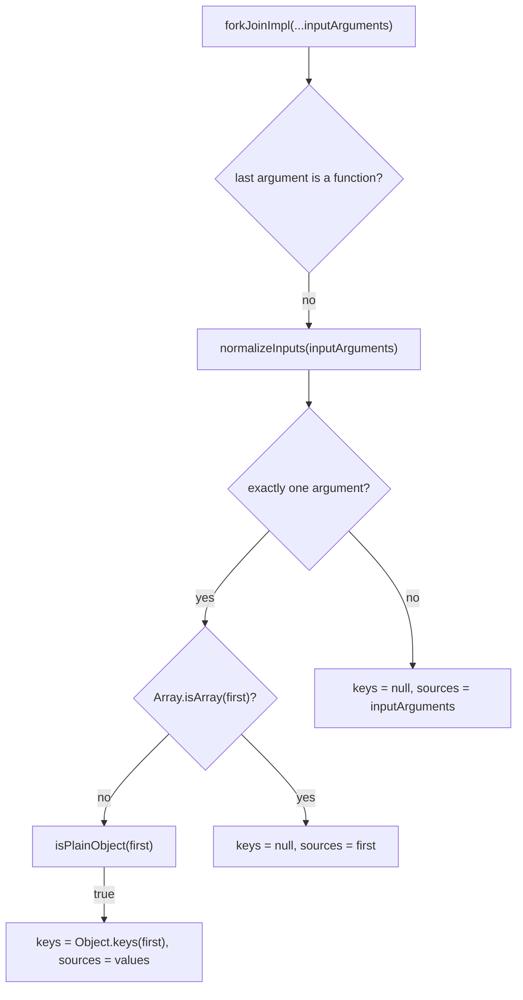

# rxjs-trace-002: How forkJoin recognizes a dictionary of sources

**Answer:** `forkJoinImpl` -> `normalizeInputs` -> `isPlainObject`

- `packages/rxjs/src/fork-join.ts#forkJoinImpl`
- `packages/rxjs/src/fork-join.ts#normalizeInputs`
- `packages/rxjs/src/fork-join.ts#isPlainObject`

## The shape of `fork-join.ts`

All three functions are in one file, which also holds one more helper:

```text
packages/rxjs/src/fork-join.ts
  forkJoinImpl(...inputArguments)        :40    entry point, Observable[forkJoin]
  normalizeInputs(inputArguments)        :104   → { keys, sources }
  isPlainObject(value)                   :125   ◀── end condition
  createResultObject(keys, values)       :129   builds { key: value } for the output
```

## How to navigate there

1. **`forkJoinImpl`** (line 40). Before it creates the output observable, it prepares its inputs, as the hint says:

   ```ts
   // packages/rxjs/src/fork-join.ts:41-43
   const resultSelector =
     typeof inputArguments[inputArguments.length - 1] === 'function' ? (inputArguments.pop() as (...values: any[]) => any) : undefined;
   const { keys, sources } = normalizeInputs(inputArguments);
   ```

   With one plain-object argument, the last argument is not a function, so there is no result selector, and `inputArguments` still holds the object when `normalizeInputs` is called.

2. **`normalizeInputs`** (line 104) handles the single-argument case:

   ```ts
   // packages/rxjs/src/fork-join.ts:108-119
   if (inputArguments.length === 1) {
     const first = inputArguments[0];
     if (Array.isArray(first)) {
       return { keys: null, sources: first };
     }
     if (isPlainObject(first)) {
       const keys = Object.keys(first);
       return {
         keys,
         sources: keys.map((key) => first[key]),
       };
     }
   }
   ```

   `Array.isArray` is a built-in (skipped) and returns `false` for a plain object, so the next call is `isPlainObject(first)`.

3. **`isPlainObject`** (line 125) makes the decision:

   ```ts
   // packages/rxjs/src/fork-join.ts:125-127
   function isPlainObject(value: any): value is Record<string, any> {
     return value != null && typeof value === 'object' && Object.getPrototypeOf(value) === Object.prototype;
   }
   ```

   It returns `true` for `{ a: obs1, b: obs2 }`, and `normalizeInputs` returns `keys = ['a', 'b']` and `sources = [obs1, obs2]`.



## What `keys` is used for later

Once `keys` is non-null, `forkJoinImpl` emits an object instead of an array when every source completes:

```ts
// packages/rxjs/src/fork-join.ts:85
let result: any = keys ? createResultObject(keys, values) : values;
```

So `forkJoin({ a, b })` emits `{ a: lastA, b: lastB }`, while `forkJoin([a, b])` emits `[lastA, lastB]`.

## Why other candidates are wrong

| Candidate | Why it is wrong |
|---|---|
| `createResultObject` (line 129) | Called from `forkJoinImpl`, but inside the `complete` callback of a source subscription, and only after all sources complete. It builds the output object; it does not test the input. It is also not called by `normalizeInputs`. |
| `subscribeToSource` | Called from `forkJoinImpl`'s subscribe callback, but it lives in `util/observable-helpers.ts`. The prompt skips calls into other files. |
| `create`, `ObservableCtor.from` | Also in other files (or on the platform `Observable`). Skipped by the prompt, and called after the inputs are normalized. |
| `Array.isArray`, `Object.keys`, `Object.getPrototypeOf` | Built-ins, skipped by the prompt. `Array.isArray` is the test for arrays, not for plain objects. |
| Skipping `normalizeInputs` | `forkJoinImpl` never calls `isPlainObject` itself. The chain must go through `normalizeInputs`. |

## Why check the prototype?

`isPlainObject` accepts only objects whose prototype is exactly `Object.prototype`. That rules out arrays (already handled), class instances, and observables themselves. Without the prototype check, `forkJoin(someObservable)` with a single observable argument would be mistaken for a dictionary and split into its enumerable own properties. With the check, a single non-plain argument falls through to `{ keys: null, sources: inputArguments }` and is treated as one source. A side effect is that `Object.create(null)` dictionaries are not recognized, since their prototype is `null`.

## Takeaways

- Overloaded entry points usually normalize their arguments first. Find that normalizer and you know every input shape the function supports.
- A "decides X" end condition is usually a small predicate function. Look for one whose return type is a type guard (`value is Record<string, any>`).
- Calls that happen inside subscription callbacks run much later than the setup code around them. For a direct-call trace, they still belong to the enclosing function, but they do not come "before" the setup calls.
