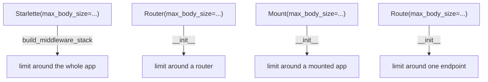

# starlette-architecture-002: Where body size limits are applied

**Answer:** all 4 of these:

- `starlette/applications.py#Starlette.build_middleware_stack`
- `starlette/routing.py#Route.__init__`
- `starlette/routing.py#Mount.__init__`
- `starlette/routing.py#Router.__init__`

## How to find them

Open `starlette/middleware/body_limit.py`, select `RequestBodyLimitMiddleware`, and run Find references. Leaving out the imports and everything under `tests/`, the references are in exactly four methods. Each one checks `max_body_size is not None` and only then adds the layer.

| Level | Method | How it applies the limit |
|---|---|---|
| Whole app | `Starlette.build_middleware_stack` (line 75) | appends `Middleware(RequestBodyLimitMiddleware, max_body_size=...)` to its list, and its own loop then wraps the router |
| Sub-router | `Router.__init__` (line 626) | wraps `self.middleware_stack`, outside the router's own middleware |
| Mounted app | `Mount.__init__` (line 394) | wraps `self.app`, outside the mount's middleware |
| Single route | `Route.__init__` (line 239) | wraps `self.app`, outside the route's middleware |

The three in `routing.py` all have the same shape. From `Route.__init__`, lines 236–240:

```python
        if middleware is not None:
            for cls, args, kwargs in reversed(middleware):
                self.app = cls(self.app, *args, **kwargs)
        if max_body_size is not None:
            self.app = RequestBodyLimitMiddleware(self.app, max_body_size=max_body_size)
```



## Why the plausible wrong answers are wrong

- **`Starlette.__init__`** accepts `max_body_size`, but it only stores it on `self.max_body_size`. Nothing is wrapped until `build_middleware_stack` runs on the first request.
- **`WebSocketRoute.__init__`** accepts `middleware` but has no `max_body_size`. A WebSocket has no HTTP request body to limit.
- **`Host.__init__`** takes neither option.
- **`RequestBodyLimitMiddleware.__call__` and `RequestBodyLimitResponder`** in `body_limit.py` enforce the limit once a request arrives. They are the mechanism, not places that apply it to an app, and they are outside the two files the prompt names.
- **The classes `Route`, `Mount`, `Router`, `Starlette`.** The prompt asks for the methods.

## Why the limit is applied at every level

The same option exists at four levels so that a limit can be as wide or as narrow as needed: one upload endpoint can allow a large body while the rest of the app stays strict. In every `routing.py` case the limit is applied *after* the level's own middleware, so it ends up outside that middleware and is enforced before any of it reads the body. Because each level only wraps its own app, the levels nest, and the innermost one wins. In `RequestBodyLimitResponder.__call__` (`starlette/middleware/body_limit.py`), a nested limit finds the responder already active in the scope and overwrites its `max_body_size` with its own value, instead of adding a second check. So a route's limit replaces the app's limit for that route, which is what lets one endpoint accept a larger body than the rest of the app.

## Takeaways

For a cross-cutting option like this, Find references on the class that implements it is the fastest map of every place it can be configured. Then read the one or two lines around each reference to see what each level wraps.
