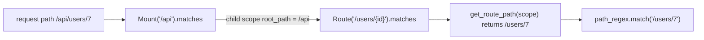

# starlette-find-001: The path a route is matched against

**Answer:** `starlette/_utils.py#get_route_path`

## How to navigate there

1. Open `starlette/routing.py` and jump to `Route.matches` (line 251).
2. The `http` branch begins with `route_path = get_route_path(scope)` (line 254), and the next line runs the regex on `route_path`, not on `scope["path"]`.
3. Go to the definition of `get_route_path`. The import at the top of `routing.py` takes you to `starlette/_utils.py`, line 137.

## The key code

`starlette/_utils.py`, lines 137–152:

```python
def get_route_path(scope: Scope) -> str:
    path: str = scope["path"]
    root_path = scope.get("root_path", "")
    if not root_path:
        return path

    if not path.startswith(root_path):
        return path

    if path == root_path:
        return ""

    if path[len(root_path)] == "/":
        return path[len(root_path) :]

    return path
```

Under ASGI, `scope["path"]` is the full request path and `scope["root_path"]` is the prefix the app is mounted under. The function removes the prefix only at a path-segment boundary: with `root_path="/api"`, `/api/users` becomes `/users`, but `/apiary` is left as it is, because the character after the prefix is not `/`.

## Why this matters: Mount sets root_path

`Mount.matches` (line 403) is what makes nested routing work. When a mount matches, it builds a child scope whose `"root_path"` is `root_path + matched_path`. The routes inside the mount then call `get_route_path` again and see only the remainder of the path.



The same helper is used by every piece of code that matches on paths: `Route.matches`, `WebSocketRoute.matches`, `Mount.matches`, `Router.app` (for the slash-redirect check) and `StaticFiles.get_path`. Find references on it shows all five.

## Why the plausible wrong answers are wrong

- **`Route.matches`** calls the function, but it does not remove the prefix itself.
- **`Mount.matches`** is where `root_path` is *extended* for child routes, but it also reads the stripped path through `get_route_path`.
- **`compile_path`** (`starlette/routing.py`, line 116) builds the regex that is matched, not the string it is matched against.
- **`StaticFiles.get_path`** is another caller. It normalises the result into a filesystem path.

## Takeaways

When a method works on a value that has been transformed first, the transformation is usually a small shared helper. Find references on that helper is a quick way to see every component that depends on the same rule, here everything in Starlette that matches on a path.
