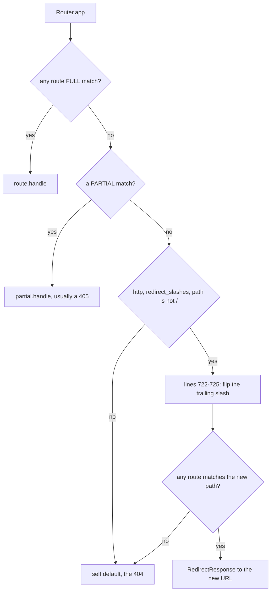

# starlette-find-002: Building the trailing-slash redirect path

**Answer:** `starlette/routing.py:L722-L725`. Any selection that covers lines 722–725 and stays within lines 720–726 is accepted.

## How to navigate there

1. Open `starlette/routing.py` and jump to `Router.app` (line 685). It is the router's real dispatch method. `Router.__call__` just calls `self.middleware_stack`, which wraps `self.app`.
2. Read it in order. The first `for route in self.routes:` loop looks for a full match and remembers the first partial match. Then `if partial is not None:` handles a partial match. Only after both have failed does the method reach the redirect code.
3. Line 720 is the guard for slash redirects: an HTTP request, `self.redirect_slashes` on, and a route path other than `/`. Line 721 copies the scope. The `if`/`else` right after it is the answer.

## The key code

`starlette/routing.py`, lines 719–733:

```python
        route_path = get_route_path(scope)
        if scope["type"] == "http" and self.redirect_slashes and route_path != "/":
            redirect_scope = dict(scope)
            if route_path.endswith("/"):
                redirect_scope["path"] = redirect_scope["path"].rstrip("/")
            else:
                redirect_scope["path"] = redirect_scope["path"] + "/"

            for route in self.routes:
                match, child_scope = route.matches(redirect_scope)
                if match is not Match.NONE:
                    redirect_url = URL(scope=redirect_scope)
                    response = RedirectResponse(url=str(redirect_url))
                    await response(scope, receive, send)
                    return
```

Lines 722–725 flip the trailing slash: a path ending in `/` loses it (all trailing slashes, because `rstrip("/")` removes every one), and any other path gains one.



## Details worth noticing

- The decision uses `route_path`, the path with `root_path` removed, but the change is made to `redirect_scope["path"]`, the full path. That way the redirect URL built by `URL(scope=redirect_scope)` keeps the mount prefix.
- The scope is copied with `dict(scope)` first, so trying the alternate path never changes the original request's scope.
- A match of any kind, `FULL` or `PARTIAL`, triggers the redirect (`match is not Match.NONE`).

## Why the plausible wrong answers are wrong

- **Line 720 (the outer `if`)** decides *whether* to try a redirect, not what the alternate path is. Including it is allowed by the window, but it is not enough on its own.
- **Lines 727–733 (the second loop)** test the alternate path and send the redirect. They use the path but do not compute it.
- **`Router.not_found`** runs only when no redirect target exists.

## Takeaways

Long dispatch methods are usually a sequence of fallbacks. Read them top to bottom and note where each stage `return`s. The code you want for "what happens when nothing matched" is near the end, after every earlier stage has given up.
