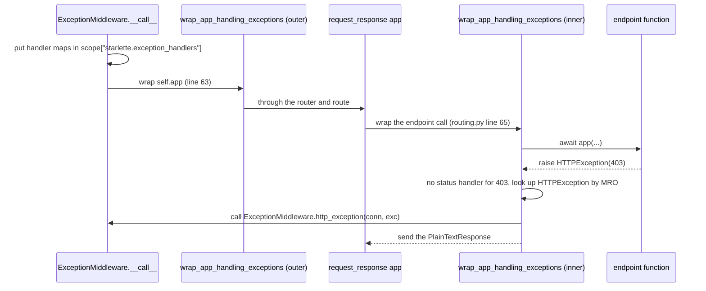

# starlette-find-003: The default HTTPException handler

**Answer:** `starlette/middleware/exceptions.py`

The handler is `ExceptionMiddleware.http_exception`, defined in that file.

## How to navigate there

There are two good starting points.

**From the exception.** Find references on `HTTPException` (`starlette/exceptions.py`) and look for places that use it as a dictionary key rather than raising it. `ExceptionMiddleware.__init__` in `starlette/middleware/exceptions.py` (lines 28–31) registers a handler for it before any user handlers are added:

```python
        self._exception_handlers: ExceptionHandlers = {
            HTTPException: self.http_exception,
            WebSocketException: self.websocket_exception,
        }
```

**From the application.** `Starlette.build_middleware_stack` (`starlette/applications.py`, line 78) always appends `Middleware(ExceptionMiddleware, handlers=exception_handlers, debug=debug)` as the innermost middleware, so every Starlette app has one.

Either way you reach the handler, lines 65–69:

```python
    async def http_exception(self, request: Request, exc: Exception) -> Response:
        assert isinstance(exc, HTTPException)
        if exc.status_code in {204, 304}:
            return Response(status_code=exc.status_code, headers=exc.headers)
        return PlainTextResponse(exc.detail, status_code=exc.status_code, headers=exc.headers)
```

## How the exception reaches it



1. `ExceptionMiddleware.__call__` (line 47) stores its two handler maps in `scope["starlette.exception_handlers"]`.
2. The middleware then runs its own app inside `wrap_app_handling_exceptions(self.app, conn)` (line 63). For a function or method endpoint, `Route` also wraps it with `request_response` in `starlette/routing.py`, which runs the endpoint inside a second, inner `wrap_app_handling_exceptions(app, request)` (line 65). The inner wrapper catches an exception from a function endpoint. For an `HTTPEndpoint` class, which isn't wrapped by `request_response`, the middleware's outer wrapper catches it. Both read the same handler maps.
3. In `starlette/_exception_handler.py`, `wrap_app_handling_exceptions` reads those maps from the scope. With nothing registered for status 403, it calls `_lookup_exception_handler`, which walks `type(exc).__mro__` and finds the `HTTPException` entry, `self.http_exception`.
4. `http_exception` returns `PlainTextResponse(exc.detail, status_code=403, ...)`, and the wrapper sends it.

## Why the plausible wrong answers are wrong

- **`starlette/exceptions.py`** defines the `HTTPException` class and builds its default `detail`, but it contains no handler and builds no response.
- **`starlette/_exception_handler.py`** finds the handler and calls it, but it is a dispatcher. The response is built by the handler it looks up.
- **`starlette/middleware/errors.py`** holds `ServerErrorMiddleware`, which handles exceptions that nothing else handled, as a 500. An `HTTPException` is handled before it gets there.
- **`starlette/routing.py`** raises `HTTPException` (for example in `Router.not_found` and `Route.handle`) and calls the wrapper, but it does not define the default handler.
- **`starlette/applications.py`** adds the middleware to the stack, but the handler is defined elsewhere.

## Why the design looks like this

Putting the default handler on `ExceptionMiddleware` means user handlers are just more entries in the same maps. `add_exception_handler` writes into `_status_handlers` or `_exception_handlers`, and a user handler for `HTTPException` simply replaces the default entry. Passing the maps through the scope lets the handling run as close to the endpoint as possible, inside `request_response`, while the middleware still owns the configuration.

## Takeaways

To find "the default behavior", look for where defaults are *registered*, not where the exception is raised or caught. Here the useful search was for `HTTPException` used as a dictionary key.
