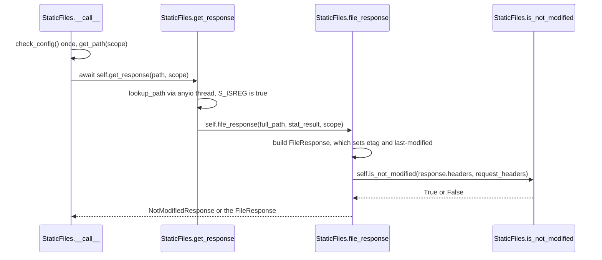

# starlette-trace-001: Serving a static file conditionally

**Answer:**

1. `starlette/staticfiles.py#StaticFiles.__call__`
2. `starlette/staticfiles.py#StaticFiles.get_response`
3. `starlette/staticfiles.py#StaticFiles.file_response`
4. `starlette/staticfiles.py#StaticFiles.is_not_modified`

## The flow



## Step by step

**1. `StaticFiles.__call__`** (`starlette/staticfiles.py`, line 88). The scope is HTTP, so the websocket branch is skipped. It may call `check_config()` once and calls `get_path(scope)`, but both return before anything else happens, so neither is part of the chain. Then:

```python
        path = self.get_path(scope)
        response = await self.get_response(path, scope)
```

**2. `StaticFiles.get_response`** (line 115). The method is GET, so no 405. `self.lookup_path` is passed as a value to `anyio.to_thread.run_sync`, which is a third-party call. It returns a `stat_result` for a regular file, so the first branch is taken (lines 136–138):

```python
        if stat_result and stat.S_ISREG(stat_result.st_mode):
            # We have a static file to serve.
            return self.file_response(full_path, stat_result, scope)
```

**3. `StaticFiles.file_response`** (line 181). It builds the `FileResponse` first. Its constructor calls `set_stat_headers`, which adds `etag` and `last-modified` from the file's stat result. Only then can the comparison happen (lines 188–193):

```python
        request_headers = Headers(scope=scope)

        response = FileResponse(full_path, status_code=status_code, stat_result=stat_result)
        if self.is_not_modified(response.headers, request_headers):
            return NotModifiedResponse(response.headers)
        return response
```

**4. `StaticFiles.is_not_modified`** (line 211) is the end. With an `If-None-Match` header present, it compares the tags against the response's `etag`, treating `*` as always matching and ignoring a `W/` weak prefix. It only falls back to `If-Modified-Since` when there is no `If-None-Match`.

## Why the plausible wrong answers are wrong

- **Including `check_config` or `get_path`.** Both are called by `__call__`, but they return before `get_response` is called. Neither calls the next step.
- **Including `lookup_path`.** `get_response` references it, but `lookup_path` only stats the file and returns. It does not call `file_response`.
- **Ending at `file_response`.** It acts on the decision, by returning a `NotModifiedResponse`, but the comparison of headers that the prompt describes is in `is_not_modified`.
- **Including `FileResponse` or `NotModifiedResponse`.** These are class constructors, which the prompt says to skip. `response.headers` is a property read, also skipped.
- **The `html` branch.** With html mode off, the directory and `404.html` branches of `get_response` are never taken.

## Background: why the check sits in `file_response`

The ETag is derived from the file's modification time and size, in `FileResponse.set_stat_headers` (`starlette/responses.py`, line 338). So the cheapest way to get the exact header values the client would otherwise receive is to build the `FileResponse` and read its headers. Building it opens no file. The file is only read when the response is sent. If the check passes, `NotModifiedResponse` copies just the cache-related headers (`NOT_MODIFIED_HEADERS`: cache-control, content-location, date, etag, expires, vary) into an empty 304 response.

## Takeaways

In a trace, siblings are the usual trap. A method calls several helpers in a row, but only one of them leads on to the end condition. Ask of each call whether it calls the next step, not whether it runs on the path.
