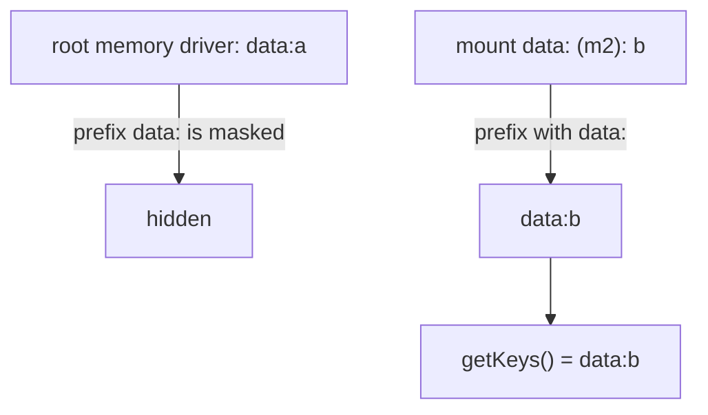

# unstorage-architecture-001: Keys hidden by a later mount

**Answer:** c, `["data:b"]`

The key `data:a` still sits in the root memory driver, but `getKeys` hides it, because the `data` mount now owns every key that starts with `data:`.

## Following the code

**1. Where each write goes.** `setItem` normalizes the key and asks `getMount` which driver owns it. `getMount` returns the first mount point the key starts with (src/storage.ts:152-167).

```text
setItem("data:a")   mountpoints [""]           -> root driver, relative key "data:a"
mount("data", m2)   mountpoints ["data:", ""]  (kept longest first by mount)
setItem("data:b")   mountpoints ["data:", ""]  -> m2, relative key "b"
```

**2. Which mounts `getKeys` visits, and in what order.** With no base, `normalizeBase(undefined)` is `""`, and `getMounts("", true)` keeps every mount point, since every string starts with `""`. It keeps the sorted order, so `data:` comes before `""`.

**3. The masking loop.** Inside `for (const mount of mounts)` (line 477), after a check of the `maxDepth` flag, comes the part that decides the answer:

```ts
// src/storage.ts:481-494
  const rawKeys = await asyncCall(mount.driver.getKeys, mount.relativeBase, opts);
  for (const key of rawKeys) {
    const fullKey = mount.mountpoint + normalizeKey(key);
    if (!maskedMounts.some((p) => fullKey.startsWith(p))) {
      allKeys.push(fullKey);
    }
  }

  // When /mnt/foo is processed, any key in /mnt with /mnt/foo prefix should be masked
  // Using filter to improve performance. /mnt mask already covers /mnt/foo
  maskedMounts = [
    mount.mountpoint,
    ...maskedMounts.filter((p) => !p.startsWith(mount.mountpoint)),
  ];
```

| Step | Mount | Raw keys | Full keys | `maskedMounts` before | Kept |
|---|---|---|---|---|---|
| 1 | `data:` (m2) | `b` | `data:b` | `[]` | `data:b` |
| 2 | `""` (root) | `data:a` | `data:a` | `["data:"]` | none (`data:a` starts with `data:`) |

The final filter only drops metadata keys, so the result is `["data:b"]`.



## Why the other options are wrong

- **a, `["data:a", "data:b"]`:** this would be true if `getKeys` just put every driver's keys together. The mask exists so the result matches what `getItem` can reach: `getItem("data:a")` now goes to m2 and returns `null`, so listing `data:a` would advertise a key you can't read.
- **b, `["b", "data:a"]`:** this mixes up two kinds of key. Drivers return keys *relative* to their mount point (`b`), and `getKeys` adds `mount.mountpoint` back, so `b` comes out as `data:b`. And `data:a` is masked, as shown above.
- **d, `["data:a"]`:** this has the masking backwards. The parent mount is the one being masked, because the more specific mount is visited first and adds its prefix to `maskedMounts`.

## Why the code is shaped this way

The masking only works because mount points are sorted longest first, the same ordering that makes `getMount` pick the most specific mount. By the time a parent mount is visited, every child under it has already been processed and added to `maskedMounts`. The `filter` in the `maskedMounts` update is only an optimization: a parent's prefix covers its children's, so their entries can be dropped.

The data isn't lost. Unmount `data` and both `getKeys()` and `getItem("data:a")` see the root driver's key again.

## Takeaways

- In a storage with mount points (like a filesystem), a mount *shadows* whatever its parent already holds under that prefix. Expect listing and reading to agree.
- When a loop's behaviour depends on order, check where the order is set. Here it's set when mounts are added, not in `getKeys`.
